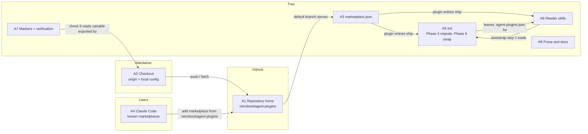
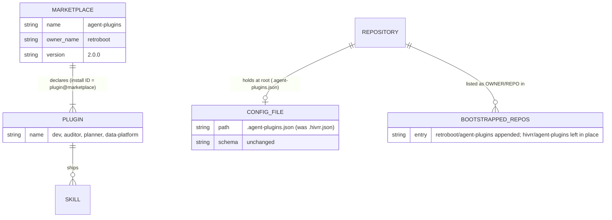
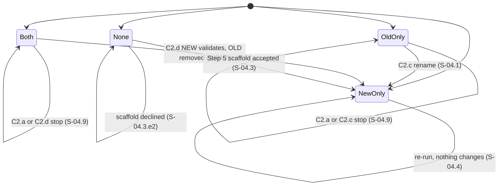
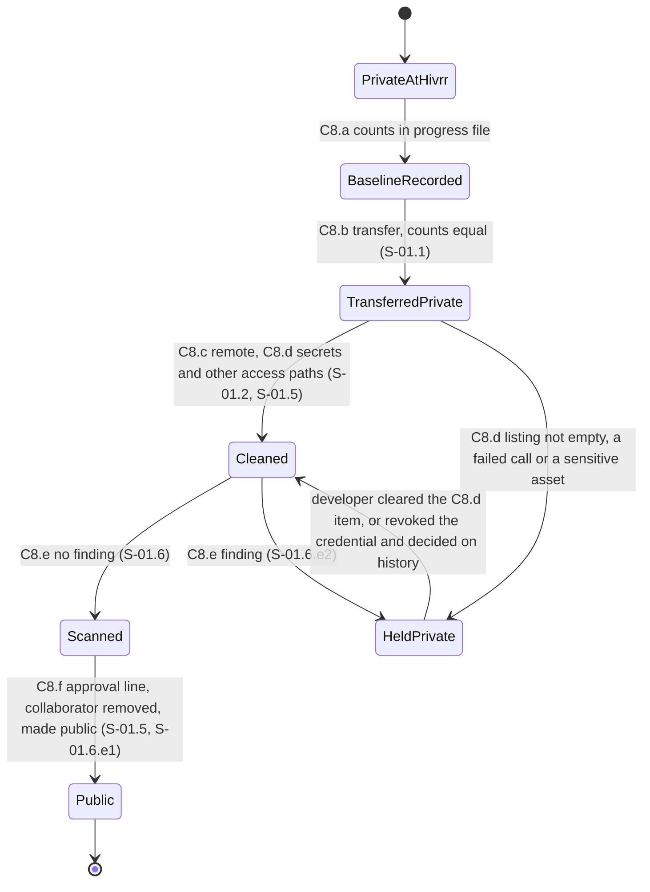
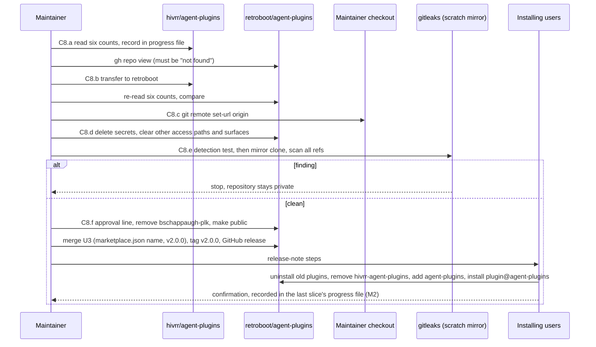

# Design — Move to retroboot and drop the hivrr name

Every path is relative to the repository root. Citations to `context.md` are by section; anything
`context.md` does not name is cited by `path:line` at commit `749feb9`. ADRs are under
[`decisions/`](decisions/).

## 1. Architecture

The work touches eight components. Five live in the tree and three live on GitHub or on the users'
machines.

| # | Component | Where | Responsibility after this work | Serves |
|---|---|---|---|---|
| A1 | Repository home | GitHub | `retroboot/agent-plugins`, public, with every record `hivrr/agent-plugins` had; collaborator `retroboot` only; no repository secret | S-01.1, S-01.5, S-01.6 |
| A2 | Maintainer checkout | maintainer's machine | `origin` names `retroboot/agent-plugins`; the local config is `.agent-plugins.json`, whose `verify.test` is the new bootstrap string | S-01.2, S-06.4 |
| A3 | Marketplace registry | `.claude-plugin/marketplace.json` (`context.md` §2.1) | `name` `agent-plugins`, `owner.name` `retroboot`, version `2.0.0`; the four plugin entries unchanged | S-02.1, S-02.4, S-02.5 |
| A4 | Users' Claude Code | `~/.claude/plugins/known_marketplaces.json` and `enabledPlugins` (`context.md` §1, Outside the repository) | each user uninstalls the old plugins, removes `hivrr-agent-plugins` and adds `agent-plugins` once, by hand | S-02.2 |
| A5 | `init` | `skills/init/SKILL.md`, `skills/init/references/` (`context.md` §2.2) | the only reader of `.hivrr.json`: Phase 3 migrates it, Phase 6 swaps its `.gitignore` line (except while the old file is still on disk, S-05.7) and untracks it; every other phase reads `.agent-plugins.json` | S-03.3, S-04.*, S-05.*, S-01.4 |
| A6 | Reader skills | the files in `context.md` §2.3, plus `init` Phases 4, 5 and 7 | read `.agent-plugins.json` by the read steps in `skills/init/references/config.md:283-309`, never `.hivrr.json` | S-03.1, S-03.2, S-04.7 |
| A7 | Markers and verification | `context.md` §2.4; `docs/verification.md` | `AGENT_PLUGINS_*` delimiters and variable; the structural checks pass on a fresh tree | S-06.1 to S-06.4 |
| A8 | Prose and docs | `README.md`, `CLAUDE.md`, `.env.example`, `RELEASE-NOTES.md`, skill headings (`context.md` §2.1, §2.5); `.github/workflows/` (§2.6) | no `hivrr` outside the allowed files; the two workflows deleted | S-01.3, S-02.3, S-03.4, S-07.1 to S-07.3 |



### Change units that must land together

Feature PRs are squash-merged, so one PR is one commit on `main` (`skills/merge-pr/SKILL.md:122`).
Each unit below is therefore one PR. The units are the design's constraints; `slice` assigns them to
slices.

| Unit | Must hold in one commit | Why | Serves |
|---|---|---|---|
| U1 Config rename | `init` Phase 3 migration (C2), Phase 6 swap (C4, C5), every reader site (C1), `.gitignore:10`, `skills/init/references/*.md`, and the config-file prose in `CLAUDE.md` and `README.md` (`context.md` §2.2, §2.3, §2.5) | a commit where readers name `.agent-plugins.json` without the migration silently drops every repository to defaults (README Key insights; ADR-004) | S-03.1 to S-03.4, S-04.*, S-05.* |
| U2 Markers | every heredoc pair and prose site in `context.md` §2.4, check 8 at `docs/verification.md:96-101`, the bootstrap string at `docs/verification.md:277`, and `CLAUDE.md:215,217` | a half-renamed pair runs body text as shell (S-06.2); check 8 and the bootstrap string must name the same variable (S-06.3) | S-06.1 to S-06.4 |
| U3 Release | `marketplace.json` `name`, `owner.name`, `metadata.description`, `metadata.version` `2.0.0` (ADR-003, ADR-008); README Setup and `.env.example` (`context.md` §2.1); the `v2.0.0` entry in `RELEASE-NOTES.md` | the marketplace name is what users switch to, so it goes live only on the day of the transfer (S-01.7) | S-02.1 to S-02.5 |
| U4 Workflows | delete `.github/workflows/claude.yml` and `.github/workflows/claude-code-review.yml` (ADR-009) | independent | S-01.3 |
| U5 Prose | remaining `hivrr` prose: `README.md:1,3`, `CLAUDE.md:3`, `skills/core/SKILL.md:3,8`, the `init` description (`context.md` §2.2) | after U2, which edits other lines of `CLAUDE.md` and `skills/core/SKILL.md`; rebases on it | S-07.1, S-07.2 |

U1, U2, U4 and U5 change nothing a user must act on and can merge before the transfer (settled at
design: merge when ready). U3 merges only after the transfer, on the same day (Flow F2). The
no-`hivrr` grep of S-07.2 passes only once every unit has landed, so it belongs to whichever unit
lands last.

### Rollback

This is a Migration, so each unit states its rollback.

| Unit | Rollback | Limits |
|---|---|---|
| U1 | `git revert` the squash commit on `main` | Repositories `init` already migrated hold `.agent-plugins.json`, which the reverted readers ignore. Each is restored by hand: `mv .agent-plugins.json .hivrr.json` and the `.gitignore` line put back. The release notes would say so |
| U2 | `git revert` the squash commit; the maintainer restores the old local `verify.test` by hand | none beyond the hand step |
| U3 | `git revert` the squash commit, restoring `hivrr-agent-plugins` as the name; users who already switched re-add the old name | Only before users switch; after that, a revert is a second switch for every user |
| U4 | `git revert` restores both files | The deleted secret's value is not recoverable; nothing needs it (ADR-009) |
| U5 | `git revert` | none |
| GitHub transfer | A reverse transfer to `hivrr` is possible while the organization exists and the maintainer is admin there; only the developer may order it | Not a routine step: the prd's non-goals keep nothing in `hivrr` |
| Visibility change | none | Making the repository public cannot be undone in effect (ADR-006). The design therefore puts every check before it (state machine "Repository home") |

## 2. Contracts

### C1 The config file

| Name | Inputs | Outputs | Errors | Invariants |
|---|---|---|---|---|
| C1 Config file path (S-03.1, S-03.2, S-03.4) | a repository root | `.agent-plugins.json`, read by `test -f`, `jq empty` and the Read tool as in `skills/init/references/config.md:283-309` (`context.md` §3, Config-file tests) | parse failure handled as today by each reader | Schema, keys and defaults unchanged (prd Non-goals). No file outside `skills/init/` names `.hivrr.json`, apart from `RELEASE-NOTES.md`, which S-07.2 allows (S-03.2.e2, S-07.2). An absent `.agent-plugins.json` resolves every key from the fallback chain even when `.hivrr.json` is present (S-03.2; ADR-002). Schema examples in `config.md:42` and `README.md:92` read `"owner": "your-org"` (ADR-003) |

### C2 `init` Phase 3, Step 1 — Migrate an old config file

The migration is the new **Step 1** of Phase 3, before the existence test (ADR-005). The existing
Steps 1 to 4 (`skills/init/SKILL.md:118-172`) become Steps 2 to 5; no other file cites them by
number, and the cross-references inside Phase 3 (such as "continue to Step 3" at
`skills/init/SKILL.md:138`) move with them (author, cold read round 2, 2026-11-25). The heading becomes ``## Phase 3 — Scaffold `.agent-plugins.json` ``, still a `## Phase 3`
heading, so checks 7 and 10 are unaffected (`context.md` §3, Phase headings and counts). The step
asks no question in any mode (ADR-004).

Let OLD be `.hivrr.json` and NEW be `.agent-plugins.json`. A path is **present** when `test -L` or
`test -e` holds; a present path is **regular** when `test -f` holds and `test -L` does not.

| Name | Inputs | Outputs | Errors | Invariants |
|---|---|---|---|---|
| C2.a Type probe (S-04.9) | OLD, NEW | continue to C2.b | either path present and not regular → `INIT: migration stopped — type check failed: {path} is not a regular file`; `init` stops | runs first, every time; nothing is moved before it passes |
| C2.b OLD absent (S-04.3, S-04.4) | NEW absent or regular (a non-regular NEW stops at C2.a) | nothing changes; no migration line; the existence test runs as today under the new name | — | a run that migrates nothing emits no migration line (prd NFR Observability) |
| C2.c OLD only (S-04.1, S-04.5) | OLD regular, NEW absent | `mv -- .hivrr.json .agent-plugins.json`; emit `INIT: upgraded .hivrr.json to .agent-plugins.json`; continue to the existence test, which validates NEW | `mv` fails → `INIT: migration stopped — rename .hivrr.json to .agent-plugins.json failed: {error}`; `init` stops; both paths as they were | NEW holds exactly OLD's bytes: a same-directory rename never rewrites content. OLD is never validated or repaired first, so a malformed OLD is renamed unchanged and the existence test then stops on it (S-04.5.e1) |
| C2.d Both, NEW valid (S-04.2, S-04.8.e2) | OLD and NEW regular; `jq empty .agent-plugins.json` exits 0 | `rm -- .hivrr.json`; emit `INIT: removed .hivrr.json (.agent-plugins.json kept)`; continue to the existence test | `rm` fails → `INIT: migration stopped — remove .hivrr.json failed: {error}`; `init` stops | NEW is not touched |
| C2.e Both, NEW not validated (S-04.2.e2, S-04.8) | OLD and NEW regular; `jq` exits non-zero, or 127 | nothing changes; no migration line; the existence test reports NEW as malformed (stop) or present but unvalidated, as today | — | OLD is never removed while NEW is unvalidated: the repository never loses its only valid config (prd NFR Reliability) |
| C2.f Re-run (S-04.4.e2) | a repository C2 already migrated | C2.b applies | — | a second run changes nothing |

### C3 `init` report lines

Every line follows the one-line `INIT:` form (`context.md` §3, `INIT:` report lines). The first two
strings are fixed by the prd; the rest keep today's wording with the new name.

| Line | When | Serves |
|---|---|---|
| `INIT: upgraded .hivrr.json to .agent-plugins.json` | C2.c | S-04.1 |
| `INIT: removed .hivrr.json (.agent-plugins.json kept)` | C2.d | S-04.2 |
| `INIT: migration stopped — type check failed: {path} is not a regular file` | C2.a; stops `init` | S-04.9 |
| `INIT: migration stopped — {operation} failed: {error}` | C2.c or C2.d; stops `init` | S-04.9 |
| `INIT: .agent-plugins.json ok` | existence test, file parses | S-04.1.e1, S-04.4 |
| `INIT: .agent-plugins.json is malformed — {jq error}` | existence test, parse fails; stops `init` (`skills/init/SKILL.md:135`) | S-04.5, S-04.2.e2 |
| `INIT: .agent-plugins.json present (unvalidated — jq not installed)` | existence test, `jq` exit 127 | S-04.5.e2, S-04.8 |
| `INIT: .agent-plugins.json scaffolded (integration: {integration}, ladder: {ladder})` | Step 5 | S-04.3 |
| `INIT: .gitignore line .hivrr.json replaced with .agent-plugins.json` | C4, replace case | S-05.1 |
| `INIT: .gitignore line .hivrr.json removed (.agent-plugins.json already listed)` | C4, remove case | S-05.3 |
| `INIT: .agent-plugins.json gitignored ({branch})` / `… — {branch} is protected, commit deliberately` / `INIT: .agent-plugins.json gitignored` | Phase 6 end, as `skills/init/SKILL.md:352-354` today | S-05.4, S-05.5 |

### C4 `init` Phase 6, Step 1 — Swap and ensure the ignore line

The heading becomes ``## Phase 6 — Keep `.agent-plugins.json` Out of Git``. Step 1 gains a swap
before today's check-ignore and append (`skills/init/SKILL.md:270-287`).

| Name | Inputs | Outputs | Errors | Invariants |
|---|---|---|---|---|
| C4.a Swap (S-05.1, S-05.3, S-05.7) | `.gitignore`; lines exactly equal to `.hivrr.json` (`grep -xF`); whether `.hivrr.json` is present on disk | `.hivrr.json` present (Phase 3 kept it, C2.e) → no change, so it stays ignored (author, cold read round 2, 2026-11-25). Otherwise: none → no change. Some, and no line exactly `.agent-plugins.json` → the first becomes `.agent-plugins.json`, any others are deleted, one replace line emitted. Some, and a `.agent-plugins.json` line exists → each is deleted, one remove line emitted | — | Only exact lines change; comments and every other line keep their bytes (S-05.1.e1, e2). The edit is made with the Edit tool on those lines, never by rewriting the file. Records that `.gitignore` changed, for C5 |
| C4.b Ensure ignored (S-05.2, S-05.5) | `git check-ignore -q .agent-plugins.json` | ignored → nothing. Not ignored → `printf '%s\n' '.agent-plugins.json' >> .gitignore`, creating the file if absent | — | Never overwrites. A pattern such as `*.json` that already ignores the file means nothing is appended (S-05.2.e2). A file already listing the line twice is left alone (S-05.3.e2) |

### C5 `init` Phase 6, Steps 2 and 3 — Untrack and commit

| Name | Inputs | Outputs | Errors | Invariants |
|---|---|---|---|---|
| C5.a Untrack (S-05.6) | `git ls-files --error-unmatch` on each of `.agent-plugins.json` and `.hivrr.json` | each tracked path gets `git rm --cached -- {path}`; the working-tree file is untouched | — | Untracks `.hivrr.json` even when C2 already renamed it away, since the index still holds it |
| C5.b Commit (S-05.4, S-05.6) | the paths C4 and C5.a changed; current branch; `branches.protected` read from `.agent-plugins.json` (`skills/init/SKILL.md:310`) | not protected → `git add .gitignore` (when changed), then `git commit -m "chore(config): keep .agent-plugins.json out of git" -- {changed paths}`, then `git show --stat --oneline HEAD`. Protected → stage only, report, no commit. Nothing changed → skip, emit the third C3 Phase 6 line | `git show --stat` lists any other path → report and stop, as today | The pathspec lists exactly `.gitignore` when it changed plus each path C5.a untracked, never a path that did not change. Never pushes (`skills/init/SKILL.md:349`). The pathspec rule stays inline (`context.md` §3) |

### C6 Marketplace, install IDs and release

| Name | Inputs | Outputs | Errors | Invariants |
|---|---|---|---|---|
| C6.a `marketplace.json` (S-02.1, S-02.5) | the file at `749feb9` | `name` `agent-plugins`; `owner.name` `retroboot`; `metadata.description` without `Hivrr`; `metadata.version` `2.0.0` | — | the four `plugins[]` entries are byte-identical to `749feb9`, so check 5 still passes (`context.md` §4). ADR-003, ADR-008 |
| C6.b Install IDs (S-02.2) | a user with the marketplace added from `retroboot/agent-plugins` | `dev@agent-plugins`, `planner@agent-plugins`, `auditor@agent-plugins`, `data-platform@agent-plugins` | old marketplace only → the new IDs are unknown (S-02.2.e2) | no fallback for the old name (ADR-002) |
| C6.c Release entry (S-02.4) | `RELEASE-NOTES.md` | a top `## v2.0.0 ({date})` entry naming `agent-plugins`, the four IDs, `.agent-plugins.json`, the automatic `init` migration, a sentence telling users to run an `init`-loading skill first in each repository (R8), and the user steps below | an entry missing the remove step fails S-02.4 (S-02.4.e2) | past entries untouched (ADR-007). The entry and the version ship in U3's PR, and the `v2.0.0` tag and GitHub release point at its squash commit, as `v1.6.0` points at its release commit (`git show --stat 749feb9`; `git tag`) |
| C6.d Setup docs (S-02.3) | `README.md:144-154`, `.env.example` | the Setup block adds the marketplace from `retroboot/agent-plugins` and installs `{plugin}@agent-plugins`; `.env.example` header without `hivrr-agent-plugin`; no GitHub Packages wording | — | `README.md:156-164` kept (`context.md` §2.1) |

The user steps the release entry gives, as Claude Code slash commands, in order:

| Step | Claude Code command |
|---|---|
| 1 | `/plugin uninstall {plugin}@hivrr-agent-plugins` for each installed plugin (author, cold read round 2, 2026-11-25) |
| 2 | `/plugin marketplace remove hivrr-agent-plugins` |
| 3 | `/plugin marketplace add retroboot/agent-plugins` |
| 4 | `/plugin install dev@agent-plugins`, and likewise `planner`, `auditor` and `data-platform` as used |

### C7 Markers

| Name | Inputs | Outputs | Errors | Invariants |
|---|---|---|---|---|
| C7.a Heredoc delimiters (S-06.1, S-06.2) | each site in `context.md` §2.4 | `HIVRR_BODY_7f3a` → `AGENT_PLUGINS_BODY_7f3a`; `HIVRR_COMMIT_7f3a` → `AGENT_PLUGINS_COMMIT_7f3a`, in prose and in both lines of every pair | — | each opening `<<'…'` line and its closing line carry the same name in the same commit (U2) |
| C7.b Verify variable (S-06.3, S-06.4) | `docs/verification.md:96-101`, `:277`; `CLAUDE.md:215,217` | `HIVRR_VERIFY_BLOCK` → `AGENT_PLUGINS_VERIFY_BLOCK` at every site | run bare, check 8 prints `CHECK COUNT UNCHECKED AGENT_PLUGINS_VERIFY_BLOCK unset …` (S-06.3.e2) | the bootstrap string stays below the checks fence (`docs/verification.md:280-285`). The local `verify.test` is not rewritten by `init`; the maintainer replaces it by hand in the U2 Verify step (S-06.4) |

### C8 Repository home

Every C8 command runs under the maintainer's existing `gh` login; the mirror clone authenticates through `gh auth setup-git` (developer, cold read panel, 2026-11-25). The transfer (C8.b), any acceptance it needs, and the approval line before C8.f are the maintainer's own steps; an executor runs the rest and records each output.

| Name | Inputs | Outputs | Errors | Invariants |
|---|---|---|---|---|
| C8.a Baseline counts (S-01.1, S-01.5) | `hivrr/agent-plugins`, before the transfer | six counts recorded in the transfer slice's progress file | the progress file lacks them at the visibility change → stop (S-01.5.e2) | read with the baseline commands in `plan.md` Slice 5, Verify; counted, not listed, so default list limits do not truncate them |
| C8.b Transfer (S-01.1; ADR-001) | `retroboot/agent-plugins` absent; maintainer admin | the repository at `retroboot/agent-plugins`, still private; the six counts equal the baseline | name taken or transfer refused → stop before any tree change that assumes the new home is merged (S-01.1.e2). Count mismatch → stop and investigate. Acceptance still pending at the end of the UTC day → record a deviation and continue F2 when it is accepted (developer, cold read panel, 2026-11-25) | nothing is kept in `hivrr` |
| C8.c Remote (S-01.2) | the maintainer's checkout | `git remote set-url origin https://github.com/retroboot/agent-plugins` | — | the redirect is not relied on (prd Non-goals) |
| C8.d Clean (S-01.5; ADR-006, ADR-009) | secrets and every other access path or public surface (developer, cold read panel, 2026-11-25) | `gh secret delete CLAUDE_CODE_OAUTH_TOKEN --repo retroboot/agent-plugins`; list and remove every deploy key (`repos/{r}/keys`), webhook (`hooks`), pending invitation (`invitations`), environment with its secrets (`environments`; nothing here deploys, (developer, cold read round 1, 2026-11-25)), Dependabot secret (`dependabot/secrets`) and Codespaces secret (`codespaces/secrets`); delete every Actions run (`actions/runs`), which removes its logs and artifacts; confirm `actions/runners` lists none; set fork-PR workflow approval for all outside contributors (`actions/permissions/fork-pr-contributor-approval`); open each release's assets (`gh release view {tag} --json assets`) and read them | a listing still non-empty after clean-up, a `gh api` call that fails, or a release asset the maintainer judges sensitive → stop before C8.f; the repository stays private and the developer decides (developer, cold read round 1, 2026-11-25) | each listing reads 0 afterwards. Collaborators are **not** removed here: see C8.f |
| C8.e History scan (S-01.6; ADR-006) | a fresh `git clone --mirror` of `retroboot/agent-plugins` outside the checkout, which holds every branch, tag and `refs/pull/*` ref; authenticated by the maintainer's `gh` login after `gh auth setup-git` (developer, cold read panel, 2026-11-25) | `gitleaks` from the official release binary at `github.com/gitleaks/gitleaks/releases`, verified with `sha256sum -c` against that release's checksums file, default rules, version recorded (developer, cold read panel, 2026-11-25). First a **detection test**: a scratch repository holding one generated fake token (`ghp_` followed by 36 random alphanumerics) must make `gitleaks` exit 1. Then the scan over all refs (`plan.md` Slice 5, Verify) | detection test exits 0 → stop, the scanner is not trusted. A scan finding → the repository stays private and the slice stops for the developer (S-01.6.e2), who judges it: a false positive is recorded with its fingerprint in a `.gitleaksignore` kept outside the scanned repository, and the scan re-runs with `--gitleaks-ignore-path`; a real secret is revoked and the developer decides on history (HeldPrivate) | ADR-006 leaves the tool to the design: `gitleaks`, because it scans every commit reachable from any ref in one pass. The scan runs after C8.d and before C8.f |
| C8.f Publish (S-01.5, S-01.6) | a clean scan, and the line `Go public: approved by retroboot {date}` written by the maintainer in the progress file (developer, cold read panel, 2026-11-25) | first `gh api -X DELETE repos/retroboot/agent-plugins/collaborators/bschappaugh-plk`, so access is removed only after a clean scan (developer, cold read panel, 2026-11-25); then `gh repo edit retroboot/agent-plugins --visibility public --accept-visibility-change-consequences`; `gh repo view --json visibility` prints `PUBLIC` | no approval line → stop | never before C8.e passes. `retroboot` is the only collaborator. `cedwards-plk` (the maintainer's own second account) was removed as a direct collaborator on 2026-11-25; its remaining access came from `hivrr` organization membership, which does not follow the repository to a personal account |

The baseline and after-transfer counts are issues, pull requests, labels, milestones, tags and
releases, each read by one command in `plan.md` Slice 5, Verify, with `{owner}` `hivrr` and then
`retroboot`; the tag count uses the GitHub tags API, which the maintainer's `gh` login can read on a
private repository. Baseline read on 2026-11-25: 154, 138, 30, 0, 5, 2 (prd Assumptions); the slice
re-reads it on the day.

The history scan runs in a scratch directory outside the checkout: a `git clone --mirror` of
`retroboot/agent-plugins`, then `gitleaks version`, then the scan over every ref, with the commands in
`plan.md` Slice 5, Verify. `gitleaks` before v8.19 spells the scan with `detect --source` in place of
`git`. A clean scan exits 0 and prints `no leaks found`; a finding exits 1 and prints `leaks found:`;
an exit 1 without `leaks found:`, or a failed clone, is a runtime error and a stop, not a clean scan.

### C9 The no-`hivrr` boundary

| Name | Inputs | Outputs | Errors | Invariants |
|---|---|---|---|---|
| C9 Allowed files (S-07.1, S-07.2, S-07.3; ADR-007) | `grep -rIl -i "hivrr" --exclude-dir=.git --exclude-dir=plans .` on a clean tree | exactly `skills/init/SKILL.md`, `skills/init/references/config.md`, `RELEASE-NOTES.md` | any other file listed fails S-07.2 | `skills/init/references/git-hygiene.md`, `CLAUDE.md`, `README.md` and `.gitignore` describe the migration without the literal old name ("the old config file"). `git diff --name-only 749feb9 -- docs/plans/` lists only `docs/plans/move-to-retroboot/` paths |

## 3. Domain model

Included because the persisted config file changes its identity (its path), and the marketplace
changes its name, which every install ID carries. No schema changes.



`CONFIG_FILE`, `MARKETPLACE`, `PLUGIN` and `BOOTSTRAPPED_REPOS` are the glossary's config file,
marketplace, plugin and `bootstrappedRepos` (`context.md` §5).

## 4. State machines

### Config file (per repository, across `init` runs)



Illegal transitions:

- OldOnly → None: the repository would lose its only config (prd NFR Reliability).
- OldOnly → Both: the migration renames, it never copies; a copy leaves two configs to drift.
- Both → OldOnly: `init` never removes the new file; it wins (ADR-004).
- Both → None: the same, and it loses every config.
- Both → NewOnly while NEW is unvalidated: OLD may be the only valid config (S-04.8).
- NewOnly → OldOnly or NewOnly → Both: nothing in this work ever writes `.hivrr.json`.
- Any → a state where NEW holds bytes OLD did not: the rename never rewrites content (S-04.1).

### Repository home



Illegal transitions:

- PrivateAtHivrr → TransferredPrivate without BaselineRecorded: S-01.1 could not be shown (S-01.5.e2).
- PrivateAtHivrr, BaselineRecorded or TransferredPrivate → Public: exposure before the clean-up and scan (ADR-006).
- Cleaned → Public: skips the scan (ADR-006).
- HeldPrivate → Public or HeldPrivate → Scanned: a finding is resolved only by the developer, then the scan re-runs from Cleaned.
- Public → any private state as a rollback: it does not undo the exposure, so no slice uses it.
- TransferredPrivate → PrivateAtHivrr: not a slice step; only the developer may order a reverse transfer (Rollback).

## 5. Flows

### F1 A skill run migrates a repository (S-04.1, S-04.7, S-05.1, S-05.6, S-03.1)

`init` is bootstrap step 1 of every `init`-loading skill, and Phase 3 is the first phase that reads
the repository config (`context.md` §1, Who loads `init`; Run order inside `init`).

```mermaid
sequenceDiagram
  participant S as work-issue (any init-loading skill)
  participant I as init
  participant FS as Repository root
  participant G as git
  S->>I: bootstrap step 1
  I->>I: Phases 1-2 (settings.json only; Phase 2 appends retroboot/agent-plugins, S-01.4)
  I->>FS: Phase 3 Step 1: probe .hivrr.json, .agent-plugins.json (C2.a)
  alt only .hivrr.json
    I->>FS: mv .hivrr.json .agent-plugins.json (C2.c)
    I-->>S: INIT: upgraded .hivrr.json to .agent-plugins.json
  else both, NEW valid
    I->>FS: rm .hivrr.json (C2.d)
    I-->>S: INIT: removed .hivrr.json (.agent-plugins.json kept)
  end
  I->>FS: Phase 3 existence test: jq empty .agent-plugins.json
  I-->>S: INIT: .agent-plugins.json ok
  I->>FS: Phases 4, 5 read .agent-plugins.json
  I->>FS: Phase 6 Step 1: swap .gitignore line (C4.a), ensure ignored (C4.b)
  I->>G: Phase 6 Step 2: git rm --cached .hivrr.json if tracked (C5.a)
  I->>G: Phase 6 Step 3: commit -- .gitignore .hivrr.json, or stage on a protected branch (C5.b)
  I->>FS: Phase 7 reads .agent-plugins.json
  I-->>S: init done
  S->>FS: reads branches.integration from .agent-plugins.json
```

### F2 Move, publish and switch, on one day (S-01.1, S-01.2, S-01.5, S-01.6, S-01.7, S-02.2)

U1, U2, U4 and U5 may already be on `main`. U3 waits for this flow.



## 6. Test strategy

The repository has no test runner (`context.md` §4). Each criterion is shown by a step recorded
against its ID in the slice's progress file (README rule 4).

| Level | Proves | How | Fixtures and test data |
|---|---|---|---|
| structural | the 14 checks pass, including 5, 7, 8, 10 and 14 | the bootstrap string at `docs/verification.md:277` on a fresh tree; expected `structural checks pass`, exit 0 | a fresh detached tree of the slice's commit |
| static | file content: names, absences, pairs, diffs | `grep`, `jq`, `git diff --name-only 749feb9 -- docs/plans/`, `git check-ignore`, reading the cited lines | the changed tree; the base commit `749feb9` |
| dry run | `init` behaviour (C2 to C5) and reader resolution | an agent session follows the changed `init` (and, for reader rows, the skill up to its config read) in a scratch repository, with a temporary `HOME` and no remote so Phase 2 skips labels (`context.md` §4, Behavioural criteria with no test); the `INIT:` lines, `ls -la`, `cmp`, `git status`, `git log --stat` are read | F-scratch below |
| manual (GitHub) | the transfer, cleaning, scan and publish | the commands in C8, run as its preamble says (the maintainer's steps by the maintainer, the rest by the executor), output recorded | the live repository; the baseline counts |
| manual (Claude Code) | the marketplace and install IDs | the maintainer's Claude Code adds the marketplace from a local checkout of U3's tree and installs all four `{plugin}@agent-plugins` before U3 merges, then uninstalls each and removes the marketplace, with `~/.claude/settings.json` and `~/.claude/plugins/known_marketplaces.json` copied first and shown unchanged after by `cmp` of their `jq -S .` output, leaving no `agent-plugins` entry in `known_marketplaces.json` or `enabledPlugins`; then each user's real switch | the U3 tree; each user's `known_marketplaces.json` |

**F-scratch.** A directory made with `mktemp -d` outside the checkout, `git init`, one commit, on a
branch not in the protected set unless the row says `main`. `HOME` points at a scratch directory
whose `.claude/settings.json` holds only `providerConfig.repoProvider` and `issueTracker`. Variants
by row: `.hivrr.json` valid (`{"branches":{"integration":"dev"},"verify":{"detectedFrom":["manual"]}}`, whose `["manual"]` makes Phase 4 leave the file alone so `cmp` holds (developer, cold read round 1, 2026-11-25)), malformed (`{`), or a directory;
`.agent-plugins.json` valid (holding the same `verify` key) or malformed; `.gitignore` absent, holding `.hivrr.json` under a comment,
holding `node_modules/`, holding `*.json`, holding both lines, or `.agent-plugins.json` twice;
`.hivrr.json` committed (tracked); `PATH` set to a directory without `jq`; the scratch root made
read-only with `chmod a-w` (run as a non-root user). Byte equality is shown with `cmp` against a copy
saved outside the scratch repository before the run.

### Level of each example row

| Example rows | Level |
|---|---|
| S-01.1.e1, S-01.1.e2, S-01.2.e1, S-01.2.e2, S-01.5.e1, S-01.5.e2, S-01.6.e1, S-01.6.e2, S-01.7.e1, S-01.7.e2 | manual (GitHub) |
| S-01.3.e1, S-01.3.e2 | static |
| S-01.4.e1, S-01.4.e2 | dry run (with the real `settings.json`, copied first and restored after with `cmp`, listing `hivrr/agent-plugins` and then `retroboot/agent-plugins`; this one needs the real remote, so it runs in the maintainer's checkout after the transfer) |
| S-02.1.e1, S-02.1.e2, S-02.3.e1, S-02.3.e2, S-02.4.e1, S-02.4.e2 | static |
| S-02.2.e1, S-02.2.e2 | manual (Claude Code) |
| S-02.5.e1, S-02.5.e2 | structural (e2 by a scratch edit to one `plugins[]` description, reverted after) |
| S-03.1.e1, S-03.1.e2, S-03.2.e1 | dry run |
| S-03.2.e2, S-03.3.e1, S-03.3.e2, S-03.4.e1, S-03.4.e2 | static (S-03.3 by reading the unit's single squash commit for both the readers and C2) |
| S-04.1.e1 to S-04.5.e2, S-04.8.e1, S-04.8.e2, S-04.9.e1, S-04.9.e2 | dry run |
| S-04.6.e1 | static |
| S-04.6.e2 | structural |
| S-04.7.e1, S-04.7.e2 | dry run (to the point where `work-issue` resolves its base branch, and `merge-pr` reaches its worktree gate) |
| S-05.1.e1 to S-05.7.e2 | dry run |
| S-06.1.e1, S-06.1.e2, S-06.2.e1, S-06.2.e2 | static (e2: for every pair, the opening and closing lines name the same marker) |
| S-06.3.e1, S-06.3.e2 | structural (e2 by running the extracted block bare) |
| S-06.4.e1, S-06.4.e2 | manual, in the maintainer's checkout after the hand replacement |
| S-07.1.e1, S-07.1.e2, S-07.2.e1, S-07.2.e2, S-07.3.e1, S-07.3.e2 | static |

## 7. Risks

| # | Risk or assumption | Mitigation |
|---|---|---|
| R1 | The config rename lands on `main` without the migration, through a split PR or a non-squash merge | U1 is one PR, squash-merged (`skills/merge-pr/SKILL.md:122`); S-03.3 is checked on that commit; a stop condition in the slice that renames the config file |
| R2 | `hivrr` creates a new `agent-plugins` before remotes and marketplaces switch, breaking the redirect | F2 runs on one day (S-01.7); remotes are switched straight after the transfer |
| R3 | A credential in history, or in `refs/pull/*` of closed PRs, becomes public | C8.e scans a mirror clone, which holds every ref, before C8.f; a finding stops the slice |
| R4 | Issue and pull request bodies and comments become public too, and the scan covers only git history; other surfaces (Actions logs and artifacts, release assets, deploy keys, webhooks, other secret types) are cleared or read in C8.d | Accepted: the scan covers git history only (developer, design checkpoint, 2026-11-25) |
| R5 | `marketplace.json` `name` changes on `main` before users switch, and Claude Code mishandles a registered marketplace whose manifest name changed | U3 merges only inside F2; the manual (Claude Code) probe runs on U3's tree before merge (prd Assumptions, row 5) |
| R6 | A pathspec that names an untracked path makes `git commit` fail (`error: pathspec '.hivrr.json' did not match any file(s) known to git`, git 2.43.0, checked by the cold read panel); today's Phase 6 commit at `skills/init/SKILL.md:322` has this bug, and `skills/init/references/git-hygiene.md:42-44` wrongly says it does not | C5.b lists only the paths that changed; U1 corrects the `git-hygiene.md` sentence and never copies the line-322 form |
| R7 | A repository ignores the config by a variant line (`/.hivrr.json`, a trailing space), which C4.a's exact match misses | C4.b still adds the new line, so the new file stays ignored; the variant line is left as-is, outside this repository's no-`hivrr` boundary |
| R8 | `core`-only skills run first in an unmigrated repository and use defaults | Accepted gap (ADR-002); the release entry tells users to run an `init`-loading skill first in each repository |
| R9 | Merging U1 before the release ships a breaking change under `1.6.0` to users who update between merge and release | The migration in the same commit keeps their config; the window is the gap between U1 and U3 |
| R10 | The maintainer's local `verify.test` still exports the old variable after U2, so verification exits 1 | Hand replacement as a Verify step of U2 (S-06.4) |
| R11 | `chmod a-w` does not stop root, so the S-04.9.e1 dry run passes trivially | F-scratch runs as a non-root user |
| R12 | A transfer to a personal account may need the recipient to accept by email, delaying the count check | Not verified; the counts are read only after the repository answers at `retroboot/agent-plugins` |
| R13 | `gitleaks` is not installed on the maintainer's machine (checked 2026-11-25: neither `gitleaks` nor `trufflehog` is on `PATH`) | The transfer slice installs `gitleaks` (developer, design checkpoint, 2026-11-25) and records `gitleaks version` before C8.e; with no scanner, the slice stops before C8.f |

## 8. Pre-mortem

It is six months later and this failed. Why?

| # | Failure story | Maps to |
|---|---|---|
| P1 | Dozens of repositories silently lost their branch and verify settings after an update | R1; stop condition in the slice that renames the config file: S-03.3 fails on its commit |
| P2 | An old commit's token was found on the public repository | R3; stop condition in the slice that publishes the repository: any scan finding, no scanner, or a C8.d clean-up stop |
| P3 | `cedwards-plk` could not install anything for a week | R5; F2's same-day order; the release entry's steps (S-02.4); M2 confirmation in the last slice |
| P4 | A PR body ran as shell commands in someone's terminal | U2 lands every pair at once; static check S-06.2 in the slice that renames the markers |
| P5 | `init` committed someone's staged work along with `.gitignore`, or failed on the commit | C5.b pathspec of changed paths only; R6; `git show --stat` check stays |
| P6 | A repository ended with no config after a half-finished earlier switch | C2.e and the config-file illegal transitions; dry runs S-04.2.e2 and S-04.8.e1 |
| P7 | A past plan pack's record was rewritten by a bulk replace | C9; stop condition in every slice that edits text: S-07.3 diff lists a path outside this pack |
| P8 | The transfer lost the issue history and no one noticed until public | C8.a and C8.b; stop condition in the transfer slice: a count mismatch, or no recorded baseline (S-01.5.e2) |
| P9 | Verification quietly stopped running in this repository | R10; the U2 Verify step runs the local `verify.test` (S-06.4.e1) |
| P10 | The redirect broke because the transfer and the release were days apart | R2; S-01.7.e2 recorded as a deviation in the transfer slice |

## Modifier: infra

**Environments.** Three, none of them deployed services:

| Environment | What lives there | Changed by |
|---|---|---|
| GitHub | `retroboot/agent-plugins`: visibility, collaborators, secrets, issues, tags, releases | C8, split as its preamble says |
| Maintainer machine | the checkout's `origin` and local `.agent-plugins.json`; `~/.claude` marketplace registration | C8.c, S-06.4, C6.b |
| Each consuming repository | its `.hivrr.json` or `.agent-plugins.json` and `.gitignore` | `init` on its first `init`-loading run (F1) |

**Flags.** None. The clean cut (ADR-002) has no fallback switch; the change units' merge order is
the only gate.

**Rollout order.** U1, U2, U4 and U5 merge to `main` when ready, each one PR. On one day (F2,
S-01.7): baseline counts, transfer, count check, remote switch, secret and access-path clean-up,
history scan, approval line, collaborator removal, publish, U3 merge with the `v2.0.0` tag and release, then each user's marketplace
switch, confirmed in the last slice's progress file.

**Rollback.** Per unit, in **Architecture → Rollback**. The visibility change has none, which is why
every check precedes it.

## Modifier: public-api

**Consumers.**

| Contract | Consumers | Change |
|---|---|---|
| Marketplace name and install IDs (C6) | `retroboot` and `cedwards-plk`, through Claude Code's `known_marketplaces.json` and `enabledPlugins` | `hivrr-agent-plugins` → `agent-plugins`; `{plugin}@hivrr-agent-plugins` → `{plugin}@agent-plugins` |
| Config filename (C1) | every repository either user has run a skill in, read by `init` and seventeen reader files | `.hivrr.json` → `.agent-plugins.json`, schema unchanged |
| `INIT:` report lines (C3) | agents and people reading `init` output | the filename in each line; two new migration lines, two `.gitignore` swap lines and two error lines |
| Repository URL | clones, the marketplace source | `hivrr/agent-plugins` → `retroboot/agent-plugins`; GitHub redirects until the organization reuses the name |

**Versioning.** `v2.0.0`, a major bump, because both renamed contracts need every consumer to act
(ADR-008).

**Deprecation policy.** Clean cut, no deprecation window for the marketplace name (ADR-002): the old
marketplace stops receiving updates at the transfer. The config filename has a one-way migration in
`init` (ADR-004) that stays until a later release removes it, outside this plan. The release entry
(C6.c) is the notice.

**Compatibility tests.** The dry runs for S-04 and S-05 (migration from every starting state of the
config-file state machine), the manual Claude Code probe of C6.b before U3 merges, the structural
checks on a fresh tree (S-06.3), and the confirmation from both users (M2).
