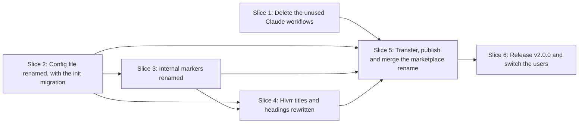

# Plan

## Dependency graph



Slices 1 and 2 are independent and may merge in either order. Slice 3 also edits
`CLAUDE.md:215`, which Slice 2 edits first, and Slice 4 follows Slice 3, so both rebase on Slice 2. Slices 3 and 4 both edit
`skills/core/SKILL.md` and `CLAUDE.md`, on different lines (Slice 3: `skills/core/SKILL.md:92-100`,
`CLAUDE.md:215,217`; Slice 4: `skills/core/SKILL.md:3,8`, `CLAUDE.md:3`), so Slice 4 depends on Slice 3
and rebases on it. Slices 1 to 4 may merge before the transfer (`design.md` §1, Change units);
Slices 5 and 6 run on one day, in that order (prd S-01.7; `design.md` §5, F2).

## Traceability

| Criterion | Slices |
|---|---|
| S-01.3 | 1 |
| S-03.1, S-03.2, S-03.3, S-03.4, S-04.1, S-04.2, S-04.3, S-04.4, S-04.5, S-04.6, S-04.7, S-04.8, S-04.9, S-05.1, S-05.2, S-05.3, S-05.4, S-05.5, S-05.6, S-05.7 | 2 |
| S-06.1, S-06.2, S-06.3, S-06.4 | 3 |
| S-07.1 | 4 |
| S-01.1, S-01.2, S-01.4, S-01.5, S-01.6, S-02.1, S-02.3, S-02.4, S-02.5, S-07.2, S-07.3 | 5 |
| S-01.7, S-02.2 | 5, 6 |

Example rows (S-NN.k.eN) follow their criterion's slices.

---

## Slice 1 — Delete the unused Claude workflows

Issue: #297 · Depends on: none · Stories: S-01

### Outcome

`.github/workflows/claude.yml` and `.github/workflows/claude-code-review.yml` are gone, and no tracked
file outside `docs/plans/` names either one or the `CLAUDE_CODE_OAUTH_TOKEN` secret.

### Acceptance

- **S-01.3**
- **1.1** `git ls-files .github` lists nothing: the two workflows were the only tracked files there
  (`git ls-files .github` at `749feb9`).
- **1.2** The maintainer has revoked the `CLAUDE_CODE_OAUTH_TOKEN` token at its issuer (the Claude
  account that created it), and `progress/slice-01.md` holds the line `Token revoked: {date}`
  (developer, cold read panel, 2026-11-25). If the maintainer cannot find or revoke it, the line is
  `Deviation: token not revoked — {reason}` instead, and the slice closes on the secret's deletion in
  Slice 5 (`design.md` §2, C8.d) (developer, cold read round 1, 2026-11-25).

### Contracts

None new. The deletion follows ADR-009 and `design.md` §1, Change units, U4. The repository secret
itself is deleted in Slice 5 (`design.md` §2, C8.d).

**Rollback:** `git revert` the squash commit, which restores both files; the secret's value is not
recoverable and nothing needs it (`design.md` §1, Rollback, U4).

### Stop conditions

- Stop if a contract this slice depends on has drifted from `context.md` (preflight).
- Stop if any tracked file outside `docs/plans/` other than the two workflows names `claude.yml`,
  `claude-code-review` or `CLAUDE_CODE_OAUTH`: `context.md` §2.6 says none does, so the change is
  larger than this slice.
- Stop if `git diff --name-only 749feb9 -- docs/plans/` lists a path outside
  `docs/plans/move-to-retroboot/` (`design.md` §8, P7).

### Verify

```bash
git ls-files .github
# expected: no output (S-01.3.e1, 1.1)
test -d .github/workflows && ls .github/workflows || echo absent
# expected: absent (S-01.3.e1)
git grep -n 'claude.yml\|claude-code-review\|CLAUDE_CODE_OAUTH' -- . ':!docs/plans'
# expected: no output (S-01.3.e2)
eval "$(grep -m1 '^bash -c ' docs/verification.md)"
# expected: structural checks pass
git cat-file -e '749feb9^{commit}' && { git diff --name-only 749feb9 -- docs/plans/; git ls-files -o --exclude-standard docs/plans/; } | grep -v '^docs/plans/move-to-retroboot/'
# expected: no output on stdout or stderr, exit 1; any `fatal:` or exit 128 means the base commit is missing and the check did not run
```

S-01.3 and its example rows are static (`design.md` §6, Level of each example row); the commands
above prove them. Record each ID in `progress/slice-01.md`.

```bash
grep -cE '^(Token revoked: [0-9]{4}-[0-9]{2}-[0-9]{2}|Deviation: token not revoked — .+)$' docs/plans/move-to-retroboot/progress/slice-01.md
# expected: 1 (1.2); the revocation is the maintainer's own step, and the executor records the date they give
```

### Pattern to follow

None in the tree: a pure deletion. ADR-009 decides it; `context.md` §2.6 lists the two files and
their token lines (`.github/workflows/claude.yml:37`, `.github/workflows/claude-code-review.yml:40`).

### Suggested path

Default route. You may deviate if every mandatory item still holds; record why.

1. Preflight the two files and the grep in `context.md` §2.6.
2. `git rm` both workflow files.
3. Ask the maintainer to revoke the token at its issuer, and record the date they give (1.2).
4. Run Verify and record the IDs in the progress file.

### Files

- Delete: `.github/workflows/claude.yml`
- Delete: `.github/workflows/claude-code-review.yml`
- Create: `docs/plans/move-to-retroboot/progress/slice-01.md`

---

## Slice 2 — Config file renamed, with the init migration

Issue: #298 · Depends on: none · Stories: S-03, S-04, S-05

### Outcome

Every skill reads its per-repo config from `.agent-plugins.json`, and `init` migrates an old
`.hivrr.json` in Phase 3 and swaps its `.gitignore` line in Phase 6, all in one squash commit, so a
repository that runs any `init`-loading skill keeps its settings under the new name.

### Acceptance

- **S-03.1**
- **S-03.2**
- **S-03.3**
- **S-03.4**
- **S-04.1**
- **S-04.2**
- **S-04.3**
- **S-04.4**
- **S-04.5**
- **S-04.6**
- **S-04.7**
- **S-04.8**
- **S-04.9**
- **S-05.1**
- **S-05.2**
- **S-05.3**
- **S-05.4**
- **S-05.5**
- **S-05.6**
- **S-05.7**
- **2.1** `init`'s Phase 3 heading reads ``## Phase 3 — Scaffold `.agent-plugins.json` `` and its
  Phase 6 heading reads ``## Phase 6 — Keep `.agent-plugins.json` Out of Git`` (`design.md` §2, C2
  and C4).
- **2.2** `.gitignore`, `skills/init/references/git-hygiene.md`, `skills/init/references/verify.md`,
  `CLAUDE.md` and `README.md` describe the config file and its migration without the literal old
  name (`design.md` §2, C9).
- **2.3** The **Read steps** section of `skills/init/references/config.md` names only
  `.agent-plugins.json`; the old name appears in that file only where it documents the migration
  (prd S-07.2; `design.md` §2, C1).
- **2.5** `skills/init/references/git-hygiene.md` no longer claims that a pathspec naming an untracked
  file "matches nothing extra"; it says the commit names only the paths that changed (`design.md`
  §7, R6).
- **2.4** `skills/init/SKILL.md` holds each `INIT:` line of `design.md` §2, C3 verbatim, and the
  Phase 6 commit message `chore(config): keep .agent-plugins.json out of git` (`design.md` §2, C5.b).

### Contracts

- **C1 The config file**, `design.md` §2: the path every reader uses; schema, keys and defaults
  unchanged.
- **C2 `init` Phase 3, Step 1 — Migrate an old config file**, `design.md` §2: rows C2.a to C2.f. The
  migration is the new first step of Phase 3; today's Steps 1 to 4 (`skills/init/SKILL.md:118-172`)
  each move down one number, and the existence test and validation that C2.b to C2.e hand over to
  keep today's behaviour under the new name.
- **C3 `init` report lines**, `design.md` §2: every line, verbatim.
- **C4 `init` Phase 6, Step 1 — Swap and ensure the ignore line**, `design.md` §2: C4.a and C4.b.
- **C5 `init` Phase 6, Steps 2 and 3 — Untrack and commit**, `design.md` §2: C5.a and C5.b.
- Every usage site in `inventory.md` whose path is a reader file of `context.md` §2.3, an `init`
  file of `context.md` §2.2 (except the frontmatter description at `skills/init/SKILL.md:3`, which
  Slice 4 rewrites under U5), `.gitignore:10`, `docs/verification.md:6,226,267,269,273`,
  `README.md:29,76,78,92,128,170,172` and `CLAUDE.md:140,145,149,157,165,170,174,190,209,215`
  changes in this slice (`design.md` §1, Change units, U1).

**Rollback:** `git revert` the squash commit on `main`. Repositories `init` already migrated are
restored by hand with `mv .agent-plugins.json .hivrr.json` and the `.gitignore` line put back
(`design.md` §1, Rollback, U1).

### Stop conditions

- Stop if a contract this slice depends on has drifted from `context.md` (preflight).
- Stop if any reader site would name `.agent-plugins.json` in a commit whose `init` Phase 3 lacks
  the C2 migration: the slice must land as one squash-merged PR, never split and never merged other
  than by squash (prd S-03.3; `design.md` §7, R1; §8, P1).
- Stop if a dry run ends with a repository holding neither config file, or with its only valid
  config removed (`design.md` §4, Config file illegal transitions; §8, P6).
- Stop if the Phase 6 commit carries any path other than `.gitignore` and the untracked config
  file, or fails because of its pathspec (`design.md` §2, C5.b; §7, R6; §8, P5).
- Stop if the change needs an eighth `init` phase or moves the count word "seven" (ADR-005; prd
  S-04.6).
- Stop if the migration needs a question in any mode (ADR-004; prd S-04.1).
- Stop if `git grep -n -i hivrr -- . ':!docs/plans'` lists a `.hivrr.json` site that `inventory.md`
  does not.
- Stop if `git diff --name-only 749feb9 -- docs/plans/` lists a path outside
  `docs/plans/move-to-retroboot/` (`design.md` §8, P7).

### Verify

```bash
grep -c '^## Phase' skills/init/SKILL.md
# expected: 7 (S-04.6.e1)
grep -n '^## Phase [36] ' skills/init/SKILL.md
# expected: two lines, "## Phase 3 — Scaffold `.agent-plugins.json`" and "## Phase 6 — Keep `.agent-plugins.json` Out of Git" (2.1)
git grep -l '\.hivrr\.json' -- . ':!docs/plans'
# expected, exactly: RELEASE-NOTES.md, skills/init/SKILL.md, skills/init/references/config.md (S-03.2.e2)
for f in skills/session/SKILL.md skills/session/references/github.md skills/session/references/gitlab.md skills/work-issue/SKILL.md skills/work-issue/references/worktree.md skills/work-issue/references/hierarchy.md skills/merge-pr/SKILL.md skills/merge-pr/references/board.md skills/merge-pr/references/cleanup.md skills/promote/SKILL.md skills/wave/SKILL.md skills/ship-issue/SKILL.md skills/planning/SKILL.md skills/planning/references/publish.md skills/planning/references/roles/dispatch.md skills/planning/references/roles/test-engineer.md skills/core/SKILL.md; do grep -q '\.agent-plugins\.json' "$f" || echo "missing: $f"; done
# expected: no output — every reader file of context.md §2.3 now names the new file (S-03.1)
awk '/^## Phase/ { p = $3 } /\.hivrr\.json/ { print (p == "" ? "frontmatter" : p) }' skills/init/SKILL.md | sort -u
# expected: 3, 6 and frontmatter (the description Slice 4 rewrites); no 4, 5 or 7 (S-03.1)
grep -c 'load-bearing' skills/init/SKILL.md; grep -c '^## Read steps' skills/init/references/config.md
# expected: 1, then 1 — the two anchors the next checks use still exist
grep 'load-bearing' skills/init/SKILL.md | grep -c '\.hivrr\.json'
# expected: 0 (S-03.1: the phase-contract sentence, found by its text, names only the new file)
awk '/^## Read steps/ { r = 1; next } r && /^## / { r = 0 } r' skills/init/references/config.md | grep -c '\.hivrr\.json'
# expected: 0 (2.3)
git grep -n -i 'hivrr' -- .gitignore skills/init/references/git-hygiene.md skills/init/references/verify.md
# expected: no output (2.2)
git grep -n '\.hivrr\.json' -- CLAUDE.md README.md
# expected: no output (2.2)
grep -cxF '.agent-plugins.json' .gitignore; grep -cxF '.hivrr.json' .gitignore
# expected: 1, then 0 (S-03.4)
git check-ignore -q .agent-plugins.json && echo ignored
# expected: ignored (S-03.4.e1)
grep -c '"owner": "your-org"' README.md skills/init/references/config.md
# expected: README.md:1 and skills/init/references/config.md:1 (S-03.4.e2)
git grep -n '"owner": "hivrr"' -- README.md skills/init/references/config.md
# expected: no output (S-03.4.e2)
for l in 'INIT: .agent-plugins.json gitignored' 'INIT: .agent-plugins.json ok' 'INIT: .agent-plugins.json is malformed' 'INIT: .agent-plugins.json present (unvalidated' 'INIT: .agent-plugins.json scaffolded (integration:' 'is not a regular file' 'INIT: upgraded .hivrr.json to .agent-plugins.json' 'INIT: removed .hivrr.json (.agent-plugins.json kept)' 'INIT: migration stopped' 'INIT: .gitignore line .hivrr.json replaced with .agent-plugins.json' 'INIT: .gitignore line .hivrr.json removed (.agent-plugins.json already listed)' 'chore(config): keep .agent-plugins.json out of git'; do grep -qF "$l" skills/init/SKILL.md || echo "missing: $l"; done
# expected: no output (2.4)
grep -c 'INIT: \.hivrr\.json gitignored' skills/init/SKILL.md; grep -c 'matches nothing extra' skills/init/references/git-hygiene.md
# expected: 0, then 0 (2.4, 2.5)
grep -c 'names only the paths that changed' skills/init/references/git-hygiene.md
# expected: 1 (2.5)
git fetch -q origin main && git diff --name-only origin/main...HEAD | grep -cxE 'skills/init/SKILL.md|skills/session/SKILL.md|skills/work-issue/SKILL.md|skills/merge-pr/SKILL.md|skills/planning/references/roles/dispatch.md'
# expected, on the PR branch just before the squash merge: 5 — all five readers are in the diff the squash commit carries (S-03.3.e1: readers and migration in one commit)
git show HEAD:skills/init/SKILL.md | grep -cF 'INIT: upgraded .hivrr.json to .agent-plugins.json'
# expected: 1 or more (S-03.3.e1)
eval "$(grep -m1 '^bash -c ' docs/verification.md)"
# expected: structural checks pass (S-04.6.e2: checks 7 and 10 report nothing)
git cat-file -e '749feb9^{commit}' && { git diff --name-only 749feb9 -- docs/plans/; git ls-files -o --exclude-standard docs/plans/; } | grep -v '^docs/plans/move-to-retroboot/'
# expected: no output on stdout or stderr, exit 1; any `fatal:` or exit 128 means the base commit is missing and the check did not run
```

S-03.3.e2 is shown by the same two commands: a branch lacking the migration prints 0 for the second,
and must not be merged. Both run before the merge, so S-03.3 is recorded in this slice's own
progress file; the PR is then merged by squash only. Straight after the merge, on `main`:

```bash
git fetch -q origin main && c=$(git log -1 --format=%H -G 'INIT: upgraded .hivrr.json' origin/main -- skills/init/SKILL.md) && git rev-list --parents -n1 "$c" | wc -w
# expected: 2 — the commit that added the migration has exactly one parent, so it landed as a squash (S-03.3)
git show --name-only --format= "$c" | grep -cxE 'skills/init/SKILL.md|skills/session/SKILL.md|skills/work-issue/SKILL.md|skills/merge-pr/SKILL.md|skills/planning/references/roles/dispatch.md'
# expected: 5 — the readers landed in that same commit (S-03.3.e1)
```

Slice 2's progress file has already merged by then, so these two results are recorded in
`progress/slice-03.md`, under S-03.3, as Slice 3's first step. A result other than 2 and 5 is a stop
for Slice 3: revert Slice 2 (its Rollback) before anything else merges.

Dry runs (`design.md` §6, dry run level, fixture F-scratch): an agent session follows the changed
`init` in a scratch repository made with `mktemp -d` outside the checkout, with `HOME` pointing at a
scratch directory and no remote, run as a non-root user (`test "$(id -u)" -ne 0` before D8). The
agent's Read tool reads the real `~/.claude/settings.json` whatever the shell `HOME`, so before each
dry-run session copy that file to a path outside `~/.claude`, and after it restore the copy and show
`cmp` prints nothing (developer, cold read panel, 2026-11-25). Each valid config fixture holds `verify.detectedFrom: ["manual"]` (`design.md` §6, F-scratch), so
Phase 4 leaves it alone and `cmp` shows the migration's bytes (developer, cold read round 1, 2026-11-25). Before each run, copy any config file to a
path outside the scratch repository; after it, read the `INIT:` lines, `ls -la`, `cmp` against the
copy, `git status --short` and `git log -1 --stat`. Record each ID in `progress/slice-02.md`.

- **D1** `.hivrr.json` only, valid; again in `--auto` mode: S-04.1.e1, S-04.1.e2.
- **D2** both files, different content, `.agent-plugins.json` valid: S-04.2.e1, S-04.8.e2.
- **D3** both files, `.agent-plugins.json` malformed: S-04.2.e2.
- **D4** neither file, scaffold accepted, then declined: S-04.3.e1, S-04.3.e2.
- **D5** `.agent-plugins.json` only, valid; then a second run on D1's repository: S-04.4.e1,
  S-04.4.e2.
- **D6** `.hivrr.json` only, malformed; then valid with `PATH` lacking `jq`: S-04.5.e1, S-04.5.e2.
- **D7** both files, `PATH` lacking `jq`, `.gitignore` holding `.hivrr.json`, run through Phase 6;
  then `jq` restored and run again: S-04.8.e1, S-05.7.e1, S-05.7.e2.
- **D8** `.hivrr.json` only with the root made read-only by `chmod a-w`; then `.hivrr.json` as a
  directory; then `.hivrr.json` as a symlink to a valid file, which stops with the type-check line; then `.agent-plugins.json` as a
  directory with no `.hivrr.json`: S-04.9.e1, S-04.9.e2.
- **D9** `.hivrr.json` only holding `branches.integration: dev`, `work-issue` followed to its base
  branch; then `worktree` set, `merge-pr` followed to its worktree gate: S-04.7.e1, S-04.7.e2.
- **D10** `.agent-plugins.json` with `branches.integration: dev`, `work-issue` to its base branch;
  then no `worktree` key, `merge-pr` to its worktree gate: S-03.1.e1, S-03.1.e2.
- **D11** `.hivrr.json` only with `branches.integration: dev`, no `init` run, `spec` resolving
  `{base}` through `skills/planning/references/roles/dispatch.md`: S-03.2.e1.
- **D12** Phase 6 over each `.gitignore` of `design.md` §6, F-scratch, on a feature branch and on
  `main`, and with `.hivrr.json` committed: S-05.1.e1, S-05.1.e2, S-05.2.e1, S-05.2.e2, S-05.3.e1,
  S-05.3.e2, S-05.4.e1, S-05.4.e2, S-05.5.e1, S-05.6.e1, S-05.6.e2.

### Pattern to follow

- `skills/init/SKILL.md:122-138`: the existence test, `jq empty` validation and `INIT:` emits the
  migration step sits in front of.
- `skills/init/SKILL.md:270-300`: Phase 6 Steps 1 and 2, the check-ignore, append and untrack form
  C4 and C5.a extend.
- `skills/init/SKILL.md:320-356`: the commit with a trailing pathspec, its inline rule, the
  protected-branch path and the three emits C5.b keeps. Do **not** copy line 322's pathspec: naming
  an untracked `.hivrr.json` makes `git commit` fail (`design.md` §7, R6), and
  `skills/init/references/git-hygiene.md:42-44`, which says it does not, is corrected in this slice.
- `skills/init/references/config.md:283-309`: the read steps every reader follows (`design.md` §1,
  A6).

### Suggested path

Default route. You may deviate if every mandatory item still holds; record why.

1. Preflight `context.md` §2.2, §2.3, §2.5 and §3 against the tree.
2. Write C2 as the new first step of Phase 3 and renumber the following steps; rename the Phase 3
   heading and the filename in its later steps.
3. Write C4.a in Phase 6 Step 1 ahead of the check-ignore; extend Step 2 to untrack either name
   (C5.a) and Step 3's pathspec and message (C5.b); rename the Phase 6 heading and emits.
4. Rename the filename in Phases 4, 5 and 7, line 14, and `skills/init/references/*.md`, writing
   any migration description in `config.md` and the old-name-free wording C9 asks for elsewhere.
5. Rename the filename at every reader site of `context.md` §2.3, then `.gitignore`, `CLAUDE.md`,
   `README.md` (including `"owner": "your-org"`) and `docs/verification.md`.
6. Run the static Verify, then dry runs D1 to D12, recording each ID.
7. Open one PR; merge it by squash only.

### Files

- Modify: `skills/init/SKILL.md`, `skills/init/references/config.md`,
  `skills/init/references/git-hygiene.md`, `skills/init/references/verify.md`
- Modify: `skills/session/SKILL.md`, `skills/session/references/github.md`,
  `skills/session/references/gitlab.md`, `skills/work-issue/SKILL.md`,
  `skills/work-issue/references/worktree.md`, `skills/work-issue/references/hierarchy.md`,
  `skills/merge-pr/SKILL.md`, `skills/merge-pr/references/board.md`,
  `skills/merge-pr/references/cleanup.md`, `skills/promote/SKILL.md`, `skills/wave/SKILL.md`,
  `skills/ship-issue/SKILL.md`, `skills/planning/SKILL.md`,
  `skills/planning/references/publish.md`, `skills/planning/references/roles/dispatch.md`,
  `skills/planning/references/roles/test-engineer.md`, `skills/core/SKILL.md`
- Modify: `.gitignore`, `CLAUDE.md`, `README.md`, `docs/verification.md`
- Create: `docs/plans/move-to-retroboot/progress/slice-02.md`

---

## Slice 3 — Internal markers renamed

Issue: #299 · Depends on: Slice 2 · Stories: S-06

### Outcome

Every `HIVRR_BODY_7f3a`, `HIVRR_COMMIT_7f3a` and `HIVRR_VERIFY_BLOCK` outside `docs/plans/` is now its
`AGENT_PLUGINS_*` name, every heredoc pair opens and closes on the same name, and verification passes
both on a fresh tree and from the maintainer's migrated local config.

### Acceptance

- **S-06.1**
- **S-06.2**
- **S-06.3**
- **S-06.4**
- **3.1** The bootstrap string stays below the checks fence in `docs/verification.md`
  (`design.md` §2, C7.b; `docs/verification.md:280-285`).

### Contracts

- **C7 Markers**, `design.md` §2: C7.a over every site of `context.md` §2.4, and C7.b at
  `docs/verification.md:96-101`, `docs/verification.md:277` and `CLAUDE.md:215,217`, all in one
  commit (`design.md` §1, Change units, U2).

**Rollback:** `git revert` the squash commit; the maintainer restores the old local `verify.test` by
hand (`design.md` §1, Rollback, U2).

### Stop conditions

- Stop if a contract this slice depends on has drifted from `context.md` (preflight).
- Stop if Slice 2's post-merge check on `main` does not print 2 and 5 (`plan.md` Slice 2 Verify;
  `design.md` §8, P1).
- Stop if any heredoc pair's opening `<<'…'` line and closing line would carry different names in
  the commit (prd S-06.2; `design.md` §8, P4).
- Stop if the maintainer's checkout has not been migrated to `.agent-plugins.json` by `init` when
  S-06.4 is to be shown: Slice 2 must be merged and the maintainer must have run an `init`-loading
  skill there. The maintainer runs that skill and replaces `verify.test` by hand; the executor
  records the output they give (developer, cold read panel, 2026-11-25).
- Stop if the maintainer's local `verify.test`, replaced with the new bootstrap string, does not
  print `structural checks pass` (prd S-06.4; `design.md` §8, P9).
- Stop if `git diff --name-only 749feb9 -- docs/plans/` lists a path outside
  `docs/plans/move-to-retroboot/` (`design.md` §8, P7).

### Verify

```bash
git grep -n 'HIVRR_' -- . ':!docs/plans'
# expected: no output (S-06.1.e1)
git grep -l 'AGENT_PLUGINS_' -- . ':!docs/plans'
# expected, exactly these 10: CLAUDE.md, docs/verification.md, skills/audit/SKILL.md, skills/core/SKILL.md, skills/planning/references/publish.md, skills/promote/SKILL.md, skills/review-pr/SKILL.md, skills/session/references/github.md, skills/session/references/gitlab.md, skills/session/references/linear.md (S-06.1)
grep -n 'AGENT_PLUGINS_' skills/core/SKILL.md
# expected: four lines; the prose pair names both AGENT_PLUGINS_COMMIT_7f3a and AGENT_PLUGINS_BODY_7f3a (S-06.1.e2)
for f in skills/audit/SKILL.md skills/core/SKILL.md skills/promote/SKILL.md skills/session/references/github.md skills/session/references/gitlab.md; do echo "$f $(grep -cE "<<'AGENT_PLUGINS_(BODY|COMMIT)_7f3a'\$" "$f") $(grep -cxE 'AGENT_PLUGINS_(BODY|COMMIT)_7f3a' "$f")"; done
# expected: audit 1 1, core 1 1, promote 1 1, github 2 2, gitlab 2 2 (S-06.2)
for f in skills/audit/SKILL.md skills/core/SKILL.md skills/promote/SKILL.md skills/session/references/github.md skills/session/references/gitlab.md; do diff <(grep -oE "<<'AGENT_PLUGINS_(BODY|COMMIT)_7f3a'\$" "$f" | tr -d "<'") <(grep -xE 'AGENT_PLUGINS_(BODY|COMMIT)_7f3a' "$f") >/dev/null || echo "pair mismatch: $f"; done
# expected: no output — in every file the closers name the same markers as the openers, in the same order (S-06.2, S-06.2.e1, S-06.2.e2)
grep -m1 '^bash -c ' docs/verification.md | grep -c 'export AGENT_PLUGINS_VERIFY_BLOCK'
# expected: 1 (S-06.3)
eval "$(grep -m1 '^bash -c ' docs/verification.md)"
# expected: structural checks pass (S-06.3.e1)
FENCE=$(printf '\140\140\140'); env -u AGENT_PLUGINS_VERIFY_BLOCK bash -c "$(awk -v fence="$FENCE" '/^# Verification/ { v = 1; next } v && !f && /^## / { exit } v && index($0, fence) == 1 { if (f) exit; f = 1; next } v && f' docs/verification.md)" </dev/null 2>&1 | grep -c '^CHECK COUNT UNCHECKED AGENT_PLUGINS_VERIFY_BLOCK unset'
# expected: 1 (S-06.3.e2)
awk -v f="$(printf '\140\140\140')" 'index($0, f) == 1 { n++ } /^bash -c / { print n; exit }' docs/verification.md
# expected: 3 — the checks fence has opened and closed, and the bootstrap fence opened, before the bootstrap line (3.1)
eval "$(jq -r .verify.test .agent-plugins.json)" 2>&1 | grep -c '^CHECK COUNT UNCHECKED'; echo "exit ${PIPESTATUS[0]}"
# run by the maintainer first, before the replacement below: expected 1, then exit 1 (S-06.4.e2); same note as below
t=$(mktemp) && jq --arg t "$(grep -m1 '^bash -c ' docs/verification.md)" '.verify.test = $t' .agent-plugins.json > "$t" && mv "$t" .agent-plugins.json
# run by the maintainer in their own migrated checkout, never in an executor's worktree; expected: no output; would fail because .agent-plugins.json is git-ignored and absent anywhere init has not run
jq -r '.verify.detectedFrom[0]' .agent-plugins.json
# expected: manual; same note — maintainer's checkout only, exit 2 where the file is absent
eval "$(jq -r .verify.test .agent-plugins.json)"
# expected: structural checks pass (S-06.4.e1); same note — where the file is absent it prints nothing, which is a failure
git cat-file -e '749feb9^{commit}' && { git diff --name-only 749feb9 -- docs/plans/; git ls-files -o --exclude-standard docs/plans/; } | grep -v '^docs/plans/move-to-retroboot/'
# expected: no output on stdout or stderr, exit 1; any `fatal:` or exit 128 means the base commit is missing and the check did not run
```

S-06.4.e2 is the state before the hand replacement, so the fence runs it first. Record every ID in
`progress/slice-03.md`.

### Pattern to follow

- `skills/core/SKILL.md:92-100`: a heredoc pair with its prose naming the delimiter, the shape every
  C7.a site keeps.
- `docs/verification.md:96-101`: check 8's use of the variable, which changes with the bootstrap
  string at `docs/verification.md:277`.

### Suggested path

Default route. You may deviate if every mandatory item still holds; record why.

1. Run Slice 2's two post-merge commands on `main` and record them in this slice's progress file
   under S-03.3; then preflight `context.md` §2.4.
2. Rename both lines of every heredoc pair and each prose mention, file by file.
3. Rename the variable in check 8, the bootstrap string and `CLAUDE.md:215,217`.
4. Run the static and structural Verify.
5. Ask the maintainer to run an `init`-loading skill in their checkout, show S-06.4.e2, replace the
   local `verify.test` by hand, then show S-06.4.e1; record the outputs they give.

### Files

- Modify: `skills/audit/SKILL.md`, `skills/core/SKILL.md`, `skills/promote/SKILL.md`,
  `skills/review-pr/SKILL.md`, `skills/planning/references/publish.md`,
  `skills/session/references/github.md`, `skills/session/references/gitlab.md`,
  `skills/session/references/linear.md`
- Modify: `docs/verification.md`, `CLAUDE.md`
- Create: `docs/plans/move-to-retroboot/progress/slice-03.md`

---

## Slice 4 — Hivrr titles and headings rewritten

Issue: #300 · Depends on: Slice 2, Slice 3 · Stories: S-07

### Outcome

`README.md`, `CLAUDE.md`, `core` and `init` carry the new name in their titles, introduction,
descriptions and headings, with no "Hivrr" wording.

### Acceptance

- **S-07.1**
- **4.1** `.claude-plugin/marketplace.json` is unchanged, and no plugin description in `CLAUDE.md`
  changes (prd Non-goals; check 5, `context.md` §4).

### Contracts

None new: prose only (`design.md` §1, Change units, U5). The sites are `README.md:1,3`,
`CLAUDE.md:3`, `skills/core/SKILL.md:3,8` and `skills/init/SKILL.md:3`, with the titles prd S-07.1
fixes.

**Rollback:** `git revert` the squash commit (`design.md` §1, Rollback, U5).

### Stop conditions

- Stop if a contract this slice depends on has drifted from `context.md` (preflight).
- Stop if the rewrite would change a plugin name or plugin description (prd Non-goals; check 5).
- Stop if `git diff --name-only 749feb9 -- docs/plans/` lists a path outside
  `docs/plans/move-to-retroboot/` (`design.md` §8, P7).

### Verify

```bash
sed -n 1p README.md
# expected: # agent-plugins (S-07.1)
sed -n 3p README.md | grep -ci hivrr
# expected: 0 (S-07.1)
sed -n 3p CLAUDE.md
# expected: # Agent Plugins (S-07.1.e1)
git grep -n -i 'hivrr' -- CLAUDE.md
# expected: no output, since Slice 3 merges first (Dependency graph)
sed -n 3p skills/core/SKILL.md
# expected: description: Core coding philosophy - quality gates, git safety, and task completion standards (S-07.1.e2)
grep -m1 '^# ' skills/core/SKILL.md
# expected: # Core Philosophy (S-07.1.e2)
sed -n 3p skills/init/SKILL.md | grep -c '\.agent-plugins\.json'; sed -n 3p skills/init/SKILL.md | grep -ci hivrr
# expected: 1, then 0 (S-07.1)
git diff --stat 749feb9 -- .claude-plugin/marketplace.json
# expected: no output (4.1)
eval "$(grep -m1 '^bash -c ' docs/verification.md)"
# expected: structural checks pass (4.1: check 5 reports nothing)
git cat-file -e '749feb9^{commit}' && { git diff --name-only 749feb9 -- docs/plans/; git ls-files -o --exclude-standard docs/plans/; } | grep -v '^docs/plans/move-to-retroboot/'
# expected: no output on stdout or stderr, exit 1; any `fatal:` or exit 128 means the base commit is missing and the check did not run
```

S-07.1 and its example rows are static. Record each ID in `progress/slice-04.md`.

### Pattern to follow

- `skills/core/SKILL.md:3,8` and `CLAUDE.md:3`: the lines that change, with the target text from prd
  S-07.1.
- `RELEASE-NOTES.md:1`: "Agent Plugins Release Notes", the repository's existing name-free title.

### Suggested path

Default route. You may deviate if every mandatory item still holds; record why.

1. Preflight the five sites.
2. Rewrite the `README.md` title and introduction, the `CLAUDE.md` title, the `core` description and
   heading, and the `init` description to name `.agent-plugins.json`.
3. Run Verify.

### Files

- Modify: `README.md`, `CLAUDE.md`, `skills/core/SKILL.md`, `skills/init/SKILL.md`
- Create: `docs/plans/move-to-retroboot/progress/slice-04.md`

---

## Slice 5 — Transfer, publish and merge the marketplace rename

Issue: #301 · Depends on: Slice 1, Slice 2, Slice 3, Slice 4 · Stories: S-01, S-02, S-07

### Outcome

The repository is at `retroboot/agent-plugins` with every record it had, cleaned, scanned and
public, the maintainer's `origin` names it, and the marketplace rename to `agent-plugins` with
version `2.0.0`, its setup docs and its release entry is merged, leaving no `hivrr` outside the
allowed files.

### Acceptance

- **S-01.1**
- **S-01.2**
- **S-01.4**
- **S-01.5**
- **S-01.6**
- **S-01.7** (transfer side): the transfer, the remote switch and this slice's merge happen on one
  date, in that order, recorded in `progress/slice-05.md`.
- **S-02.1**
- **S-02.2** (probe side): before the merge, the maintainer's Claude Code adds the marketplace from
  a local checkout of this slice's tree and installs `dev@agent-plugins`, `planner@agent-plugins`,
  `auditor@agent-plugins` and `data-platform@agent-plugins`, then uninstalls each and runs
  `/plugin marketplace remove agent-plugins`; `~/.claude/settings.json` and
  `~/.claude/plugins/known_marketplaces.json` are copied outside `~/.claude` first and
  `cmp <(jq -S . {copy}) <(jq -S . {file})` shows each unchanged after, so key order alone is not a
  difference; all of it is recorded (`design.md` §6, manual
  (Claude Code); §7, R5) (developer, cold read panel, 2026-11-25).
- **S-02.3**
- **S-02.4**
- **S-02.5**
- **S-07.2**
- **S-07.3**
- **5.1** `gitleaks version` is recorded in the progress file before the scan (`design.md` §7, R13).
- **5.2** The `v2.0.0` entry also tells users to run an `init`-loading skill first in each
  repository, in a sentence containing "`init`-loading skill first" (`design.md` §7, R8).
- **5.4** `progress/slice-05.md` holds the line `Go public: approved by retroboot {date}`, written
  by the maintainer before C8.f, and `bschappaugh-plk` is removed only after a clean scan
  (`design.md` §2, C8.f) (developer, cold read panel, 2026-11-25).
- **5.5** The C8.d listings (deploy keys, webhooks, invitations, environments, Dependabot and
  Codespaces secrets, Actions runs, runners) each read 0 before C8.f, fork-PR approval is set, and
  every release asset has been read and judged, with the result in `progress/slice-05.md`
  (`design.md` §2, C8.d) (developer, cold read panel, 2026-11-25).
- **5.6** The `gitleaks` detection test exits 1 on a planted fake token before the real scan
  (`design.md` §2, C8.e) (developer, cold read panel, 2026-11-25).
- **5.3** The PR is squash-merged only after `gh repo view retroboot/agent-plugins --json visibility`
  prints `PUBLIC` (`design.md` §5, F2; §7, R5).

### Contracts

- **C6.a `marketplace.json`**, **C6.c Release entry** (entry text only; the tag and GitHub release
  are Slice 6) and **C6.d Setup docs**, `design.md` §2.
- **C8.a to C8.f Repository home**, `design.md` §2, run in the order of `design.md` §4, Repository
  home, and §5, F2. The transfer, any acceptance, and the go-public approval are the maintainer's
  steps; the executor runs the rest under the maintainer's `gh` login and records each output
  (`design.md` §2, C8 preamble).
- **C9 The no-`hivrr` boundary**, `design.md` §2.

**Rollback:** before users switch, `git revert` the squash commit, restoring `hivrr-agent-plugins`
(`design.md` §1, Rollback, U3). The transfer is undone only by a reverse transfer the developer
orders; the visibility change has no rollback, which is why every check precedes it (`design.md` §1,
Rollback).

### Stop conditions

- Stop if a contract this slice depends on has drifted from `context.md` (preflight).
- Stop if Slices 1 to 4 are not all merged: S-07.2 cannot pass, and ADR-009 wants no workflow
  referring to the secret in the public repository.
- Stop if the Claude Code probe cannot add the `agent-plugins` marketplace or install any of the
  four plugins, or leaves an `agent-plugins` entry behind (prd Assumptions, row 5; `design.md` §7, R5; §8, P3).
- Stop if `retroboot/agent-plugins` exists before the transfer, or GitHub refuses it: no tree change
  that assumes the new home is merged (prd S-01.1.e2; `design.md` §2, C8.b).
- Stop if the baseline counts are not in the progress file before the transfer, or any count after
  it differs (prd S-01.5.e2; `design.md` §8, P8).
- Stop if `gitleaks` is not installed, its checksum does not verify, its detection test exits 0, or
  the scan reports any finding: the repository stays private and the developer judges each finding
  as `design.md` §2, C8.e says (prd S-01.6.e2; `design.md` §8, P2).
- Stop before C8.f if any C8.d listing is non-empty after clean-up or its `gh api` call fails
  (an empty value is a failure, not 0), or a release asset holds anything the maintainer judges
  sensitive: the repository stays private and the developer decides (`design.md` §2, C8.d)
  (developer, cold read round 1, 2026-11-25).
- Stop before C8.f if the progress file lacks the maintainer's `Go public: approved by retroboot`
  line (`design.md` §2, C8.f).
- Transfer acceptance still pending at the end of the UTC day is not a stop: record a deviation and
  continue when it is accepted (`design.md` §2, C8.b).
- Stop if this PR would merge before the repository is public (`design.md` §5, F2).
- Stop if `git diff --name-only 749feb9 -- docs/plans/` lists a path outside
  `docs/plans/move-to-retroboot/` (`design.md` §8, P7).
- A transfer and merge on different dates is not a stop: record it as a deviation (prd S-01.7.e2;
  `design.md` §8, P10).

### Verify

```bash
o=hivrr   # before the transfer; then o=retroboot after it
gh issue list   --repo $o/agent-plugins --state all --limit 1000 --json number --jq length
gh pr list      --repo $o/agent-plugins --state all --limit 1000 --json number --jq length
gh label list   --repo $o/agent-plugins --limit 1000 --json name --jq length
gh api "repos/$o/agent-plugins/milestones?state=all" --jq length
gh api "repos/$o/agent-plugins/tags?per_page=100" --jq length
gh release list --repo $o/agent-plugins --limit 1000 --json tagName --jq length
# expected: every command exits 0 (a failed call is a stop, never a count of 0); six numbers, recorded for hivrr before the transfer — 154, 138, 30, 0, 5, 2 on 2026-11-25, higher only by issues or PRs opened since — and for retroboot after it, the same six (S-01.1, S-01.1.e1, S-01.5)
gh repo view retroboot/agent-plugins 2>&1 | head -1
# expected, before the transfer: an error containing "Could not resolve to a Repository" (S-01.1.e2)
git remote get-url origin
# expected, after the remote switch: https://github.com/retroboot/agent-plugins (S-01.2, S-01.2.e1); a fetch that worked through the redirect does not meet S-01.2 until this prints the new URL (S-01.2.e2)
r=retroboot/agent-plugins; for e in keys hooks invitations dependabot/secrets codespaces/secrets actions/runners; do echo "$e $(gh api "repos/$r/$e" --jq 'if type == "array" then length else .total_count end')"; done; echo "runs $(gh api "repos/$r/actions/runs" --jq .total_count)"; echo "environments $(gh api "repos/$r/environments" --jq .total_count)"
# expected, after C8.d: every count 0 (5.5); would fail before the transfer because the repository is not there
for e in $(gh api "repos/$r/environments" --jq '.environments[].name'); do echo "$e $(gh api "repos/$r/environments/$e/secrets" --jq .total_count)"; done
# expected: no output, since every environment was deleted (developer, cold read round 1, 2026-11-25) (5.5)
gh api "repos/$r/actions/permissions/fork-pr-contributor-approval" --jq .approval_policy
# expected: all_external_contributors (5.5)
for t in $(gh release list --repo "$r" --json tagName --jq '.[].tagName'); do echo "$t $(gh release view "$t" --repo "$r" --json assets --jq '.assets | length')"; done
# expected: each tag with its asset count, whatever it is; every asset is downloaded and read, and the result recorded in progress/slice-05.md (5.5)
gh api repos/retroboot/agent-plugins/collaborators --jq '.[].login'
# expected, after C8.f's first step: exit 0 and one line, retroboot (S-01.5.e1); before it, also bschappaugh-plk
gh secret list --repo retroboot/agent-plugins --json name --jq length
# expected: exit 0 and 0 (S-01.5.e1); would fail before the transfer, and prints 1 before C8.d
gitleaks version
# expected: a version, recorded (5.1); would fail until gitleaks is installed, which is a stop before C8.f
git init -q detect-test.git && printf 'token = "ghp_%s"\n' "$(tr -dc 'A-Za-z0-9' </dev/urandom | head -c 36)" > detect-test.git/t.txt && git -C detect-test.git add t.txt && git -C detect-test.git -c user.name=scan -c user.email=scan@invalid commit -qm t
# run in a scratch directory outside the checkout; expected: no output
gitleaks git detect-test.git --log-opts="--all" --redact 2>&1 | tee detect.log; echo "exit ${PIPESTATUS[0]}"; grep -c 'leaks found: 1' detect.log
# expected: exit 1, then 1 — a runtime error also exits 1 but never prints "leaks found: 1" (5.6)
git clone --mirror https://github.com/retroboot/agent-plugins agent-plugins-scan.git
# run in the same scratch directory; expected: exit 0, and a failed clone is a stop
gitleaks git agent-plugins-scan.git --log-opts="--all" --redact --verbose 2>&1 | tee scan.log; echo "exit ${PIPESTATUS[0]}"; grep -c 'no leaks found' scan.log
# expected: exit 0, then 1, and a positive commits-scanned count in scan.log (S-01.6; before v8.19 use the detect form in design.md §2, C8.e)
git -C agent-plugins-scan.git rev-list --all --count
# expected: a positive number, recorded beside gitleaks' count; a gap of merge or empty commits is not a stop, since gitleaks counts commits with a diff
gh repo view retroboot/agent-plugins --json visibility --jq .visibility
# expected, after C8.f: PUBLIC (S-01.6.e1, 5.3)
jq -r '.name, .owner.name, .metadata.version' .claude-plugin/marketplace.json
# expected: three lines, agent-plugins then retroboot then 2.0.0 (S-02.1.e1, S-02.4)
jq -r .metadata.description .claude-plugin/marketplace.json | grep -ci hivrr
# expected: 0 (S-02.1)
diff <(git show 749feb9:.claude-plugin/marketplace.json | jq .plugins) <(jq .plugins .claude-plugin/marketplace.json)
# expected: no output (S-02.1.e2)
git grep -n -i 'github packages\|manager-plugin\|data-platform-plugin\|hivrr' -- README.md .env.example
# expected: no output (S-02.3, S-02.3.e2)
grep -c 'retroboot/agent-plugins' README.md; grep -cE '(dev|planner|auditor|data-platform)@agent-plugins|\{plugin\}@agent-plugins' README.md
# expected: 1 or more, then 1 or more (S-02.3.e1)
grep -m1 '^## ' RELEASE-NOTES.md
# expected: ## v2.0.0 ({date}), {date} being the transfer date recorded in progress/slice-05.md (S-02.4.e1)
for s in 'dev@agent-plugins' 'planner@agent-plugins' 'auditor@agent-plugins' 'data-platform@agent-plugins' '.agent-plugins.json' 'plugin uninstall' 'marketplace remove hivrr-agent-plugins' 'marketplace add retroboot/agent-plugins'; do awk '/^## /{n++} n==1' RELEASE-NOTES.md | grep -qF "$s" || echo "missing: $s"; done
# expected: no output (S-02.4, S-02.4.e2)
awk '/^## /{n++} n==1' RELEASE-NOTES.md | grep -cF '`init`-loading skill first'
# expected: 1 or more (5.2)
eval "$(grep -m1 '^bash -c ' docs/verification.md)"
# expected: structural checks pass (S-02.5, S-02.5.e1)
t=$(mktemp -d)/tree && git worktree add -q --detach "$t" HEAD && (cd "$t" && grep -rIl -i "hivrr" --exclude-dir=.git --exclude-dir=plans . | sort); git worktree remove "$t"
# expected, on main after the merge: ./RELEASE-NOTES.md, ./skills/init/SKILL.md, ./skills/init/references/config.md (S-07.2, S-07.2.e1)
git cat-file -e '749feb9^{commit}' && { git diff --name-only 749feb9 -- docs/plans/; git ls-files -o --exclude-standard docs/plans/; } | grep -v '^docs/plans/move-to-retroboot/'
# expected: no output on stdout or stderr, exit 1; any `fatal:` or exit 128 means the base commit is missing and the check did not run (S-07.3, S-07.3.e1)
```

Every date this pack records is UTC, taken with `date -u +%F`. `progress/slice-05.md` records
these lines, which the commands below check:

```bash
f=docs/plans/move-to-retroboot/progress/slice-05.md
grep -cE '^(Baseline|After): issues [0-9]+, prs [0-9]+, labels [0-9]+, milestones [0-9]+, tags [0-9]+, releases [0-9]+$' "$f"
# expected: 2 (S-01.1, S-01.5)
diff <(grep '^Baseline:' "$f" | cut -d: -f2) <(grep '^After:' "$f" | cut -d: -f2)
# expected: no output, exit 0 (S-01.1.e1)
grep -cE '^gitleaks: [0-9]' "$f"; grep -cE '^Go public: approved by retroboot [0-9]{4}-[0-9]{2}-[0-9]{2}$' "$f"
# expected: 1, then 1 (5.1, 5.4)
grep -cE '^Dates \(UTC\): transfer [0-9-]{10}, remote [0-9-]{10}, merge [0-9-]{10}$' "$f"
# expected: 1 (S-01.7, transfer side)
# the merge date is written as planned before the squash merge; a merge on another day adds a `Deviation:` line to progress/slice-05.md after the merge
awk -F'[ ,]+' '/^Dates \(UTC\):/ { print ($4 == $6 && $6 == $8) ? "same day" : "different days" }' "$f"; grep -c '^Deviation:' "$f"
# expected: same day, then any count; or different days, then 1 or more (S-01.7, S-01.7.e2)
```

Manual and dry-run scenarios, each recorded with its date and output in `progress/slice-05.md`:

- **S-01.4.e1, S-01.4.e2** (dry run, after the remote switch, in the maintainer's checkout): with the
  real `HOME`, since the Read tool reads the real `~/.claude/settings.json` whatever the shell
  `HOME`: copy that file outside `~/.claude` first, check its `providerConfig.bootstrappedRepos`
  lists `hivrr/agent-plugins` and not `retroboot/agent-plugins`, then run `init` twice;
  only after the second run restore the copy and show `cmp` prints nothing. The label writes go to the live repository with `--force`,
  which updates existing labels to the `labels.md` colours and descriptions (the author, applying the developer's copy-and-restore
  answer from the cold read panel, 2026-11-25). Then `init` Phase 2 creates the labels with `--force` without error
  and appends `retroboot/agent-plugins`; a second run skips label creation.
- **S-02.5.e2** (structural): a scratch edit to the `dev` entry's description makes the structural
  checks print `DESC DRIFT dev` and exit 1; revert the edit after.
- **S-02.2** (probe side): the Claude Code probe of the Acceptance line above, then
  `jq -e 'has("agent-plugins") | not' ~/.claude/plugins/known_marketplaces.json` and
  `jq -e '[.enabledPlugins | keys[] | select(endswith("@agent-plugins"))] | length == 0' ~/.claude/settings.json`
  each print `true`, so the probe left nothing registered or enabled; each plugin is uninstalled
  before the marketplace is removed.
- **S-07.2.e2, S-07.3.e2**: shown by the two commands above, which list the offending path in those
  states.
- **S-01.7** (transfer side): the dates of the transfer, the remote switch and the merge.

### Pattern to follow

- `git show --stat 749feb9`: the `v1.6.0` release commit, which changed only
  `.claude-plugin/marketplace.json` and `RELEASE-NOTES.md`.
- `RELEASE-NOTES.md:3`: the `## v1.6.0 (2026-11-25)` heading form.
- `design.md` §2, C8: the exact transfer, clean, scan and publish commands; §2, C6: the user steps
  the entry gives.

### Suggested path

Default route. You may deviate if every mandatory item still holds; record why.

1. Preflight; confirm Slices 1 to 4 are merged.
2. On a branch, change `marketplace.json` (C6.a), the README Setup block and `.env.example` (C6.d),
   and add the `v2.0.0` entry (C6.c, with 5.2); run the static Verify; open the PR, unmerged.
3. Ask the maintainer to run the Claude Code probe on this tree and remove it again; install
   `gitleaks` from the official release, verify its checksum, record its version, and run the
   detection test.
4. On the day: read and record the `Baseline:` line and commit the progress file; confirm
   `retroboot/agent-plugins` is absent; the maintainer transfers it in the settings page and
   accepts it if asked; re-read and record the `After:` line.
5. Switch `origin`; run `gh auth setup-git`; run the S-01.4 dry run; clean every surface (C8.d).
6. Mirror-clone and scan (C8.e). On a clean scan, ask the maintainer to write the go-public line;
   then remove `bschappaugh-plk` and make the repository public (C8.f).
7. Record the dates and results; squash-merge the PR; run the post-merge Verify on `main`. Start
   Slice 6 the same day.

### Files

- Modify: `.claude-plugin/marketplace.json`, `README.md`, `.env.example`, `RELEASE-NOTES.md`
- Create: `docs/plans/move-to-retroboot/progress/slice-05.md`

---

## Slice 6 — Release v2.0.0 and switch the users

Issue: #302 · Depends on: Slice 5 · Stories: S-01, S-02

### Outcome

`v2.0.0` is tagged and released on `retroboot/agent-plugins` the same day as the transfer, both
installing users have switched to the `agent-plugins` marketplace and confirmed it (or, after 7 days,
`retroboot` with a deviation for `cedwards-plk`, 6.3), and the pack is closed.

### Acceptance

- **S-01.7** (release and users side): the `v2.0.0` tag and release, and both users' marketplace
  switch, happen on the date Slice 5 recorded for the transfer, after it.
- **S-02.2** (users side): each user who removed `hivrr-agent-plugins` adds the marketplace from
  `retroboot/agent-plugins` and installs their plugins as `{plugin}@agent-plugins`.
- **6.1** An annotated tag `v2.0.0` points at Slice 5's squash commit, and a GitHub release
  `v2.0.0` exists on `retroboot/agent-plugins` (`design.md` §2, C6.c).
- **6.2** On a fresh tree of `v2.0.0`, the bootstrap string prints `structural checks pass` and
  exits 0 (prd M5).
- **6.3** Both users' confirmations, `retroboot` and `cedwards-plk` (the maintainer's second
  account), are recorded in `progress/slice-06.md` (prd M2). If the `cedwards-plk` confirmation has
  not arrived 7 days after the release, the slice closes on the `retroboot` confirmation and records
  the missing one as a deviation; the maintainer runs it as that account (developer, cold read panel, 2026-11-25).
- **6.4** The pack README has its **Retro** section, with the `_Written by the final slice` placeholder
  line replaced by the retro itself, and Status `done` (README, How to execute this
  pack, rule 8).

### Contracts

- **C6.b Install IDs** and **C6.c Release entry** (the tag and GitHub release), `design.md` §2, with
  the user steps given there.

**Rollback:** the switch is undone as `design.md` §1, Rollback, U3 says: `git revert` Slice 5's
commit, and each user who already switched re-adds the old name. `git revert` of this slice's own
commit removes only the pack records.

### Stop conditions

- Stop if a contract this slice depends on has drifted from `context.md` (preflight).
- Stop if Slice 5 is not merged, or `retroboot/agent-plugins` is not public.
- Stop if a user's install of `{plugin}@agent-plugins` fails after the switch steps: S-02.2 is not
  met, and the release entry or the marketplace is wrong (`design.md` §8, P3).
- Stop if `git diff --name-only 749feb9 -- docs/plans/` lists a path outside
  `docs/plans/move-to-retroboot/` (`design.md` §8, P7).
- A release or user switch on a later date than the transfer is not a stop: record it as a
  deviation (prd S-01.7.e2).

### Verify

```bash
git cat-file -t v2.0.0; git rev-list -n1 v2.0.0; git log -1 --format=%H -- .claude-plugin/marketplace.json
# expected: tag, then the same commit twice (6.1)
gh release view v2.0.0 --repo retroboot/agent-plugins --json tagName,publishedAt --jq '.tagName + " " + .publishedAt'
# expected: v2.0.0 and a UTC timestamp whose date equals the transfer date in progress/slice-05.md (6.1, S-01.7, S-01.7.e1)
jq -e 'has("agent-plugins") and (has("hivrr-agent-plugins") | not)' ~/.claude/plugins/known_marketplaces.json
# expected, for each user after the switch: true, exit 0 (S-02.2.e1, 6.3)
jq -e '[.enabledPlugins | keys[] | select(endswith("@hivrr-agent-plugins"))] | length == 0' ~/.claude/settings.json
# expected, for each user after the switch: true, exit 0; a missing file or enabledPlugins key exits non-zero (S-02.2.e1, 6.3)
jq -e '[.enabledPlugins | keys[] | select(endswith("@agent-plugins"))] | length > 0' ~/.claude/settings.json
# expected, for each user after the switch: true, exit 0 (S-02.2.e1, 6.3, prd M2)
t=$(mktemp -d)/tree && git worktree add -q --detach "$t" v2.0.0 && (cd "$t" && eval "$(grep -m1 '^bash -c ' docs/verification.md)" && grep -rIl -i "hivrr" --exclude-dir=.git --exclude-dir=plans . | sort); git worktree remove "$t"
# expected: structural checks pass, then ./RELEASE-NOTES.md, ./skills/init/SKILL.md, ./skills/init/references/config.md (6.2)
awk '/^## Retro/ { r = 1; next } r && /^## / { r = 0 } r && /^\| / && !/^\| Cold read predicted/' docs/plans/move-to-retroboot/README.md | grep -c .
# expected: 1 or more — a filled Retro row, which the template's empty table does not have (6.4)
grep -c '^_Written by the final slice' docs/plans/move-to-retroboot/README.md; grep -c '^| \*\*Status\*\* | done |' docs/plans/move-to-retroboot/README.md
# expected: 0, then 1 (6.4)
git cat-file -e '749feb9^{commit}' && { git diff --name-only 749feb9 -- docs/plans/; git ls-files -o --exclude-standard docs/plans/; } | grep -v '^docs/plans/move-to-retroboot/'
# expected: no output on stdout or stderr, exit 1; any `fatal:` or exit 128 means the base commit is missing and the check did not run
```

Manual scenarios (`design.md` §6, manual (Claude Code)), each recorded with its date in
`progress/slice-06.md`:

- **S-02.2.e2**: before removing the old marketplace, the maintainer tries
  `/plugin install dev@agent-plugins`; it fails because the marketplace is unknown.
- **S-02.2.e1**: the maintainer runs the four user steps of `design.md` §2, C6, and installs each
  plugin they use as `{plugin}@agent-plugins`; then does the same as `cedwards-plk` (their second
  account) and runs the three `jq -e` commands above there. That output,
  is recorded verbatim in `progress/slice-06.md` with the date; anything but three `true` lines is
  the stop condition above.
- **6.3** check:

```bash
grep -cE '^Confirmed \((retroboot|cedwards-plk)\): [0-9]{4}-[0-9]{2}-[0-9]{2}$' docs/plans/move-to-retroboot/progress/slice-06.md
# expected: 2, or 1 with a `Deviation:` line naming the missing account after the 7-day wait (6.3)
```

- **S-01.7.e1**: the dates of the tag, the release and both switches equal the transfer date:

```bash
d=$(sed -n 's/^Dates (UTC): transfer \([0-9-]*\),.*/\1/p' docs/plans/move-to-retroboot/progress/slice-05.md); test -n "$d" || echo 'no transfer date'; test "$(gh release view v2.0.0 --repo retroboot/agent-plugins --json publishedAt --jq '.publishedAt[:10]')" = "$d" && echo same || echo differs
# expected: same, or differs with a `Deviation:` line in progress/slice-06.md (S-01.7.e1, S-01.7.e2)
grep -cE '^Confirmed \(' docs/plans/move-to-retroboot/progress/slice-06.md; grep -E '^Confirmed \(' docs/plans/move-to-retroboot/progress/slice-06.md | grep -vc "$d\$"
# expected: 2 (or 1 with a `Deviation:` line, 6.3), then 0, or a count matched by `Deviation:` lines (S-01.7.e1)
```

### Pattern to follow

- `git cat-file -t v1.6.0` prints `tag`, and `v1.6.0` points at `749feb9`, its release commit: the
  annotated-tag form to repeat.
- `design.md` §2, C6: the user steps, verbatim.

### Suggested path

Default route. You may deviate if every mandatory item still holds; record why.

1. Preflight; confirm Slice 5's merge and the public repository.
2. Tag Slice 5's squash commit `v2.0.0` (annotated, message `v2.0.0`), push the tag, and create the
   GitHub release titled `v2.0.0` with the `## v2.0.0` entry as its body.
3. Show S-02.2.e2, then switch the maintainer's marketplace; switch `cedwards-plk`'s as well (the
   maintainer's second account), and record both `Confirmed` lines.
4. Run Verify; record every ID and the dates.
5. Add the README **Retro** and set Status `done`, in this slice's PR.

### Files

- Create: `docs/plans/move-to-retroboot/progress/slice-06.md`
- Modify: `docs/plans/move-to-retroboot/README.md`
