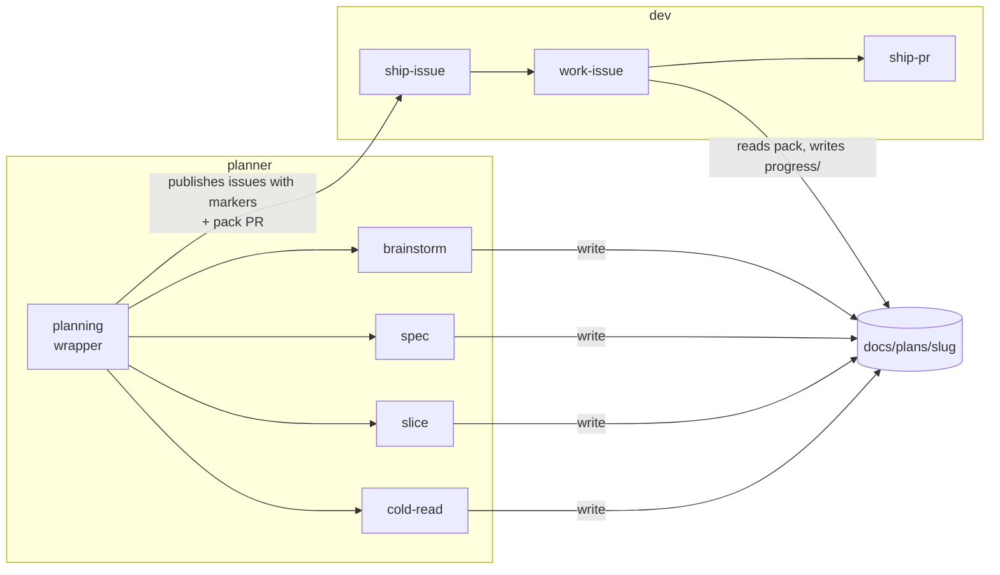
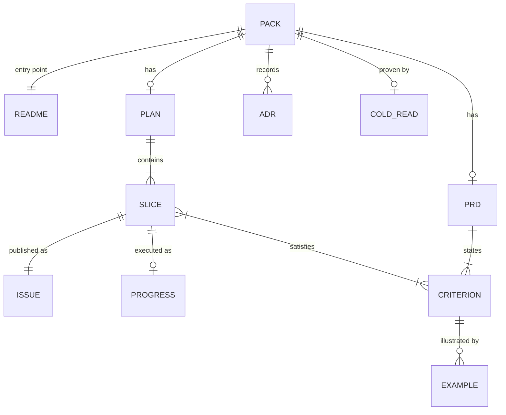
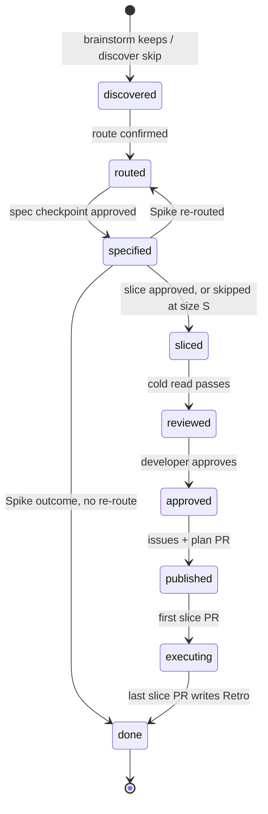
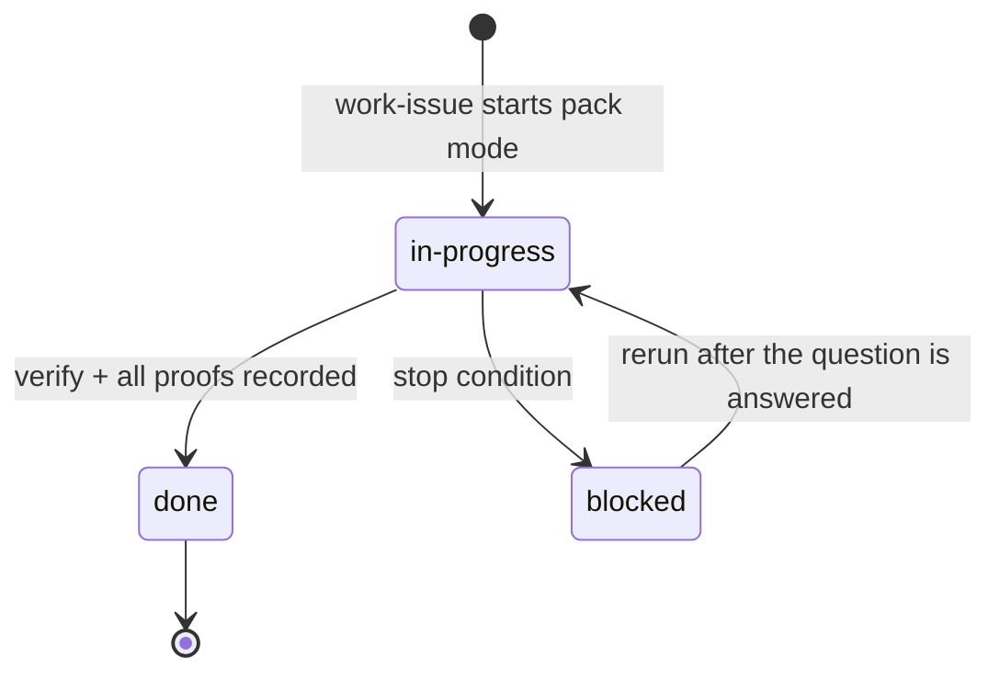
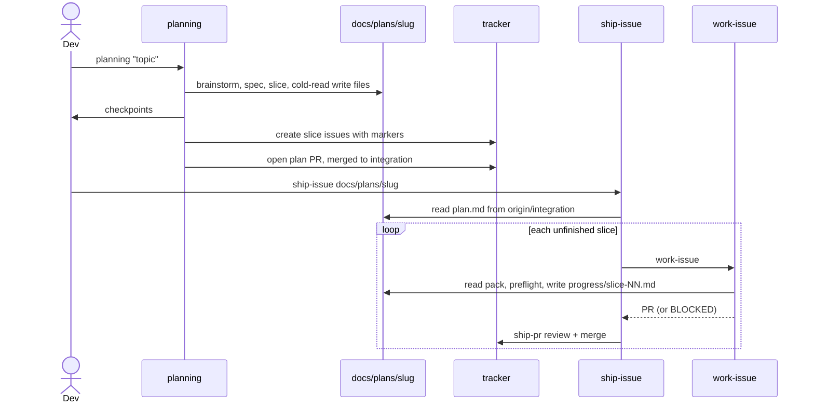

# Design

The pack format (§2–§7) is the contract between the planner skills and the executors. Slices 1–6
implement the writing side, and Slices 7–8 the reading side. Nothing here is code. Contracts are
tables and behaviour is prose.

## 1. Skill architecture



| Skill | Plugin | Status | Responsibility | Writes |
|---|---|---|---|---|
| `planning` | planner | rewritten | Wrapper: parses input, resumes, routes, holds the checkpoints, publishes | README Status, issues, pack PR |
| `brainstorm` | planner | rewritten | Discovery conversation, then proposes a route | `README.md` (Brief, Ruled out, Key insights, Open questions, Route proposed) |
| `spec` | planner | new | Writes what to build and why, scaled by route | `prd.md`, `context.md`, `design.md`, `decisions/`, `inventory.md` |
| `slice` | planner | new | Splits into ordered slices and checks the trace | `plan.md` |
| `cold-read` | planner | new | Cold review by the smallest model, then fix rounds | `cold-read.md`, edits to the pack |
| `work-issue` | dev | extended | Pack mode when a marker is present | `progress/slice-NN.md`, README Retro |
| `ship-issue` | dev | extended | Accepts a pack path | none |

Each new planner skill also runs standalone on an existing pack (for example `cold-read
docs/plans/x`), so the developer can repeat one phase without the wrapper.

**Shared references.** All templates live in `skills/planning/references/`. Sibling skills reach
them as `$CLAUDE_SKILL_DIR/../planning/references/...`, which works because they ship in the same
plugin. `dev` skills never read planner references (ADR-007): everything an executor needs is
inside the pack.

## 2. Pack layout

```text
docs/plans/<slug>/
  README.md        always
  prd.md           what and why: problem, users, goals, non-goals, measures, stories
  context.md       current-state map with citations, conventions, glossary
  design.md        architecture, contracts, invariants, one section per modifier
  decisions/ADR-NNN-<kebab>.md
  inventory.md     Migration: usages and breaking changes; Rewrite: behaviour inventory and parity
  ux.md            ui modifier at size M+: screens, flow, wireframes, states
  plan.md          slices
  progress/slice-NN.md   written by executors
  cold-read.md     written by cold-read
```

The slug is kebab-case, derived from the topic, and confirmed at Route. If it collides with an
existing folder, append `-2`. ADR numbers are per pack, start at 001, and are never reused.

**Inventory sections.**

- Migration: a **Usage sites** table with columns path:line, usage, breaking change, slice.
- Rewrite: a **Behaviour inventory** table with columns behaviour, evidence (path:line in the old
  system), criterion ID; then a **Parity matrix** with one row per behaviour and the columns old,
  new and status (`kept`, `changed`, `dropped`, with a reason for each).

**ADRs.** Every decision with at least one rejected option gets an ADR, in the shape used in this
pack's `decisions/`: Status, Context, Options with the reason for each rejection, Decision,
Consequences.

- A decision the developer stated outright is `accepted`.
- A decision the author made is `proposed`, and it is shown at the `spec` checkpoint. These are
  the "contested" ADRs.
- When the developer approves a proposed ADR, it becomes `accepted (developer, <date>)`.

## 3. Routing matrix

R = required, O = optional (write it only when it has real content), blank = absent.

| Type | README | prd | context | design | decisions | inventory | plan | Notes |
|---|---|---|---|---|---|---|---|---|
| Change | R | | | | O | | | README carries acceptance criteria and Verify; always size S |
| Bug | R | R at M+ | R | O | O | | O | README carries repro and root cause (from `debug` if run). Regression rules and examples live in the README at S, in the prd at M+ |
| Spike | R | | O | | R | | | README carries the question and a timebox; the outcome is an ADR, then re-route; has no size and no rules or examples |
| Feature | R | R | R | R at M+ | O | | R at M+ | Stories with Given/When/Then |
| Refactor | R | R | R | R | O | | R | prd replaces stories with a **behaviour-preservation contract**; Slice 1 adds characterization tests |
| Migration | R | R | R | R | R | R | R | inventory: every usage site and each breaking change mapped to a slice; rollback per slice |
| Greenfield | R | R | R | R | R | | R | context = chosen stack and conventions (seed for the new `CLAUDE.md`); Slice 1 = walking skeleton |
| Rewrite | R | R | R | R | R | R | R | inventory = behaviour inventory and parity matrix; cutover plan in design |

**Size.**

| Size | Slices | What it changes |
|---|---|---|
| S | 1 | plan.md absent; the README's acceptance criteria and Verify are the slice |
| M | 2–6 | Full set per type |
| L | 7–12 | Adds a dependency graph in plan.md |
| XL | over 12 | Split into child packs `docs/plans/<slug>-<part>/`. The parent pack is a README only, with a **Child packs** section (template variant) listing each child and its order. The wrapper writes the parent README, then plans each child as its own `planning` run whose Brief links the parent |

**Modifiers.** Each adds one `## Modifier: <name>` section to `design.md`. At size S, where there is
no design.md, the section goes in the README instead. The `ui` modifier at size M+ gets its own
`ux.md`, linked from that section, because wireframes are long.

| Modifier | The section must state |
|---|---|
| data | Schema change as expand/contract steps, backfill, deploy order, rollback |
| integration | The external contract, failure modes, timeouts and retries, how tests fake it |
| performance | Baseline with measurement command, numeric target, benchmark command |
| security | Threat model: assets, entry points, mitigations; links to `auditor` findings if any |
| ui | Screen inventory; navigation flow (Mermaid); one text wireframe per screen (`text` fence: regions, hierarchy, primary action); state table per screen (loading, empty, error, success, partial); responsive behaviour; accessibility. High-fidelity mockups are linked, never embedded. Guidance: `skills/planning/references/ux-checklist.md` |
| observability | Events logged, with levels and what must never be logged; metrics; alerts, each with a numeric threshold; how to tell in production that it works, tied to the PRD's success measures |
| public-api | Consumers, versioning, deprecation policy, compatibility tests |
| infra | Environments, flags, rollout order, rollback |

### Content sections

These are sections inside files, switched on by the route. "Stories" means the PRD has a
**Stories** section, which is true for every type with a prd except Refactor. A Refactor's
preservation contract uses the same rules-and-examples form (S-10.4).

| Section | File | Included when | What it holds |
|---|---|---|---|
| Users and jobs | prd | always with a prd | Who, plus "When …, I want …, so I can …" per user |
| Story map | prd | Feature, Greenfield, Rewrite at M+ | Journey steps left to right, stories under each step |
| Stories | prd | Feature, Greenfield, Rewrite, Migration | "As a …, I want …, so that …" plus criteria `S-NN.k` |
| Rules and examples | prd (README at size S) | whenever there are stories, a preservation contract, or Bug regression criteria | Per story: rules, each with an examples table whose columns make given, when and then explicit (a When shared by every row may sit in the column header). IDs `S-NN.k.eN`; ≥2 rows per rule, ≥1 edge or failure |
| Failure modes | prd | whenever there are stories; Bug | Failure, trigger, expected behaviour, what the user sees, criterion |
| Non-functional requirements | prd | always with a prd | One row per quality: performance, reliability, security, privacy, accessibility, observability, compatibility/portability, maintainability. Each is a measurable target or `none` |
| Assumptions | prd | always with a prd | Assumption, how to validate, what changes if false |
| Domain model | design | the work adds or changes persisted entities or core types | Mermaid `erDiagram`, with names matching the glossary |
| State machines | design | any entity with a lifecycle is touched | Mermaid `stateDiagram-v2` per entity, plus a list of illegal transitions |
| Flows | design | two or more components interact | Mermaid `sequenceDiagram` of each main flow |
| Test strategy | design | always with a design | Levels used, what each proves, fixtures and test data, the level each example is proven at |
| Pre-mortem | design | size M+ | "It failed; why?" items, each mapped to a mitigation, stop condition or risk row |

At size S, the README's Acceptance section uses the same rules-and-examples form, and a one-line
failure note replaces the Failure modes table.

**Not routed.** For a batch of independent small items, the wrapper recommends `ship-issue` and
writes nothing (S-09.3).

**Re-routing.** A route can grow at any checkpoint.

- No file is ever deleted or rewritten wholesale (S-03.4).
- New files are added.
- Inside an existing file, a section may be added or revised, and each revision is recorded in
  the README **Open questions** until the developer approves it at the next checkpoint. For
  example, a Feature re-routed to a Refactor revises the prd's Stories section into a
  behaviour-preservation contract.
- Status stays where it was. It advances only through the next approved checkpoint.
- A Spike always ends by offering a re-route.

**Optional (O) files.** The skill that owns the file proposes it at its checkpoint, giving the
content it would hold. The developer decides whether it is written.

## 4. README contract

Its sections, in order:

1. A title line.
2. A **header table** with Status, Type, Size, Modifiers, Issues, Owner and Opened.
3. **Brief.**
4. **Slice**, at size S only: Outcome, Acceptance (as rules and examples), Contracts, Stop
   conditions and Verify, with the same meaning as in §5. This is the pack's single slice. **`spec`
   writes it**, for every type at size S, Change included.
5. **Route**: type, size and modifiers, each with its one-line reason. `brainstorm` writes a
   proposed Route; the wrapper rewrites it as confirmed at the Route checkpoint.
6. **Read order.** Whichever skill adds a file to the pack also adds it here.
7. **How to execute this pack**, copied verbatim from the template. This includes the progress-file
   format (rule 7), so a `dev`-only install needs nothing from `planner` (ADR-007).
8. **Open questions.**
9. **Retro.**

`brainstorm` adds **Ruled out** and **Key insights** after Brief. An XL parent adds **Child packs**
after Brief and has no Slice section (§3).

Status always names the **last finished phase** (S-02.3). Values, in order:

| Status | Meaning | Next |
|---|---|---|
| `discovered` | Brainstorm finished and its brief kept | route |
| `routed` | Route confirmed | specify |
| `specified` | Spec files approved | slice; for a Spike, the outcome ADR (§8) |
| `sliced` | plan.md approved; at size S, passed through when `slice` is skipped (§8) | cold read |
| `reviewed` | Cold read ended with zero blocking questions | approve |
| `approved` | Developer approved for publish | publish |
| `published` | Issues exist and the pack PR is open or merged | execute |
| `executing` | At least one progress file exists | — |
| `done` | Retro written; for a Spike, the outcome ADR written with no re-route | — |

The wrapper resumes at the phase after the current Status (S-02.2).

- `executing` is written by `work-issue`, in the first slice PR that finds Status `published`
  (README rule 7).
- `done` is written by `work-issue`, in the last slice's PR (README rule 8).
- A Spike's Status goes `routed` → `specified` (question written) → `done` (outcome ADR written,
  no re-route), or back to `routed` under its new type.

## 5. Slice contract (`plan.md`)

`plan.md` opens with:

- a dependency graph in Mermaid, required at L;
- a **traceability table** mapping PRD criterion IDs to the slices that cover them. A row may group
  several IDs that share the same slices. Every ID appears at least once (S-04.4).

Optionally, a **Shared contract** section for interfaces several slices use. Then one section per
slice:

| Heading | Kind | Content |
|---|---|---|
| `## Slice N — <name>` | — | Then a line: `Issue: #… · Depends on: Slice … · Stories: S-… · Map: <story-map steps>`. Map applies only when the PRD has a Story map |
| `### Outcome` | mandatory | One or two sentences describing the observable result |
| `### Acceptance` | mandatory | PRD criterion IDs this slice satisfies, plus local criteria (IDs `N.k`). A behavioural local criterion uses Given/When/Then; a structural one (a file exists, a grep is empty) may be a plain statement whose proof is a Verify command |
| `### Contracts` | mandatory | Interfaces this slice creates or changes, as tables (name, inputs, outputs, errors, invariants), or a reference to a design.md table. Migration and Rewrite slices end it with a **Rollback:** line |
| `### Stop conditions` | mandatory | "Stop if …" bullets. Must include any preflight drift in a contract this slice depends on |
| `### Verify` | mandatory | Exact commands with expected output, plus the dry-run scenarios for behavioural criteria |
| `### Pattern to follow` | guide | `path:line` of existing work to imitate |
| `### Suggested path` | guide | Opens with: "Default route. You may deviate if every mandatory item still holds; record why." |
| `### Files` | guide | Expected create, modify and delete list |

No fenced block may hold code in a programming language (S-04.3). A fence's info string must be one
of:

- `bash` or `sh`: shell commands, meant for Verify sections;
- `mermaid`;
- `text`: trees and layouts.

An untagged fence is not allowed, because it could hide code. Check 14 enforces the info string,
and `slice` and `cold-read` enforce what is inside it.

## 6. Progress file (`progress/slice-NN.md`)

`NN` is the slice number, zero-padded to two digits. Each slice has its own file, so parallel
branches never conflict (ADR-008). This table and README rule 7 must say the same thing. The README
copy is the one executors read.

| Section | Content |
|---|---|
| Header | Status (`in-progress`, `blocked`, `done`), Issue, PR, Executor model if known, Date |
| Preflight | Citations checked and their result, one line each |
| Acceptance | Each criterion ID → how it was shown (test name, or dry-run scenario with line reference) |
| Deviations | Table: plan said / reality / why / contract affected (y/n) |
| Decisions | Choices the plan left open, and what was chosen |
| Discoveries | Things the next slice or the retro should know |
| Blocked on | Only when Status is `blocked`: the question, and which stop condition triggered |

## 7. Execution contract (`work-issue` and `ship-issue`)

### Marker

`work-issue` matches the first line of the issue body that starts with `Plan: docs/plans/`, in the
form `Plan: docs/plans/<slug> · Slice: <N>`. For packs without a plan.md (size S), `Slice: 1` refers
to the README. Matching is case-sensitive. The separator may be `·` or `|`.

A line that starts with `Plan: ` but is not a `docs/plans/` path is not a marker. Warn
`unrecognised Plan: line — legacy mode` and continue in legacy mode (S-07.1.e2).

### `work-issue` in pack mode

The table lists only what differs from legacy mode.

| Phase | Behaviour with a marker |
|---|---|
| 2 Route | Phase 2 already scans issue bodies; fetch them here if needed. Force `sequential` whenever any issue carries a marker |
| 3 Context | Resolve `{integration}` here, by the rule Phase 5 uses (the `branches.integration` lookup and its fallbacks). Phase 5 then reuses it. `git fetch origin {integration}`, then read the pack with `git show origin/{integration}:docs/plans/<slug>/<file>`: the README first, then the files in its Read order. If the README is missing there, stop: "pack docs/plans/<slug> is not on {integration}; merge its PR first". Hold `pack_context`. Read from `origin/{integration}` because that is what the branch will fork from, not the developer's working copy |
| 4 Complexity | Skip the question; map by size: S is `simple`, M is `medium`, L is `complex`. A Change is always S. XL never reaches here, because it is split into child packs |
| 6 Plan | First run **preflight** (README rule 2) against the branch's working tree, which now exists. Then the slice is the plan; display `Plan: pack slice N` |
| 7 Implement | Add the slice's stop conditions to the blocker rules |
| 8 Verify | Run the slice's Verify. Collect a proof for every acceptance ID, to be written in Phase 10 |
| 10 Commit | Write the progress file before staging: status `done`, PR field `this PR` (the PR is opened in Phase 11 and is found from the branch), with the Phase 6 preflight, the Phase 8 proofs, and deviations and decisions from Phase 7. If README Status is `published`, set it to `executing`. If this is the last slice, also write the Retro and set Status `done` (see below). Stage these files by name |
| 12 Done | Final JSON keys unchanged: `{status, pr, pr_url, branch, issues}` |

**Last slice.** Read `progress/slice-NN.md` on `origin/{integration}` for every other slice listed
in plan.md. If all of them say `done`, this is the last slice. The Retro compares `cold-read.md`
with the deviations across every progress file: what the cold read predicted, and what really
diverged.

**Blocked path.** When a stop condition triggers in Phase 6 or 7:

1. Skip Phases 8, 9 and 11.
2. Write the progress file with status `blocked` and the **Blocked on** section filled in.
3. Commit the partial work as one `wip:` commit together with the progress file, so the state
   survives a new session or machine (ADR-002). The progress file lists what is partial.
4. Push the branch.
5. Emit the final JSON with `status: "BLOCKED"` and `pr`/`pr_url` null. The key set is unchanged;
   `BLOCKED` is a new value. This applies even under `--auto`.

### `ship-issue` in pack mode

The input is a path that starts with `docs/plans/`.

1. Resolve `{integration}` by the same rule as `work-issue` Phase 5: `branches.integration`, then
   the repository default branch, then `origin/HEAD`, then `main`. Run
   `git fetch origin {integration}`.
2. Check `git ls-tree origin/{integration} -- docs/plans/<slug>/README.md`. Missing means stop
   before any slice (S-06.3).
3. Build the slice list with `git show` from `origin/{integration}`, never from the working tree:
   - When plan.md exists: one entry per `## Slice N` section, its issue number from that section's
     `Issue: #N` line, and its prerequisites from `Depends on: Slice …`.
   - At size S, with no plan.md: one entry, Slice 1, with the issue from the README Issues row.
4. Drop slices whose `progress/slice-NN.md` on `origin/{integration}` says `done`.
5. Each remaining slice is its own group, ordered by its prerequisites. A cycle stops the run, as
   it does in legacy Phase 4.
6. Run Phase 5 per group. Two changes apply in pack mode:
   - When `work-issue` returns `status: "BLOCKED"`, skip the Ship step and record state `stuck`.
   - On `stuck` or any failure, stop the whole run, as legacy Error Handling already does. No
     later slice starts, whether or not it depends on the failed one (S-06.2).
7. Add `"pack": "docs/plans/<slug>"` to the final JSON.
8. Reword the Error Handling bullet "does not touch git directly" to "changes no working tree,
   index or branch; it only fetches and reads".

Legacy input skips all of this (S-07.2).

## 8. Planning wrapper phases

**Each checkpoint lives in the skill that does the phase, and that skill sets Status only after the
developer approves.** The wrapper sequences the phases. It owns only Route, Approve, Publish and the
Discover-skip README.

**No skill ever lowers Status.** A phase skill run standalone writes its Status only when the
current Status is the one immediately before it. Otherwise it leaves Status as it is and says so.
For example, `cold-read` on a pack at `executing` appends a round but leaves Status `executing`. A
phase skill run standalone therefore behaves exactly as it does inside the wrapper, and a rejected
checkpoint never advances Status.

| # | Phase | Loads | Checkpoint (held by) | Sets Status |
|---|---|---|---|---|
| 1 | Parse input: topic, issue refs or pack path; resume if a pack path | — | — | — |
| 2 | Discover | `brainstorm` | its own conversation (`brainstorm`) | `discovered` |
| 3 | Route | — | **yes** (`planning`): type, size, modifiers, slug, each with a reason | `routed` |
| 4 | Specify | `spec` | **yes** (`spec`): PRD, then contested ADRs, then design | `specified` |
| 5 | Slice | `slice` | **yes** (`slice`) | `sliced` |
| 6 | Cold read | `cold-read` | only if blocking questions remain after 3 rounds (`cold-read`) | `reviewed` |
| 7 | Approve | — | **yes** (`planning`): slices, issue titles and labels, epic if hierarchy applies | `approved` |
| 8 | Publish | tracker commands | — | `published` |
| 9 | Done | — | — | — |

Skip rules by route:

- Size S: no `slice`. `spec` writes the README's single slice instead (§4 item 4).
- Change: `spec` writes only the README's single slice. A Change is always S.
- Spike: see below.

When the wrapper skips a phase, it advances Status to that phase's value without loading the skill.
Spike is the exception: it follows its own path, below.

**Phase 8, Publish**, in this order:

1. Create one issue per slice, in slice order. Each body holds the Outcome, the acceptance IDs with
   their text, and the marker. Size S creates one issue. Once every issue exists, edit each body to
   add its `Depends on #N` lines, so legacy ordering works too.
2. Write the issue numbers into plan.md and the README Issues row.
3. Keep the epic, hierarchy, board and Linear behaviours from the old `planning` (see `context.md`
   §2), with the epic body linking the pack README.
4. Create branch `plan/<slug>` from `origin/{integration}`. The untracked pack folder carries across
   a branch switch unchanged. Stage the pack by name, commit, push, and open a PR to
   `{integration}`.
5. If `ship-pr` appears among the session's available skills, offer to run it on that PR. Otherwise
   tell the developer to merge it before executing.

Phase 9 displays `Next: ship-issue docs/plans/<slug>`.

**Discover skip.** If the input already states problem, outcome and scope (for example an issue
with acceptance criteria), the wrapper asks once: "Skip discovery?" On yes, the wrapper writes the
README from the template itself, with the Brief taken from the input, and sets `discovered`.

**Who writes the README parts:**

| Part | Written by |
|---|---|
| Owner (`git config user.name`), Opened (today) | Whichever writes the README first: `brainstorm` or the Discover skip |
| Type, Size and Modifiers rows, and a **Route** section giving the reason for each | Proposed by `brainstorm`; confirmed and rewritten by the wrapper at the Route checkpoint |
| Issues row | Publish |

**Slug.** `brainstorm` proposes the slug, and creates the folder only when the developer keeps the
brainstorm (S-01.2). At Route the developer may change it. The pack is still untracked then, so the wrapper renames the folder. After Publish the slug is
fixed.

**Resume at or past `published`:**

- `published`: display `Next: ship-issue docs/plans/<slug>`.
- `executing`: display each slice's progress status, then the same Next line.
- `done`: display the Retro.

In every case, stop there.

**Spike and Bug.** At Route:

- Bug with an unknown cause: recommend `debug`, and continue with its report folded into the README.
- Spike:
  1. `spec` writes the question and timebox into the README and sets `specified`.
  2. The wrapper stops; a Spike publishes no issues. The developer runs the spike.
  3. On resume, `spec` writes the outcome ADR.
  4. The wrapper offers a re-route: the new type returns Status to `routed`, and no re-route sets
     `done`. Slice, cold read, approve and publish are never run for the Spike itself.

## 9. Risks and assumptions

| # | Risk or assumption | Mitigation |
|---|---|---|
| R1 | The Agent `model` override is not available in Codex or Antigravity | `cold-read` falls back to a fresh subagent on the default model and records the model used. With no subagent at all, it tells the developer to run `cold-read` in a new session |
| R2 | A pack PR adds a merge step before execution | Accepted (ADR-010); `ship-pr` makes it one command |
| R3 | A dry run is weaker evidence than a test | Accepted for this repo; recorded per ID so a reviewer can check it |
| R4 | Issue bodies drift from the pack | The pack wins. `work-issue` treats the issue body as a summary when a marker exists; issue comments still override scope, as in `ship-issue` Phase 2 |
| R5 | Stop conditions under `--auto` may stop `ship-issue` runs more often | Intended; the progress file records why |
| R6 | Old `.ai/session/` content on users' machines | Ignored; nothing reads it any more |

## 10. Domain model



## 11. State machines

### Pack (README Status)



Illegal transitions:

- Any move to an earlier state, except the Spike re-route `specified → routed`. No skill lowers
  Status (§8).
- Skipping a state, except the skips by route in §8. Those still pass through each skipped value,
  at the moment of the skip.
- `sliced → approved` without `reviewed`. Publish needs a passed cold read.

### Slice (progress file Status)



Illegal: `blocked → done` without passing through `in-progress`, and `done` with any acceptance
ID or example row lacking a proof.

## 12. Main flow



## 13. Test strategy

This repo has no test runner, so there are two levels:

| Level | Proves | How | Fixtures |
|---|---|---|---|
| Structural | Format and registry invariants: checks 1–14, and the removal greps in each slice's Verify | `eval "$(jq -r .verify.test .hivrr.json)"` plus the slice's grep commands | The repo itself; synthetic packs in the scratchpad for check 14's negative test |
| Dry run | Behaviour: every example row in `prd.md` | Read the changed skill as an executor, against the row's Given, and record the phase and line that produces its Then | The example rows, plus this pack itself as a real input |

Every example row is proven at the dry-run level unless its Then is a check message (S-04.3.e1 and
e2), which are proven structurally. **Every row is proven in the slice that owns its criterion**
(plan.md Traceability). The dry-run lists in each slice's Verify are a minimum, not the whole set.
Synthetic fixtures go in a temporary directory outside the repository, never committed. The first real pack after release is the integration test; its
retro (S-08.2) is the evidence.

## 14. Pre-mortem

It's six months later and nobody uses the new planner. Why?

| # | Failure story | Maps to |
|---|---|---|
| P1 | Too many checkpoints; the developer abandons the run halfway | Assumption 3 in the PRD; resume (S-02.2) keeps partial work |
| P2 | Packs bloat: every section written for every route | Content-section triggers (§3); cold read flags sections nobody needs |
| P3 | Executors ignore the guide/mandatory split and rewrite the design | Stop conditions plus deviations recorded; the retro measures it |
| P4 | Packs go stale between publish and execution | Preflight (README rule 2); the pack is read from integration |
| P5 | The cold read is skipped "to save time" | Publish requires `reviewed` (§11 illegal transitions) |
| P6 | `dev` and `planner` drift apart on the pack format | ADR-007: rules travel in each pack; executors never read planner files |
| P7 | Slices too large for one PR, so reviews get rubber-stamped | `slice` 4.1 sizing; the stop condition at more than 12 slices |
