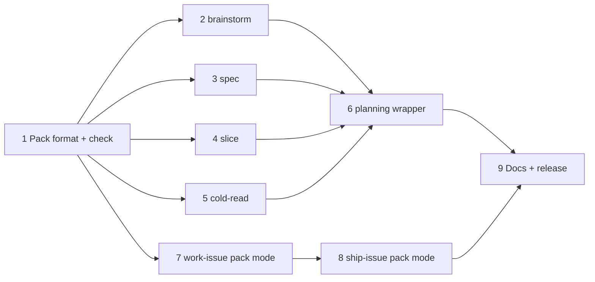

# Plan — Planning redesign

Each slice is one issue and one PR against `main`. Every slice must leave `structural checks pass`
green (see `context.md` §5), so a slice that adds a skill also registers it.

## Dependency graph



Slices 2, 3, 4, 5 and 7 are independent in logic once Slice 1 merges, but not in merges. Slices
3, 4 and 5 each edit the same planner lines in `marketplace.json`, `CLAUDE.md` and `README.md`.
Merge them in numeric order, and rebase each on the one before.

## Traceability

| Criterion | Slices |
|---|---|
| S-01.1, S-01.2, S-01.3 | 2 |
| S-02.1, S-02.2, S-02.3 | 6 |
| S-03.1 | 1, 3 |
| S-03.2 | 1, 3, 6 |
| S-03.3 | 3 |
| S-03.4 | 3, 6 |
| S-03.5 | 3, 6 |
| S-04.1 | 1, 2 |
| S-04.2 | 3, 4 |
| S-04.3 | 1, 4, 5 |
| S-04.4 | 4 |
| S-05.1, S-05.2, S-05.4 | 5 |
| S-05.3 | 5, 6 |
| S-06.1, S-06.2, S-06.3 | 8 |
| S-07.1 | 7 |
| S-07.2 | 8 |
| S-07.3 | 7, 9 |
| S-08.1, S-08.2 | 7 |
| S-09.1, S-09.2, S-09.3, S-09.4 | 6 |
| S-10.1, S-10.2, S-10.4 | 1, 3 |
| S-10.3 | 1, 7 |
| S-11.1, S-11.2, S-11.3, S-11.4 | 1, 3 |
| S-11.5 | 3, 4 |
| S-12.1, S-12.2 | 1, 3 |

Example rows (`S-NN.k.eN`) follow their criterion's slices.

## Shared contract: phase-skill completion

Every planner phase skill (`brainstorm`, `spec`, `slice` and `cold-read`) ends with a single JSON
object as its entire final response, like `work-issue` does. The wrapper reads only these fields.

| Field | Type | Values |
|---|---|---|
| `status` | string | `<SKILL> COMPLETE`, or one of the skill-specific values below |
| `pack` | string or null | `docs/plans/<slug>`, or null only for `BRAINSTORM DISCARDED` |
| `pack_status` | string or null | The README Status after the run (`design.md` §4); null when the path has no README |

Skill-specific extra fields:

- `brainstorm`: `route` = `{type, size, modifiers[], slug}`. `status` may be `BRAINSTORM DISCARDED`.
- `spec`: `files` = paths written or extended. `status` may be `SPEC STOPPED`.
- `slice`: `slices` = count. `status` may be `SLICE STOPPED`.
- `cold-read`: `model` (null when no reader ran), `rounds`, `blocking` (count remaining). `status`
  may be `COLD READ BLOCKED` or `COLD READ STOPPED`.

Amended by Slice 6 on 2026-11-14: the null `pack_status`, the three `STOPPED` values and the null
`model` were recorded as contract deviations by Slices 2–5 and accepted by the orchestrator. The
wrapper treats every `STOPPED` value as a stop and shows its reason.

---

## Slice 1 — Pack format, templates, and the pack check

Issue: #207 · Depends on: none · Stories: S-03, S-04, S-10, S-11, S-12 · Map: Specify, Prove

### Outcome
`skills/planning/references/` holds the canonical pack format and one template per pack file. A new
structural check guards every pack in `docs/plans/`.

### Acceptance
- **S-03.1** (format side): `pack-format.md` contains the routing matrix, size table and modifier
  table from `design.md` §3, unchanged in meaning.
- **S-03.2** (format side): the README template has the size-S **Slice** section (Outcome,
  Acceptance as rules and examples, Contracts, Stop conditions, Verify) and the **Route** section,
  in the order of `design.md` §4.
- **S-04.1** (template side): `templates/README.md` contains **How to execute this pack** with the
  eight rules from this pack's README, with `planning-redesign` replaced by `<slug>`.
- **S-04.3** (guard): a new 14th check reports:
  - `PACK NO README {dir}` for any directory directly under `docs/plans/` without `README.md`;
  - `PACK CODE FENCE {file}:{line}` for any opening fence in `docs/plans/**/*.md` whose info
    string is not exactly `bash`, `sh`, `mermaid` or `text`. An empty info string is reported too
    (`design.md` §5).

  An opening fence is a line that **starts** with three backticks, outside any open fence. A
  mention of backticks mid-line is not a fence.
- **S-10.1, S-10.2, S-10.4, S-11.1–S-11.4** (template side): `templates/prd.md` and
  `templates/design.md` contain every content section in `design.md` §3, Content sections, each
  headed by its "included when" trigger.
- **S-10.3** (template side): `templates/README.md` rule 4 and rule 7 name example IDs, as this
  pack's README does.
- **S-12.1, S-12.2** (reference side): `ux-checklist.md` is restructured into the `ui` modifier's
  six parts, and `pack-format.md` defines the `observability` modifier.
- **1.1** Given check 14's lines run with the working directory set to a scratch directory holding
  `docs/plans/x/README.md`, when that README contains a fence tagged python, the check prints
  `PACK CODE FENCE`. When it contains an untagged fence, the check also prints it. Run against this
  repository, the check prints nothing.

### Contracts

| Artifact | Path | Must contain |
|---|---|---|
| Format spec | `skills/planning/references/pack-format.md` | `design.md` §2–§6 restated as the normative reference for planner skills: layout, inventory and ADR shape, routing, README contract and Status values, slice contract, progress contract. From §7 take **only** the Marker subsection; executor behaviour belongs to Slices 7 and 8 |
| Templates | `skills/planning/references/templates/{README,prd,context,design,adr,plan,inventory,progress,cold-read}.md` | Section skeletons with one-line guidance per section, and no example code. **README** has the size-S Acceptance and Verify sections, marked "size S only". **README** also has a **Child packs** section, marked "XL parent only". **progress** follows
`design.md` §6. **cold-read** has a header (model, rounds, final result) and one section per round: questions table (id, blocking y/n, file, gap, resolution), contradictions, citations checked. **inventory** follows `design.md` §2, Inventory sections. **adr** follows `design.md` §2, ADRs. **ux** (new, tenth template) holds the `ui` modifier's parts for size M+ |
| Check 14 | the fenced block in `docs/verification.md` | Messages exactly as in Acceptance; read-only; prints nothing when it passes |
| Check count | `CLAUDE.md:215` sentence | "Fourteen checks", and the new check named in the list |

### Stop conditions
- Stop if check 14 cannot be written without a script file on disk. The script policy in
  `CLAUDE.md` forbids shipping one.
- Stop if any of the 13 existing checks needs changing to make room. That is out of scope.

### Verify
Run the structural checks:

```bash
eval "$(jq -r .verify.test .hivrr.json)"
```

Expected: `structural checks pass`.

Then the synthetic negative test for 1.1, run in the scratchpad and never committed. Copy check 14's
lines out of the fence into a scratch shell file. `cd` into a scratch directory that holds a
synthetic `docs/plans/x/README.md`, then run that file with `bash`. Do this once with a python fence
and once with an untagged fence; expect `PACK CODE FENCE` both times. Use a temporary directory
outside the repo.

The loader ends the verify block at any line that starts with three backticks. Check 14 must
therefore build its fence pattern with `printf`, as the existing loader does, and never contain a
literal one. When `docs/plans/` does not exist, check 14 prints nothing.

### Pattern to follow
- Check style: `docs/verification.md`, check 13 at line 156 (loop, `echo` message, no exit code).
- Read the mechanics notes after the fence: test detection logic against synthetic input first.
- Reference-file tone: `skills/init/references/config.md`.
- Content-section shapes: this pack's `prd.md` (Story map, Rules and examples, Failure modes,
  Non-functional requirements, Assumptions) and `design.md` §10–§14.

### Suggested path
Default route. You may deviate if every mandatory item still holds; record why.

1. Write `pack-format.md` from `design.md` §2–§7.
2. Write the templates. Derive `templates/README.md` from this pack's README.
3. Add check 14 and update the CLAUDE.md sentence.
4. Run the negative test, then the full checks.

### Files
- Create: `skills/planning/references/pack-format.md`
- Create: `skills/planning/references/templates/` with ten files (including `ux.md`)
- Modify: `skills/planning/references/ux-checklist.md`
- Modify: `docs/verification.md`
- Modify: `CLAUDE.md`

---

## Slice 2 — Rewrite `brainstorm`

Issue: #208 · Depends on: Slice 1 · Stories: S-01, S-04 · Map: Think

### Outcome
`brainstorm` is a file-backed discovery conversation. It ends by proposing a route and, if the
developer keeps it, writing the pack README.

### Acceptance
- **S-01.1**
- **S-01.2**
- **S-01.3**
- **S-04.1** (brainstorm writes the README from the template, so the execution rules are present)
- **2.1** Given a pack path whose README Status is `discovered`, when `brainstorm` runs on it, it
  re-opens the conversation from the saved Brief and Open questions, and does not start from a
  blank page.

### Contracts
- **Input:** a topic, or nothing (open session), or `docs/plans/<slug>`.
- **Output:** the phase-skill completion JSON (see Shared contract), with `route`.
- **README sections written:** Brief, Ruled out, Key insights, Open questions and Route (proposed),
  plus the template's fixed sections. Owner comes from `git config user.name` and Opened is today.
  Status is set to `discovered`.
- **Slug:** proposed here, and the folder `docs/plans/<slug>/` is created here (`design.md` §8,
  Slug).
- **Phases** are numbered 1..N per check 7.

### Stop conditions
- Stop if keeping the Phase 4–5 conversational guidance (`context.md` §2) conflicts with the file
  output. Report it rather than dropping the guidance.

### Verify
Run the structural checks (expected `structural checks pass`), then:

```bash
grep -nE 'SESSION_UUID|session/\{|CONTAINER_MODE|question\.json|memory' skills/brainstorm/SKILL.md
```

Expected: no output, which proves S-01.3.

Dry runs to record against IDs:

- (a) A topic, kept: proves S-01.1 and S-04.1.
- (b) A topic, discarded: proves S-01.2.
- (c) Resume from `discovered`: proves 2.1.

### Pattern to follow
- Keep the conversational guidance nearly verbatim:
  - `skills/brainstorm/SKILL.md:133-144` (open the conversation, first questions);
  - `:189-202` (iterate, challenge assumptions, stay in thinking mode).

  Within 133–220, **delete** the Interactivity Model's container-mode half (145–185; keep only the
  live-terminal sentence) and "Incremental Memory Updates" (204–220). Those deletions are what
  S-01.3 requires, not a deviation.
- The JSON final response shape follows `skills/work-issue/SKILL.md:526-539`.

### Suggested path
Default route. You may deviate if every mandatory item still holds; record why.

1. Delete Phase 1 and every memory and container block.
2. Add a resume branch to Parse.
3. Turn Wrap Up into: propose a route with reasons (from `pack-format.md`), ask keep or discard,
   write the README from the template.
4. Emit the JSON.

### Files
- Modify: `skills/brainstorm/SKILL.md`

---

## Slice 3 — New `spec` skill

Issue: #209 · Depends on: Slice 1 · Stories: S-03, S-10, S-11, S-12 · Map: Decide the shape, Specify

### Outcome
`spec` writes the what-and-why files a route requires, each behind a developer checkpoint, and sets
Status `specified`.

### Acceptance
- **S-03.1** (applied side): given each type that admits size M (Bug, Feature, Refactor,
  Migration, Greenfield, Rewrite), the files `spec` writes are exactly that row's R entries other
  than README and plan, plus any O files the developer accepts. Change and Spike have no size M and
  are covered by S-03.2 and S-03.5.
- **S-03.3**
- **S-03.4**: given a pack re-routed from Feature to Rewrite, `spec` adds `inventory.md` and
  decisions, deletes no file, and revises existing sections only as `design.md` §3 Re-routing
  allows.
- **S-03.5** (spec side): for a Spike, `spec` writes the question and timebox to the README. On
  resume after the spike, it writes the outcome ADR.
- **3.1** `context.md` produced by `spec` cites `path:line` for every API, pattern and convention it
  names. This replaces the old "Allowed APIs" list.
- **3.2** Checkpoints happen in order: PRD (stories and acceptance), then each `proposed` ADR
  (`design.md` §2, ADRs), then design. A rejected checkpoint leaves Status unchanged.
- **3.3** Every file `spec` adds is listed in the README Read order.
- **3.4** Given any route at size S, Change included, `spec` writes the README's single slice
  (`design.md` §4 item 4), and S-04.2 holds for it.
- **S-03.2** (spec side): a Change produces README-only, with the single slice.
- **S-10.1**, **S-10.2**, **S-10.4** (applied side): `spec` writes rules and examples, failure
  modes, NFRs and assumptions as the content-section triggers require. A rule with no edge or
  failure example is completed or questioned (S-10.1.e1).
- **S-11.1**, **S-11.2**, **S-11.3**, **S-11.4** (applied side): design.md gets the test strategy,
  state machines, domain model, flows and pre-mortem exactly when their triggers apply, and none
  when they don't (S-11.3.e1).
- **S-11.5** (prd side): a story map for Feature, Greenfield and Rewrite at M+.
- **S-12.1**, **S-12.2**: the `ui` modifier yields `ux.md` at M+ (a section at S); `observability`
  yields its section.

### Contracts
- **Input:** `docs/plans/<slug>` with Status `routed` (or later, for re-route).
- **Output:** the phase-skill completion JSON, with `files`.
- **Templates:** read from `$CLAUDE_SKILL_DIR/../planning/references/templates/`.
- **Modifiers:** each modifier on the route adds a `## Modifier: <name>` section to design.md.
  `ui` uses `$CLAUDE_SKILL_DIR/../planning/references/ux-checklist.md`.
- **Authority:** after Slice 1, `skills/planning/references/pack-format.md` is the format of record
  for every future pack. This pack's `design.md` records the design as planned.
- **Registration:** `spec` is added to `planner` in `marketplace.json`, to the CLAUDE.md
  `**Skills:**` line, to README.md's planner table, and as `.agents/skills/spec`.

### Stop conditions
- Stop if the route asks for a file the routing matrix does not define. Report it as a format gap;
  don't invent a file.

### Verify
Run the structural checks; expected `structural checks pass`.

Dry runs to record against IDs:

- (a) Feature M: S-03.1.
- (b) Rewrite M: S-03.3.
- (c) Feature re-routed to Rewrite: S-03.4.
- (d) Spike before and after: S-03.5.
- (e) A context.md with every named API cited: 3.1.
- (f) A rejected PRD checkpoint: 3.2.
- (g) Each example row under S-10, S-11 and S-12.

### Pattern to follow
- The research guidance in `skills/planning/SKILL.md:102-121` (read the code first, cite exact
  paths).
- This pack's `prd.md`, `context.md`, `design.md` and `decisions/` as worked examples.

### Suggested path
Default route. You may deviate if every mandatory item still holds; record why.

1. Phases: read route → research → PRD → decisions → design and modifiers → inventory if required
   → set Status → JSON.

### Files
- Create: `skills/spec/SKILL.md`
- Create: `.agents/skills/spec` (symlink)
- Modify: `.claude-plugin/marketplace.json`
- Modify: `CLAUDE.md`
- Modify: `README.md`

---

## Slice 4 — New `slice` skill

Issue: #210 · Depends on: Slice 1 · Stories: S-04, S-11 · Map: Specify

### Outcome
`slice` writes `plan.md`: ordered, vertical slices that each meet the slice contract, with a
traceability table that covers every criterion. It sets Status `sliced`.

### Acceptance
- **S-04.2**
- **S-04.3** (author side): before the checkpoint, `slice` rejects its own draft if any fence
  breaks the allowed list.
- **S-04.4**: before the checkpoint, every PRD criterion ID is listed by at least one slice. Any
  gap is fixed or shown to the developer.
- **4.1** Every slice is sized to one PR: at most `size:l` in `skills/init/references/labels.md`
  terms (1–2 days of work). That is a label size, not the pack size L (7–12 slices). A larger slice
  is split.
- **S-11.5** (plan side): when the PRD has a story map, every slice header names its `Map:` steps,
  and every map step is touched by at least one slice.
- **4.2** For Refactor, Slice 1 adds characterization tests. For Greenfield, Slice 1 is a walking
  skeleton. For Migration and Rewrite, every slice names its rollback.

### Contracts
- **Input:** `docs/plans/<slug>` with Status `specified`.
- **Output:** the phase-skill completion JSON, with `slices`.
- **plan.md** follows `design.md` §5 exactly. Issue numbers are left as `#` for Publish to fill in.
- **Registration:** the same four places as Slice 3, for `slice`.

### Stop conditions
- Stop if more than 12 slices result. Report "XL: split into child packs" (S-09.4) rather than
  writing them.

### Verify
Run the structural checks; expected `structural checks pass`. Check 14 also proves S-04.3 for this
repo's packs.

Dry runs to record against IDs:

- (a) This pack's PRD: S-04.2 and S-04.4.
- (b) Refactor and Greenfield routes: 4.2.
- (c) An oversized slice: 4.1.

### Pattern to follow
This pack's `plan.md` is the worked example.

### Suggested path
Default route. You may deviate if every mandatory item still holds; record why.

1. Phases: read pack → draft slices → dependency graph → traceability and fence self-check →
   checkpoint → set Status → JSON.

### Files
- Create: `skills/slice/SKILL.md`
- Create: `.agents/skills/slice` (symlink)
- Modify: `.claude-plugin/marketplace.json`
- Modify: `CLAUDE.md`
- Modify: `README.md`

---

## Slice 5 — New `cold-read` skill

Issue: #211 · Depends on: Slice 1 · Stories: S-04, S-05 · Map: Prove

### Outcome
`cold-read` proves a pack complete by having the smallest available model read it cold, then fixing
the pack until no blocking questions remain. The result is recorded in `cold-read.md`.

### Acceptance
- **S-05.1**
- **S-05.2**
- **S-05.3** (skill side): after 3 rounds with blocking questions remaining, it returns
  `COLD READ BLOCKED` and does not set `reviewed`.
- **S-05.4**
- **S-04.3** (reader side): the reader prompt asks it to report any code in the pack as a blocking
  defect.
- **5.1** The reader prompt contains no summary of the pack, only its path, the instruction to read
  the README first, and the report format. This keeps the read cold.

### Contracts
- **Input:** `docs/plans/<slug>` with Status `sliced`, or any Status when run standalone.
- **Output:** the phase-skill completion JSON, with `model`, `rounds` and `blocking`.
- **Reader report** (required sections): Restated outcome; Restated design in five sentences or
  fewer; Questions (each: blocking yes/no, file, what is missing); Contradictions; Citations
  spot-checked (each: path, holds yes/no).
- **Model choice:** use the Agent tool's `model: haiku` where available. Otherwise use the default
  model and record it (R1 in `design.md` §9).
- **Reader:** a **new** subagent every round, never a continued one, because a reader that has seen
  the pack before is not cold. Use `subagent_type: Explore` where available, which is read-only by
  tool set. Frontmatter `allowed-tools` does not scope a spawned subagent.
- **Reader prompt:** the pack path; "read README first and follow its Read order"; "spot-check at
  least 8 citations"; one or more slices to think through as if implementing them (a different set
  each round until all are covered); the report format above. Nothing else.
- **`cold-read.md`:** append a `## Round N` section per round, and never overwrite earlier rounds.
- **Developer-only questions:** a blocking question that only the developer can answer (a product
  decision or an ADR confirmation) is asked at once. If it stays unanswered, it counts as
  remaining blocking, and the run returns `COLD READ BLOCKED`.
- **Status:** set `reviewed` only when the current Status is `sliced` (`design.md` §8, no skill
  lowers Status).
- **Registration:** the same four places as Slice 3, for `cold-read`.

### Stop conditions
- Stop if a blocking question can be resolved only by the developer (a product decision). Surface
  it immediately rather than spending rounds on it.

### Verify
Run the structural checks; expected `structural checks pass`.

Dry run: run `cold-read docs/plans/planning-redesign`, which proves S-05.1, S-05.2, S-05.4 and 5.1.
The `cold-read.md` already in this pack is the hand-run precedent.

### Pattern to follow
- The subagent dispatch shape in `skills/planning/references/plan-review.md` (to be deleted in
  Slice 6; read it before then).
- This pack's `cold-read.md`: the round format, and the kind of findings to expect.

### Suggested path
Default route. You may deviate if every mandatory item still holds; record why.

1. Phases: dispatch reader → classify → fix pack → repeat (cap 3) → write `cold-read.md` → set
   Status → JSON.

### Files
- Create: `skills/cold-read/SKILL.md`
- Create: `.agents/skills/cold-read` (symlink)
- Modify: `.claude-plugin/marketplace.json`
- Modify: `CLAUDE.md`
- Modify: `README.md`

---

## Slice 6 — Rewrite `planning` as the wrapper

Issue: #212 · Depends on: Slices 2, 3, 4, 5 · Stories: S-02, S-03, S-05, S-09 · Map: Decide the shape, Hand off

### Outcome
`planning` walks the developer from a topic to published issues and a pack PR, composing the four
phase skills, and resumes from any README Status.

### Acceptance
- **S-02.1**
- **S-02.2**
- **S-02.3**
- **S-03.2**: a Change route skips `slice`; `spec` writes the README's single slice, and Publish
  creates one issue.
- **S-03.4** (wrapper side): re-route at the Route checkpoint is allowed.
- **S-03.5** (wrapper side): a Spike skips slice and cold read, and after resume offers to re-route.
- **S-05.3** (wrapper side): `COLD READ BLOCKED` shows the questions and does not publish.
- **S-09.1**
- **S-09.2**
- **S-09.3**
- **S-09.4**
- **6.1** Publish follows `design.md` §8 Phase 8 steps 1–5 in order. Every issue body holds the
  marker and a `Depends on #N` line.
- **6.2** The epic, hierarchy, board, label and Linear behaviours of the old skill survive,
  unchanged in effect (`context.md` §2, "Keep from `planning`").
- **6.3** `blueprint.md`, `plan-writing.md` and `plan-review.md` are deleted, and nothing references
  them.
- **6.4** Given input that already states problem, outcome and scope, the wrapper asks once
  whether to skip discovery (`design.md` §8 **Discover skip**). On yes it writes the README itself
  (Brief, Owner, Opened), sets Status `discovered`, and does not load `brainstorm`.

### Contracts
- **Phases:** the 9 rows of `design.md` §8.
- **Input:** a topic; `#N …` issue refs (folded into the Brief); or `docs/plans/<slug>`.
- **Final display:** pack path, Status, issues created, pack PR URL, and
  `Next: ship-issue docs/plans/<slug>`.

### Stop conditions
- Stop if preserving 6.2 needs behaviour that conflicts with a pack ADR. Report which.

### Verify
Run the structural checks; expected `structural checks pass`. Then:

```bash
grep -rnE 'SESSION_UUID|session/\{|CONTAINER_MODE|plan-only|blueprint\.md|plan-writing\.md|plan-review\.md' skills/planning
```

Expected: no output.

Dry runs to record against IDs:

- (a) A feature topic end to end, read through the skill without making tracker calls. List each
  tracker and git command the skill would issue, in order: S-02.1, 6.1.
- (b) Resume from `specified`: S-02.2.
- (c) Stop at Slice checkpoint: S-02.3.
- (d) Change route: S-03.2.
- (e) Spike: S-03.5.
- (f) Bug: S-09.2.
- (g) Batch: S-09.3.
- (h) XL: S-09.4.

### Pattern to follow
- Wrapper structure: `skills/ship-issue/SKILL.md` (Bootstrap, composing skills by "Load the X
  skill", reading their final JSON).
- Tracker behaviour to carry over: `skills/planning/SKILL.md:187-234` and `:488-559`.

### Suggested path
Default route. You may deviate if every mandatory item still holds; record why.

1. Write the new skill beside the old one.
2. Port the tracker sections.
3. Delete the old phases and the three references.

### Files
- Rewrite: `skills/planning/SKILL.md`
- Delete: `skills/planning/references/blueprint.md`
- Delete: `skills/planning/references/plan-writing.md`
- Delete: `skills/planning/references/plan-review.md`

---

## Slice 7 — `work-issue` pack mode and session removal

Issue: #213 · Depends on: Slice 1 · Stories: S-07, S-08, S-10 · Map: Execute, Learn

### Outcome
`work-issue` executes a pack slice when the issue carries a marker, and writes its progress file
and, for the last slice, the retro. Without a marker it behaves as before. All session-memory code
is gone.

### Acceptance
- **S-07.1**
- **S-07.3**, for `skills/work-issue/SKILL.md` only. Slice 9 covers the rest of `dev`
  (`core:70`).
- **S-08.1**
- **S-08.2**
- **S-10.3**: Phase 8 collects a proof per example row under the slice's criteria, as well as per
  criterion.
- **7.1** Every pack-mode block opens with a skip-when-no-marker sentence (ADR-011).
- **7.2** Given pack mode under `--auto`, when a stop condition triggers, then the run follows
  `design.md` §7 **Blocked path**: the partial work and the progress file are committed together as
  one `wip:` commit, the branch is pushed, no PR is opened, and the JSON status is `BLOCKED`.
- **7.3** The final JSON keys are unchanged: `{status, pr, pr_url, branch, issues}`. `BLOCKED` is
  the only new `status` value.

### Contracts
- **Behaviour:** `design.md` §7, "`work-issue` in pack mode", row by row, including **Last slice**
  and **Blocked path**.
- **Pack README writes at run time:** Status `executing` and `done`, and the Retro. These are
  edits to the pack being executed, not to any skill file.
- **Marker syntax:** `design.md` §7, Marker.
- **Progress file:** the format comes from the executed pack's README rule 7, never from a planner
  reference (ADR-007).
- **The blocked path's JSON** uses `status: "BLOCKED"`, with `pr` and `pr_url` null. `ship-issue`
  must treat it as `stuck` (Slice 8).

### Stop conditions
- Stop if removing the session sections changes any legacy display or JSON beyond the
  `Session …` lines that section produced.
- Stop if `wave` needs editing. ADR-008 says it must not.

### Verify
Run the structural checks; expected `structural checks pass`. Check 4 must still pass: the
`work-issue` and `work-pr` verify procedures are not duplicated. Then:

```bash
grep -nE 'SESSION_UUID|session/\{|\.ai/session|memory' skills/work-issue/SKILL.md
```

Expected: no output.

Dry runs to record against IDs:

- (a) A plain issue: S-07.1, 7.3.
- (b) A marked slice that passes: S-08.1.
- (c) The last slice: S-08.2.
- (d) A stop condition under `--auto`: 7.2.

### Pattern to follow
- Conditional-section style: the "Skip this entire section when …" opening at
  `skills/work-issue/SKILL.md:231`.

### Suggested path
Default route. You may deviate if every mandatory item still holds; record why.

1. Delete lines 134–199, 445–449 and 480–524 (re-check them first).
2. Add pack blocks to Phases 2, 3, 4, 6, 7, 8 and 10.
3. Add `BLOCKED` to Error Handling.

### Files
- Modify: `skills/work-issue/SKILL.md`

---

## Slice 8 — `ship-issue` pack mode

Issue: #214 · Depends on: Slice 7 · Stories: S-06, S-07 · Map: Execute

### Outcome
`ship-issue docs/plans/<slug>` ships every unfinished slice in plan order. Legacy issue-number
input is unchanged.

### Acceptance
- **S-06.1**
- **S-06.2**, including a `work-issue` `BLOCKED` result, which skips the Ship step, is recorded as
  `stuck` and stops the run.
- **S-06.3**
- **S-07.2**
- **8.1** `ship-issue` still changes no working tree, index or branch. Only `git fetch` (which
  updates remote-tracking refs only), `git ls-tree` and `git show` are added.

### Contracts
- **Behaviour:** `design.md` §7, "`ship-issue` in pack mode", steps 1–8.
- **Final JSON:** gains `"pack"` only in pack mode. `state` gains no new values; `BLOCKED` maps
  to `stuck`.

### Stop conditions
- Stop if pack ordering would need `ship-issue` to write to the pack. It must not.

### Verify
Run the structural checks; expected `structural checks pass`.

Dry runs to record against IDs:

- (a) A pack whose plan PR has not merged: S-06.3.
- (b) A pack with slices 1 done and 2–3 pending: S-06.1.
- (c) Slice 2 blocked: S-06.2.
- (d) Plain issue numbers: S-07.2.

### Pattern to follow
The existing Phase 4 cycle and stop rules at `skills/ship-issue/SKILL.md:91-109`.

### Suggested path
Default route. You may deviate if every mandatory item still holds; record why.

1. Add pack input to Phase 1.
2. Add the pack branch to Phases 3 and 4.
3. Add the `BLOCKED` mapping in Phase 5.
4. Add the `pack` field in Phase 6.

### Files
- Modify: `skills/ship-issue/SKILL.md`, including the Error Handling bullet reworded per
  `design.md` §7 step 8

---

## Slice 9 — Docs, descriptions, release

Issue: #215 · Depends on: Slices 6, 8 · Stories: S-07 · Map: Hand off

### Outcome
Every document describes the new planner accurately, the last session-memory reference is gone,
and v1.4.0 is released.

### Acceptance
- **S-07.3**: `skills/core/SKILL.md:70` no longer names `.ai/session/`, and the `.gitignore`
  comment no longer mentions memory fallback.
- **9.1** The `planner` description is one sentence with no terminal period. It is identical in
  `marketplace.json` and `CLAUDE.md` (check 5), and names plan packs and the cold read.
- **9.2** `README.md`'s planner table and Overview row describe every planner skill: `init`,
  `session`, `brainstorm`, `planning`, `spec`, `slice` and `cold-read`.
- **9.3** `RELEASE-NOTES.md` has a v1.4.0 entry covering ADRs 002, 003, 008 and 011 as
  user-visible behaviour changes. `metadata.version` is `1.4.0`.

### Contracts
None new.

### Stop conditions
None beyond the general rules.

### Verify
Run the structural checks; expected `structural checks pass`. Then:

```bash
grep -rnE 'SESSION_UUID|\.ai/session|memory fallback|memory MCP|CONTAINER_MODE' skills .gitignore CLAUDE.md README.md
```

Expected: no output.

### Pattern to follow
The v1.3.1 entry in `RELEASE-NOTES.md`, and the release commit `139786d`.

### Suggested path
Default route. You may deviate if every mandatory item still holds; record why.

### Files
- Modify: `.claude-plugin/marketplace.json`
- Modify: `CLAUDE.md`
- Modify: `README.md`
- Modify: `RELEASE-NOTES.md`
- Modify: `skills/core/SKILL.md`
- Modify: `.gitignore`
