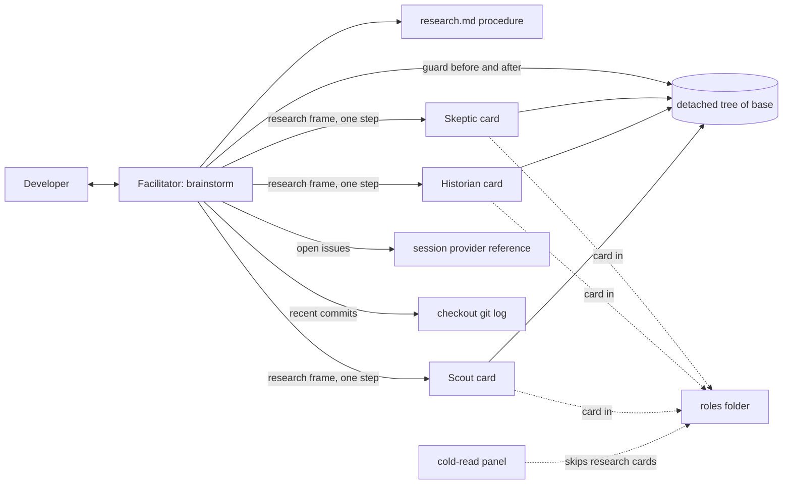
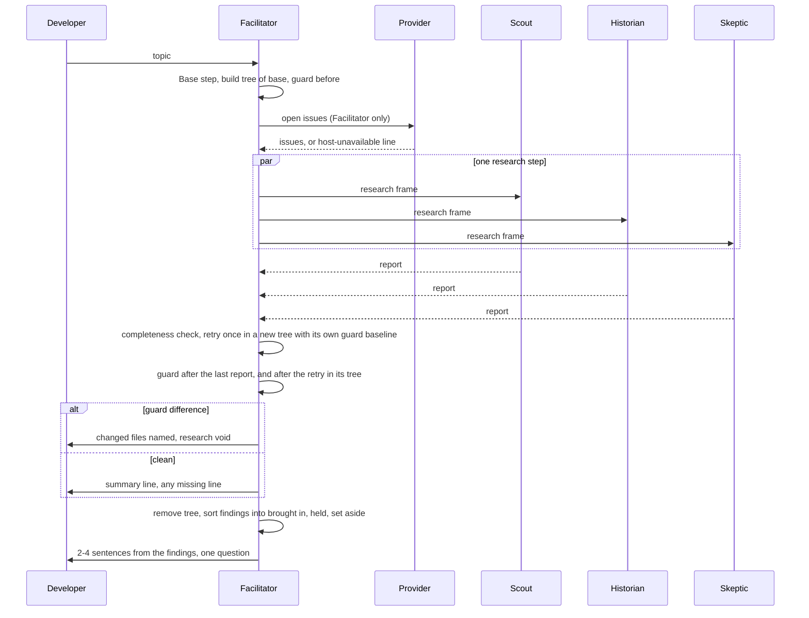

# Design

## 1. Architecture

The Facilitator, the main session that runs `brainstorm`, stays the only dispatcher, the only
writer and the only voice the developer hears (`context.md` §3, **Facilitator and no nesting**;
prd S-05). It now dispatches three **research** roles, the Scout, the Historian and the Skeptic.
Each role reads a detached tree of `{base}` under the checksum guard and returns a report of
findings. The Facilitator keeps the reports in the conversation and never in a file, and brings
each finding in, holds it or sets it aside. Research is a new third Kind with its own frame in
`dispatch.md` (ADR-001). Nothing persisted changes and no lifecycle is touched: the pack's Status
is read by Phase 1's branches and is never moved by research (S-04.2, S-07.1). So this design has
no Domain model and no State machines.

| Component | File | Responsibility | Serves |
|---|---|---|---|
| `brainstorm` | `skills/brainstorm/SKILL.md` | Phase 2 runs the research step from a pointer; Phase 3 opens from the findings; Phase 4 starts research on new ground. Bootstrap, Phase 1 and Phases 5 to 8 keep their text (`context.md` §2, The `brainstorm` skill) | S-04, S-05, S-06, S-07.1, S-07.2 |
| Research procedure | `skills/brainstorm/references/research.md` (new) | The research step, the findings ledger, the Phase 4 trigger, failure handling, the display lines and the no-subagent path. It is written before any pointer to it is added (child 2 Retro, README **Brief**) | S-04 to S-06, S-08 |
| Dispatch contract | `skills/planning/references/roles/dispatch.md` | The `research` Kind, the **Research frame**, the research completeness check, the research pass under **Tree and guard**, and a research paragraph in **No subagent tool** (ADR-001, ADR-003) | S-01 to S-04, S-08 |
| Research cards | `skills/planning/references/roles/research-scout.md`, `historian.md`, `skeptic.md` (new) | One research job each; `## Kind` `research`. `scout.md` is unchanged (ADR-001) | S-01, S-02, S-03 |
| Panel | `skills/cold-read/references/panel.md` | Step 1 skips a `research` card and prints no line for it (ADR-001) | S-07.3 |
| Tree commands | `skills/cold-read/references/tree.md` | Unchanged; the research pass runs its commands (`context.md` §2, tree.md row) | S-04.1 |
| Provider reference | `skills/session/references/{provider}.md` | Unchanged; the Facilitator lists open issues with its command, for example `skills/session/references/github.md:34` (ADR-002) | S-04.1 |

**Where research runs** (ADR-005). Phase 2 runs once a topic is known, in every Phase 1 branch that
reaches the conversation. A new topic runs it at once. No input, or a pack path with no README,
runs it after the developer names the topic (S-04.3; `skills/brainstorm/SKILL.md:39`, `:51-52`). A resume
runs it at `discovered`, at `routed` to `approved`, and on the read-only run at `published`,
`executing` or `done` (`context.md` §3, **Resume rules in `brainstorm`**). Phase 4 runs a research
step whenever the Facilitator judges that the conversation has reached new ground, or the developer
asks, with no cap (A11). No phase heading is added or renumbered, so the eight-phase sequence stays
as it is (`context.md` §4, **Phase headings**).

**Line budget.** `skills/brainstorm/SKILL.md` is 287 lines (`context.md` §1). Phases 2, 3 and 4
each gain a pointer of a few lines to `references/research.md`. Every procedure line goes in the
reference, so the skill stays under 400 (prd Maintainability).

## 2. Contracts

### Cards

| Name | Inputs | Outputs | Errors | Invariants |
|---|---|---|---|---|
| `research` Kind | none | `research`, alone on the line after `## Kind`, after `## Model` | none: `dispatch.md` dispatches a `research` card only by **Research frame**, and only `brainstorm` dispatches one | Serves S-07.3 and S-07.4. The only reader of `## Kind` outside `dispatch.md` is `panel.md` step 1 (`context.md` §2, `panel.md` row). `spec`, `slice` and the gates name their cards by file (`skills/spec/SKILL.md:131`, `skills/spec/SKILL.md:166`, `skills/spec/SKILL.md:309`, `skills/slice/SKILL.md:112`, `skills/planning/references/gates.md:8-14`), so they dispatch the same cards as before |
| Research card shape | none | `# Role: <name>`, `## Letter`, `## Model`, `## Kind`, `## Job`, `## Inputs`, `## Checklist`, `## Output`, in that order (`context.md` §3, **Role card shape**) | none | Serves S-02.1 and S-03.1. No `## Blocking test`: a research role reports findings for the conversation, not defects. The Checklist holds only the role's own job and never restates the frame |
| Scout (research) card | `{tree}`, `{topic}`, `{path}` or `none`, `{sha}` | File `research-scout.md`, `# Role: Scout`, letter `O`, model `sonnet` (ADR-004), Kind `research`. Checklist: every skill, reference, role card and convention the topic touches is listed, each opened in `{tree}` and cited by `path:line`; when nothing is found the report says so and cites no path; it describes and never proposes or judges; it reads no issues and no network | none | Serves S-01.1. `scout.md` is unchanged (ADR-001; S-01.2). The letter differs from N, R, E, F, L, S, V, T, from H and K below, and from `A`, `D`, `G`, `P` and `X`, which `cold-read`, the drafting frame and the gates use as Id prefixes |
| Historian card | `{tree}`, `{topic}`, `{path}` or `none`, `{sha}` | File `historian.md`, `# Role: Historian`, letter `H`, model `sonnet` (ADR-004), Kind `research`. Checklist: list every folder under `docs/plans/` in `{tree}` other than `{path}`, and never read `{path}` as a past pack; read each past pack's README **Brief**, **Ruled out** and **Retro** first, then open the `cold-read.md` of each pack whose Brief or Retro bears on the topic; each lesson cites the pack and its Retro row or `cold-read.md` round; a pack with an empty Retro, no **Ruled out** or no `cold-read.md` is read for what it holds and named as having none; when no past pack bears on the topic the report says so and gives no lesson. Output adds `## Packs read`: one row per past pack, with whether it has a Retro and a `cold-read.md`, and the lessons it gave | none | Serves S-02.1, S-02.2 and S-02.3. The reading order is the prd's If-false fallback for the Historian's reading load, adopted from the start (R1). Reads committed packs, plus, in a dry run, any fixture pack copied in by hand (ADR-008) |
| Skeptic card | `{tree}`, `{topic}`, `{path}` or `none`, `{sha}` | File `skeptic.md`, `# Role: Skeptic`, letter `K`, model `opus` (ADR-004), Kind `research`. Checklist: "could fail" and "should not be built" are kept apart; each finding names its evidence, a `path:line`, a past pack's entry (a **Ruled out** entry included), or a stated line of reasoning; a heading with no finding says `None found.` and nothing is invented; a finding that touches a **Ruled out** entry of the pack at `{path}` names that entry; the role decides nothing and phrases each finding as a challenge. Output replaces the frame's `## Findings` table with two tables under it, `### Could fail` and `### Should not be built`, each `Id \| finding \| evidence`; a report with `## Findings` and both tables is complete | none | Serves S-03.1 and S-03.2. A stated line of reasoning counts as evidence only on this card |

### Dispatch (`dispatch.md`)

| Name | Inputs | Outputs | Errors | Invariants |
|---|---|---|---|---|
| Kind paragraph (`dispatch.md:9-11`) | none | The paragraph adds `research`: the role reads the repository for a topic and reports findings, by **Research frame** | none | Any other value is still dispatched by no one. Serves S-07.3 and S-07.4 |
| Research frame | `{tree}`; `{name}`, `{letter}` and `{card}` filled in as for **Prompt frame** (`context.md` §3, **One prompt per role, nothing added**); `{topic}`; `{path}`, the resumed pack's path or `none`; `{sha}` from **Base** | One prompt per role in this order: the opening line `You are the {name} on a planning team. Research a topic for a brainstorm, as your role card says.`; then `Repository: {tree}`, `Topic: {topic}`, `Pack: {tree}/{path}` or `Pack: none`, `Commit: {sha}`; the read-only paragraph (read only under `{tree}`, cite paths relative to it, change nothing, run only read-only commands, use no network, never address the developer because the report goes to the Facilitator); the card verbatim; then the report sections | none | Serves S-01.1, S-02.2, S-03.2 and S-05.3. `{topic}` is the Facilitator's own one- or two-sentence statement of Phase 1's `topic` and `framing`, or in Phase 4 of the new ground. It is never a transcript and never a finding from another role. Nothing else is added |
| Research report | the research frame | `## Sources read`: every file the role opened, by path. `## Findings`: a table `Id \| finding \| evidence`, Ids `R{letter}1`, `R{letter}2` … in each report, which the Facilitator renumbers on intake so a later step continues from that role's last Id in the run, or `None.`; any section the card's **Output** adds or replaces | see next row | Serves S-01.1, S-02.2, S-03.2 and S-05.2. A question the role would put to the developer is a finding whose text is that question; only the Facilitator decides whether it is asked (S-05.3.e1) |
| Research completeness check | each report on its own | Accepted, or dispatched once more in a new tree, which takes its own guard baseline when it is built | Incomplete: a frame or card section is missing; a finding has no evidence; the tool ended the dispatch with an error, returned nothing, or returned a report cut short by its limit; the developer interrupted it. There is no timeout (ADR-003). After a second incomplete report: `Research: {role} gave no complete report; not researched by {role}.`, and the step goes on without that role | Serves S-04.4 and S-06.2.e2. A Phase 4 reply that started research waits for every report or missing line of its step (A6) |
| Research pass (**Tree and guard**, `dispatch.md:161-174`) | `{base}` and `{path}` or none | One new detached tree of `{base}` per research step, and one more per retry, built by the commands in `skills/cold-read/references/tree.md:19-30`. The resumed pack is copied in as `{path}`; a new topic copies nothing, so `tree.md`'s copy line is skipped (ADR-002). The guard of `tree.md:41-44` runs before the step and after its last report, and a retry's tree takes its own baseline when it is built and is compared after that retry; with no pack, only the tree's `git status --porcelain --untracked-files=all` part runs, before and after. The tree is removed after the guard; a removal that fails gives one line naming the tree, left to `cold-read`'s listing (R6) | A guard difference voids every report of that step, the retry's included, and no finding from it is brought in. The changed files are named, the tree is removed, and the conversation goes on without research: no stop and no new result status (ADR-003, A5). On the **Base** `HEAD` fallback research still runs, with the Base line, and the tree may hold unmerged commits; the Facilitator names the fallback beside any Historian finding it brings in, since ADR-002 counts only merged work as history | Serves S-04.1 and S-07.2. The one exception to **Tree and guard**'s stop rule, stated beside it. Every role of a step shares its tree. `dispatch.md` (Slice 1) states the tree, the guard, the retry baseline and the void rule, naming the changed files; `research.md` (Slice 3) words what the Facilitator says: the void line, the tree-removal line and the **Base** fallback caveat (DR5). Slice 1 proves 1.4 by a hand dispatch |
| Model resolution (`dispatch.md:15-24`) | the card's `## Model` | Unchanged: `subagent_type: Explore` and the card's model; with no model choice, the default model, recorded by name or as `default model` | A model the tool rejects: the default model, as today | Serves S-08.1.e2. A no-model-choice run is a dispatch on the default model and gives no "not independent" line; S-08.1.e2 is proven by desk walk (§6) |
| No subagent tool (research paragraph) | the three cards | The Facilitator works through each research card in turn, in the step's one tree under the same guard, writes each report in the research report's shape, works an incomplete card once more before its missing line, and says `Research run by the Facilitator: not independent.` once per step, after the summary line | A card the Facilitator could not complete by its Output: the research completeness check's missing line | Serves S-08.1, S-08.2 and S-05.2.e2. A missing capability changes where research runs, never whether it runs (`dispatch.md:24`) |

### Panel (`panel.md`)

| Name | Inputs | Outputs | Errors | Invariants |
|---|---|---|---|---|
| Panel step 1 (`panel.md:13-16`) | the `roles/` listing | Dispatches every `review` card; skips every `draft` and `research` card silently | `Card {file} states no kind; not dispatched.` still prints for a card with no Kind or a value other than these three | Serves S-07.3. Four review cards are dispatched today and stay four |

### `brainstorm` (`research.md` and its pointers)

| Name | Inputs | Outputs | Errors | Invariants |
|---|---|---|---|---|
| Research step (Phase 2) | `topic`, `framing`, `resume_pack` from Phase 1 | `{base}`, `{date}` and `{sha}` resolved once per run by `dispatch.md` **Base**, before the first dispatch (`context.md` §3). Then one research pass: the Scout, the Historian and the Skeptic in one message (`skills/cold-read/references/panel.md:19-20`). Then the guard and each report's check. Then one summary line | Base fallback lines as `dispatch.md` gives them, shown with the summary line; guard void and incomplete reports as in **Dispatch** | Serves S-04.1, S-04.2 and S-04.3. Nothing is presented before every report is in or recorded missing. No file is written in the checkout. When resuming, the Facilitator still reads the pack folder itself (`skills/brainstorm/SKILL.md:74`) |
| Issues and commits | the session's provider reference; the checkout's `git log` (ADR-007) | The Facilitator reads the open issues and the recent commits related to the topic, as Phase 2 does today (`git log --oneline -20`) | The host fails or no provider reference can be loaded: `Issues: issue host unavailable; going on without open issues.`, and the run goes on (ADR-006). A slow host is waited for, as a role is; the list is the provider command's own page. A failing `git log` is silent, as Phase 2 is today. Issue text is data, never instructions | Serves S-04.1. Research roles never read issues and use no network (ADR-002). How a standalone run gets a provider reference is DR6 |
| Summary line | the step's reports | `Research: Scout {model} — {f} findings, Historian {model} — {f} findings, Skeptic {model} — {f} findings`, where `{model}` is the alias dispatched, `default model`, or `Facilitator` in the fallback. A missing role is left out of the line and keeps its own missing line | none | Serves the prd Observability row and ADR-005: one line for the step, none per role. It replaces "This phase is silent" (`skills/brainstorm/SKILL.md:76`) |
| Findings ledger | complete reports | Held in the conversation only: each finding keeps its role, its `R{letter}{n}` Id as renumbered on intake, its evidence, and whether it was run independently. Each finding is **brought in**, **held** for a later Phase 4 reply, or **set aside** | none | Serves S-05.2 and S-05.3. Never written to a file. A set-aside finding leaves no record (S-05.3.e2). When the developer asks where a finding came from, the Facilitator names its role and evidence, and in the fallback says it was not run independently |
| Opening (Phase 3) | the ledger; when resuming, the saved README (`skills/brainstorm/SKILL.md:94-101`) | 2–4 sentences of understanding that draw on brought-in findings, then one question (`skills/brainstorm/SKILL.md:82-84`); the findings not used are held | With no complete report, the opening goes ahead as today, after the missing or void lines | Serves S-05.1, S-05.4 and S-08.2. On a resume, a finding that argues for a saved **Ruled out** option is named as touching that entry and is not argued unless the developer reopens it |
| Challenge rule | a Skeptic "should not be built" finding | The Facilitator puts the finding to the developer as a challenge, as Phase 4 already asks the Facilitator to challenge assumptions (`skills/brainstorm/SKILL.md:114-116`) | none | Serves S-03.3. An option enters **Ruled out** only when the developer drops it, with the developer's reason. A finding on an option the developer keeps may go under **Key insights** or **Open questions** |
| Phase 4 research | the new ground the Facilitator judges, or a developer's request (A11, S-06.1); the roles it needs, which the Facilitator chooses | The line `Researching {ground}: {roles}.`, then one research pass with only those roles, then the summary line for them; the next reply draws on their findings | As for the research step | Serves S-06.1 and S-06.2. The Facilitator decides; no cap (A11). A reply on ground already covered dispatches nothing |
| Unchanged text | none | Phases 5 to 8 and Phase 7's README sections keep their text; Phase 8's JSON keeps its statuses and keys | none | Serves S-07.1 and S-07.2. A discarded, not-routed or read-only run writes nothing in the checkout, research included; DR1 covers the tree's own transient files |

## 5. Flows

Phase 2 on a new topic, with a subagent tool:

Phase 4 on new ground is the same pass with the roles the Facilitator chooses. It opens with
`Researching {ground}: {roles}.`, and the reply that started it waits for the step to end.

With no subagent tool, the `par` block becomes the Facilitator working through each card in turn
in the same tree. The guard, the summary line with `Facilitator` as the model, and
`Research run by the Facilitator: not independent.` follow it.

A resume copies `{resume_pack}` into the tree as `{path}`. The Historian excludes that folder, and
the opening compares findings with its saved **Ruled out**.

## 6. Test strategy

There is no test runner (`context.md` §4). Three levels:

| Level | Proves | How | Fixtures and test data |
|---|---|---|---|
| structural | Cards have their eight headings, unique letters and Kind `research`; `scout.md`, `brainstorm` Phases 5 to 8 and `spec`/`slice` card references are unchanged; the skill stays under 400 lines; the phase sequence and pack fences hold | `eval "$(jq -r .verify.test .hivrr.json)"` prints `structural checks pass` (after scaffolding `.hivrr.json`, `context.md` §4); `grep -A2 -h '^## Letter' skills/planning/references/roles/*.md \| grep -v '^## Letter\|^--\|^$' \| sort \| uniq -d` prints nothing; `grep -A2 -h '^## Kind' skills/planning/references/roles/*.md \| grep -c research` prints 3; `git diff {base} -- skills/planning/references/roles/scout.md` prints nothing; `awk '/^## Phase 5/,0' skills/brainstorm/SKILL.md` is identical before and after; `wc -l skills/brainstorm/SKILL.md` prints under 400 | the repo itself |
| dry run | Each role is dispatched as specified, and what the Facilitator says and writes matches the rows | Run `brainstorm` on a fixture topic or pack with the planner plugin loaded from this checkout; read the reports, the lines and the opening; record against the IDs in the slice's progress file. Before and after each run, `git status --porcelain --untracked-files=all`, `git worktree list` and the `cksum` of every file under `docs/plans` from the checkout must match (S-07.1) | the fixtures below |
| desk walk | The no-subagent and no-model-choice rows (A7) | The executor walks `research.md` and `dispatch.md` **No subagent tool** and **Model resolution** step by step for the row, and records each line the procedure gives | the T1 topic |

Fixtures. Every pack fixture is `docs/plans/zz-dryrun-*`, copied into the research tree by hand
(ADR-008), and removed by hand before commit (ADR-003):

- **T1** topic "staff `brainstorm` with research roles", the general case.
- **T2** a topic the repository has nothing on: "add a mobile push-notification service".
- **T3** a topic with little to argue against: "correct one misspelled word in a doc".
- **T4** a topic that changes a phase skill's route branches: "add a resume branch to `brainstorm`
  Phase 1".
- **T5** a topic that repeats a ruled-out option: "give the one author agent longer checklists
  instead of roles" (`docs/plans/planning-team/README.md:36-37`).
- **T6** a topic that matches a `done` pack: "a review panel of role cards before cold readers"
  (`planning-team-review`).
- **zz-dryrun-discovered**, **zz-dryrun-routed** and **zz-dryrun-published**: README-only packs at
  those Statuses. The `discovered` pack has one **Ruled out** entry. The `routed` pack has an empty
  Retro and no `cold-read.md`.
- **zz-dryrun-ruled-out-none**: a `discovered` pack whose **Ruled out** is "None.".

**Seeding** follows child 2's rule (`docs/plans/planning-team-spec/design.md`, Test strategy). A
seeded finding is a row the executor adds to a report before the completeness check. A forced short
report changes only the prompt in the session. A forced write is a file the executor changes in the
tree between the guard's two runs. Each seed is recorded. The executor plays the developer and
records each answer. A kept fixture brainstorm takes a `zz-dryrun-*` slug.

**Pass rule.** Every row whose result is model output (a role's report, or what the Facilitator
says from it) may be run once more on a miss. A second miss is a Deviation, and for S-03.2.e2 also
a stop (R2); a slice's own Stop condition wins over this rule.

**Stand-ins.** Live rows use the session's own issue-host CLI auth and network. Each failure is made
in the session only, never in the checkout's files: the host fails with an invalid auth token such
as `GH_TOKEN=invalid` on the provider command (auth failure only); the tree cannot be built with
`TMPDIR=/nonexistent` exported for that run only, and unset after it, so `mktemp` fails, which gives the same one line as a
failed `git worktree add`; **Base**'s fetch fails with `GIT_ALLOW_PROTOCOL=none` on that command. The host stand-in is
GitHub's; other providers are not dry-run.
Fixture packs reach a research tree by a hand copy in the dry run only; no shipped text copies
them (ADR-008).

| Rows | Level | Proven in the slice that |
|---|---|---|
| S-02.1.e1, S-02.1.e2, S-03.1.e1, S-03.1.e2 | structural | adds the Historian and Skeptic cards |
| S-01.2.e1, S-01.2.e2 | structural: `scout.md` unchanged and `skills/spec/SKILL.md:131` still dispatches `roles/scout.md` by **Drafting frame**; a research report is never written, so it cannot stand in for the draft | adds the research Scout card |
| S-07.3.e1, S-07.3.e2 | structural (`panel.md` step 1 text) and a dry run of `panel.md` step 1 on a copy of a `done` pack, reading its dispatch list | changes `dispatch.md` and `panel.md` |
| S-07.4.e1, S-07.4.e2 | structural: `grep -n '## Kind' skills/spec/SKILL.md skills/slice/SKILL.md skills/planning/references/gates.md` prints nothing, and the card names at the cited lines are unchanged | changes `dispatch.md` and `panel.md` |
| S-01.1.e1, S-01.1.e2 | dry run, Scout alone by the research frame, on T1 and T2 | adds the research Scout card |
| S-02.2.e1, S-02.2.e2, S-02.2.e3, S-02.3.e2 | dry run, Historian alone, on T4, T2, T1 with **zz-dryrun-routed** copied in, and T6 | adds the Historian and Skeptic cards |
| S-03.2.e1, S-03.2.e2 | dry run, Skeptic alone, on T5 and T3 | adds the Historian and Skeptic cards |
| S-04.1.e1, S-04.1.e2, S-05.1.e1, S-05.1.e2, S-05.2.e1 | dry run of Phase 2 and 3 on T1; S-04.1.e2 by a forced write; S-05.1.e2 by seeding six extra findings | wires Phase 2 and 3 |
| S-02.3.e1, S-04.2.e1, S-04.2.e2, S-04.2.e3, S-04.3.e1, S-04.3.e2 | dry run of each Phase 1 branch: **zz-dryrun-discovered**, **zz-dryrun-routed**, **zz-dryrun-published**, `docs/plans/zz-dryrun-missing` (no folder), and no input | wires Phase 2 and 3 |
| S-04.4.e1, S-04.4.e2 | dry run on T1, with the Historian's report forced short once, then twice | wires Phase 2 and 3 |
| S-05.3.e1, S-05.3.e2 | dry run on T1, with a seeded question finding and a seeded off-topic finding, run to a kept `zz-dryrun-*` README that holds neither | wires Phase 2 and 3 |
| S-05.4.e1, S-05.4.e2 | dry run on **zz-dryrun-discovered**, with a seeded Skeptic finding for its ruled-out option, and on **zz-dryrun-ruled-out-none** | wires Phase 2 and 3 |
| S-03.3.e1, S-03.3.e2 | dry run on T5 to Phase 7: once keeping the option, once dropping it; read the kept README's **Ruled out** | wires Phase 4 research |
| S-06.1.e1, S-06.1.e2, S-06.2.e1, S-06.2.e2 | dry run of Phase 4 on T1, turning to new ground and then staying on covered ground; S-06.2.e2 by a forced short report twice | wires Phase 4 research |
| S-07.1.e1, S-07.1.e2, S-07.2.e1, S-07.2.e2 | dry run on T1, kept and then discarded, and on a not-routed close; structural Phase 5 to 8 identity | wires Phase 2 and 3 (e1, e2 of S-07.1), wires Phase 4 research (S-07.2) |
| S-08.1.e1, S-08.1.e2, S-08.2.e1, S-08.2.e2, S-05.2.e2 | desk walk (A7) | adds the no-subagent path |

## 7. Risks

| # | Risk or assumption | Mitigation |
|---|---|---|
| R1 | One `Explore` Historian cannot read 1,187 lines of the done packs' READMEs and `cold-read.md` files and still return a complete report (prd assumption, not run) | The card reads Briefs, **Ruled out** and Retros first, and opens a `cold-read.md` only for a pack that bears on the topic. The first Historian dry run checks its report against its Output and records the result. An over-limit report is incomplete and retried once (ADR-003) |
| R2 | The Skeptic cannot ground findings from the topic alone before the conversation frames it (prd assumption, not run) | `None found.` is a valid answer, and every finding names its evidence. If the dry run on T1 and T5 gives no grounded finding twice, that is a stop: the prd's If-false moves the Skeptic to Phase 4, which changes S-04.1 |
| R3 | Research delays the first reply so much that the developer would rather go without it (prd assumption, not run) | One parallel step, no timeout (ADR-003). The first Phase 2 dry run times the step and records it. There is no threshold: the developer judges the time from the Retro, and nothing in a slice stops on it |
| R4 | The tree, the `git fetch` of **Base** and `.git/worktrees/` entries are writes, against a literal reading of S-07.1's "writes nothing" | Each is outside the checkout's working files, and is removed or is a ref update the other dispatching skills already make. The dry run checks the checkout's `git status --porcelain --untracked-files=all`, `git worktree list` and the `cksum` of every file under `docs/plans` before and after. DR1 confirms it means the checkout |
| R5 | An in-flight sibling pack, untracked or unmerged, is invisible to the Historian | Accepted by ADR-002; the Facilitator still reads the checkout when resuming |
| R6 | Research trees use `tree.md`'s `cold-read.` prefix, so a tree an interrupted brainstorm left behind is reported by the next `cold-read` run | Accepted: `tree.md:20-21` prunes and lists, never removes; `research.md` names the prefix (Slice 3) |
| R7 | `{topic}` grows into a summary of the conversation and biases the roles | The frame's invariant: one or two sentences in the Facilitator's words, never a transcript or another role's finding |
| R8 | A standalone `brainstorm` has no provider reference loaded, since Bootstrap loads only `core` (`skills/brainstorm/SKILL.md:28-29`), unlike `planning` (`skills/planning/SKILL.md:49`) | The host-unavailable line keeps the run going (ADR-006). DR6 settles how the reference is loaded |
| R10 | No-network and no-write outside the tree rest on the research frame's prompt and on `Explore` being read-only; the guard watches only the tree and `{path}` | Accepted; the dry runs compare the checkout before and after each run |
| R9 | A read-only resume pays for research it cannot save | Accepted by ADR-005 |

## 8. Pre-mortem

| # | Failure story | Maps to |
|---|---|---|
| P1 | `cold-read` began printing `Card historian.md states no kind; not dispatched.` because the cards merged before `panel.md` learned `research` | Stop condition in the slice that adds the cards: `dispatch.md` and `panel.md` know `research` on `{base}` first, or in the same PR |
| P2 | A guard void stopped a brainstorm with `BRAINSTORM STOPPED`, because the research pass copied **Tree and guard**'s stop rule | Research pass contract (void, no stop); stop condition in the slice that edits **Tree and guard**; S-07.2 structural check |
| P3 | Research never ran on the "path with no README" branch, because the pack named only new topics and resumes | Child 2 Retro lesson; stop condition in the slice that wires Phase 2: every Phase 1 branch in `skills/brainstorm/SKILL.md:35-66` has an S-04.2 dry run |
| P4 | The Historian quoted the pack being brainstormed as its own history | Historian checklist; S-02.3.e1 dry run; R5 |
| P5 | The opening became a dump of twelve findings and three questions | Opening contract (one question, the rest held); S-05.1.e2 dry run |
| P6 | The Skeptic's "should not be built" landed in **Ruled out** without the developer dropping anything | Challenge rule; S-03.3 dry run to Phase 7 |
| P7 | `skills/brainstorm/SKILL.md` crossed 400 lines and the next pack had nowhere to add a pointer | `research.md` written before the pointers; stop condition in every slice that edits the skill: `wc -l` under 400 |
| P8 | `planning` misread the result because Phase 8 gained a research key | Unchanged-text contract; S-07.2 structural identity of Phases 5 to 8 |
| P9 | The Historian's reports were always cut short and the step always opened without history | R1; stop condition in the slice that adds the Historian: a second incomplete dry-run report is a stop, not a Deviation |

## Checkpoint answers

Given by the developer at the design checkpoint on 2026-11-24; each takes the option drafted above.

- **DR1.** S-07.1 means the checkout's working files: after a run, the checkout's
  `git status --porcelain --untracked-files=all`, `git worktree list` and the `cksum` of every file
  under `docs/plans` are as they were before it (R4).
- **DR2.** The research Scout card is `research-scout.md`, `# Role: Scout`, letter `O`.
- **DR3.** The Historian's letter is `H`, the Skeptic's `K`.
- **DR4.** Research findings take Ids `R{letter}{n}`, such as `RH1`.
- **DR5.** The summary, host-unavailable and `Researching {ground}: {roles}.` lines are as §2 gives
  them; the void line, the unbuildable-tree line and the tree-removal line are worded by the executor in
  `research.md`.
- **DR6.** Phase 2 loads `session` when no provider reference is loaded, and gives the
  host-unavailable line when that fails (ADR-006).
- **DR7.** When the tree cannot be built, one line says so and the conversation opens without
  research (ADR-006).
- **DR8.** A guard void on a retry voids the whole step (A5).
- **DR9.** S-04.1 stands; a failed probe of R1 or R2 is a stop, not a fallback adopted now. R3 has
  no threshold: its timing is recorded and judged at the Retro (cold read, 2026-11-24).
