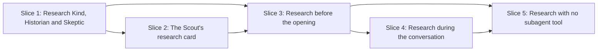

# Plan

## Dependency graph



Slices 4 and 5 both edit `skills/brainstorm/references/research.md`, so Slice 5 depends on Slice 4 as well as Slice 3.

## Traceability

| Criterion | Slices |
|---|---|
| S-02.1, S-02.2, S-03.1, S-03.2 | 1 |
| S-02.3 | 1, 3 |
| S-07.3, S-07.4 | 1, 2 |
| S-01.1, S-01.2 | 2 |
| S-04.1, S-04.2, S-04.3, S-04.4, S-05.1, S-05.3, S-05.4, S-07.1 | 3 |
| S-05.2 | 3, 5 |
| S-03.3, S-06.1, S-06.2, S-07.2 | 4 |
| S-08.1, S-08.2 | 5 |

Example rows (S-NN.k.eN) follow their criterion's slices.

## Shared contract

**Progress-file rows.** Every slice's progress file records each criterion and example ID it proves
as one row of its **Acceptance** table, `| {ID} | pass | {how shown} |`, or `fail` in place of
`pass`; the Verify loops read the example rows and the numbered rows they name, and structural
criteria are proven by their commands. The third cell is never empty: it holds the line or output
observed, and a stand-in row quotes the stand-in setting it used. A row whose expected result is a
fixed line or status quotes it, and the Verify greps for it. Every Verify runs on the slice's
finished tree: before the slice's files exist, the lines that read them fail. A dry run that cannot
load the planner plugin from this checkout follows the checkout's skill text with the skill dir set
to the checkout, as child 2 did, and records it under **Preflight**. A row proven by a live dispatch names it in its third cell
as `(Agent tool, model: {alias}, Explore)`. A slice that runs `brainstorm` writes one line
`Skill dir: {physical skills path, as pwd -P gives it, no trailing slash}` under **Preflight**. Every Verify reads
these exact shapes.

**Merge order.** The developer merges each slice's PR in order. A slice whose **Depends on** names a
slice not yet merged on `{base}` reports `blocked` and waits.

**Fixtures.** Each slice makes by hand the `zz-dryrun-*` packs and topics its dry runs name, from
`design.md` §6 **Fixtures**, copies any into a research tree by hand (never through shipped text),
and removes them before its commit (ADR-003). No slice commits a
fixture.

---

## Slice 1 — Research Kind, Historian and Skeptic

Issue: #281 · Depends on: none · Stories: S-02, S-03, S-07 · Map: Research before the conversation

### Outcome

`dispatch.md` knows a third Kind, `research`, and dispatches a research card by its own frame in a
guarded tree. The Historian and the Skeptic cards exist, each returns cited findings when it is
dispatched alone on a topic, and `cold-read`'s panel, `spec` and `slice` still dispatch the same
cards as before.

### Acceptance

- **S-02.1**
- **S-02.2**
- **S-02.3** (Historian side): the card never reads `{path}` as a past pack, and a `done` pack is
  read as a past pack (S-02.3.e2). S-02.3.e1, on a resume, is proven in Slice 3.
- **S-03.1**
- **S-03.2**
- **S-07.3** (Historian and Skeptic side). The Scout's research card is checked again in Slice 2.
- **S-07.4** (Historian and Skeptic side). The Scout's research card is checked again in Slice 2.
- **1.1** The Kind paragraph of `skills/planning/references/roles/dispatch.md` names `research`,
  dispatched by **Research frame**, and still says any other value is dispatched by no one.
- **1.2** The research frame's opening line,
  `You are the {name} on a planning team. Research a topic for a brainstorm, as your role card says.`,
  is stated once under `skills/`, in `dispatch.md`.
- **1.3** The research completeness check's missing line,
  `Research: {role} gave no complete report; not researched by {role}.`, is stated once, in
  `dispatch.md`.
- **1.4** Given a research role dispatched by hand and a file the executor changes in its tree
  between the guard's two runs, when the guard runs after the report, then every report of that
  step is void, the changed file is named, the tree is removed, and nothing says `STOPPED`.
- **1.5** Given a fixture pack copied into the tree as `{path}`, when the Historian is dispatched
  alone with `Pack: {tree}/{path}`, then its report cites no part of `{path}` as a past pack (the
  Historian side of S-02.3, before Slice 3 proves S-02.3.e1).

### Contracts

`design.md` §2 **Cards**: the `research` Kind, Research card shape, Historian card and Skeptic card
rows. `design.md` §2 **Dispatch**: the Kind paragraph, Research frame, Research report, Research
completeness check and Research pass rows; Model resolution is unchanged. `design.md` §2 **Panel**:
Panel step 1. The **No subagent tool** research paragraph is Slice 5's. Until Slice 3, no skill
dispatches a research card: this slice's dry runs dispatch each role by hand, by the frame.

### Stop conditions

- Stop if a contract this slice depends on has drifted from `context.md` (preflight).
- Stop if either card would merge without `dispatch.md` and `panel.md` knowing `research` in the
  same PR (`design.md` §8, P1).
- Stop if the research pass would stop the run on a guard difference, or would need a new result
  status: a void is no stop (`design.md` §8, P2; `design.md` §2, Research pass row; ADR-003).
- Stop if the Historian's dry-run report is incomplete a second time: set the progress file to
  `blocked`; this is not a Deviation (`design.md` §8, P9; `design.md` §7, R1; `design.md`
  **Checkpoint answers**, DR9).
- Stop if the Skeptic gives no grounded finding twice on T1 and on T5, or misses S-03.2.e2 a second
  time (`design.md` §7, R2; `design.md` §6, **Pass rule**; DR9).
- Stop if a card needs a heading beyond the eight, or restates the research frame in its Checklist
  (`design.md` §2, Research card shape row).
- Stop if letter `H` or `K` is already used by a card, or as an Id prefix (`design.md` §2,
  Scout (research) card row; DR3).
- Stop if dispatching a research card would need `skills/spec/SKILL.md`, `skills/slice/SKILL.md`
  or `skills/planning/references/gates.md` changed (`design.md` §2, `research` Kind row).
- Stop if seeding a dry run would need a card or `dispatch.md` edited: change only the prompt in
  the session (`design.md` §6, **Seeding**).
- Stop if a dry run this slice needs live could only run with no subagent tool: the desk walk is
  only for the A7 rows (`design.md` §6, Test strategy).

### Verify

```bash
eval "$(jq -r .verify.test .hivrr.json)"
# expected: structural checks pass (without .hivrr.json this prints a jq error and exits 0, which is a failure: scaffold it as docs/verification.md says)
r=skills/planning/references/roles
for f in $r/historian.md $r/skeptic.md; do head -1 "$f"; awk '/^## /{printf "%s|", substr($0, 4)} END {print " " FILENAME}' "$f"; done
# expected, four lines:
# # Role: Historian
# Letter|Model|Kind|Job|Inputs|Checklist|Output| skills/planning/references/roles/historian.md
# # Role: Skeptic
# Letter|Model|Kind|Job|Inputs|Checklist|Output| skills/planning/references/roles/skeptic.md
for f in $r/historian.md $r/skeptic.md; do awk '/^## (Letter|Model|Kind)$/ {h = $2; next} h && NF {printf "%s=%s ", h, $0; h = ""} END {print FILENAME}' "$f"; done
# expected: Letter=H Model=sonnet Kind=research skills/planning/references/roles/historian.md
#           Letter=K Model=opus Kind=research skills/planning/references/roles/skeptic.md
grep -h -A2 '^## Letter$' $r/*.md | grep -xE '[A-Z]' | sort | tr '\n' ' '; echo
# expected: E F H K L N R S T V
grep -h -A2 '^## Letter$' $r/*.md | grep -xE '[A-Z]' | sort | uniq -d
# expected: no output
grep -A2 -h '^## Kind' $r/*.md | grep -c research
# expected: 2
awk '/^## Model resolution/ {exit} 1' $r/dispatch.md | grep -c '`research`'
# expected: a number above 0
awk '/^## Model resolution/ {exit} 1' $r/dispatch.md | grep -c 'Research frame'
# expected: a number above 0
grep -c '^## Research frame' $r/dispatch.md
# expected: 1
tr '\n' ' ' < $r/dispatch.md | grep -oF 'or any other value, is dispatched by no one.' | wc -l
# expected: 1
grep -rhoF 'Research a topic for a brainstorm, as your role card says.' skills | wc -l
# expected: 1
grep -rlF 'Research a topic for a brainstorm, as your role card says.' skills
# expected: skills/planning/references/roles/dispatch.md
grep -rhoF 'Research: {role} gave no complete report; not researched by {role}.' skills | wc -l
# expected: 1
grep -rlF 'Research: {role} gave no complete report; not researched by {role}.' skills
# expected: skills/planning/references/roles/dispatch.md
grep -c 'STOPPED' $r/dispatch.md
# expected: 1 (the drafting stop rule, unchanged; the research pass adds no stop)
awk '/^1\. \*\*The roles\.\*\*/,/^2\. /' skills/cold-read/references/panel.md | grep -c research
# expected: a number above 0
grep -c 'states no kind; not dispatched.' skills/cold-read/references/panel.md
# expected: 1
grep -n '## Kind' skills/spec/SKILL.md skills/slice/SKILL.md skills/planning/references/gates.md
# expected: no output
grep -o 'roles/[a-z-]*\.md' skills/spec/SKILL.md skills/slice/SKILL.md skills/planning/references/gates.md | sort -u | tr '\n' ' '; echo
# expected: skills/planning/references/gates.md:roles/dispatch.md skills/slice/SKILL.md:roles/dispatch.md skills/slice/SKILL.md:roles/planner.md skills/spec/SKILL.md:roles/analyst.md skills/spec/SKILL.md:roles/architect.md skills/spec/SKILL.md:roles/dispatch.md skills/spec/SKILL.md:roles/scout.md
git diff --stat "$(git merge-base HEAD origin/main)" -- skills/spec skills/slice skills/planning/references/gates.md skills/planning/references/roles/scout.md skills/brainstorm
# expected: no output
g=docs/plans/planning-team-discovery/progress/slice-01.md
for id in S-02.1.e1 S-02.1.e2 S-02.2.e1 S-02.2.e2 S-02.2.e3 S-02.3.e2 S-03.1.e1 S-03.1.e2 S-03.2.e1 S-03.2.e2 S-07.3.e1 S-07.3.e2 S-07.4.e1 S-07.4.e2 1.4 1.5; do grep -qE "^\| $id \| pass \| .*[^ ].* \|" $g || echo "missing $id"; done
# expected: no output (run after the dry runs are recorded)
for id in S-02.2.e1 S-02.2.e2 S-02.2.e3 S-02.3.e2 S-03.2.e1 S-03.2.e2 1.4 1.5; do grep -F "| $id | pass" $g | grep -qF '(Agent tool, model:' || echo "not live $id"; done
# expected: no output
git worktree list --porcelain | grep '^worktree .*/cold-read\.' | grep -vxF "worktree $(pwd -P)" | wc -l
# expected: 0
while read -r id want; do grep -F "| $id | pass" $g | grep -qF "$want" || echo "unquoted $id"; done <<'EOF'
S-03.2.e2 None found.
EOF
# expected: no output
ls docs/plans | grep -c zz-dryrun
# expected: 0 (grep exits 1 on a zero count; read the output, not the status)
grep -rlE 'zz-dryrun|GH_TOKEN=invalid|TMPDIR=/nonexistent|GIT_ALLOW_PROTOCOL=none' skills
# expected: no output
```

Dry runs, recorded in `progress/slice-01.md`. Each role is dispatched alone, by hand, as the
contract says: one tree per step by `skills/cold-read/references/tree.md:19-30`, fixtures copied in by
hand (ADR-008), the guard of `tree.md:41-44` before and after (only its `git status` part when
`Pack: none`), the prompt by **Research frame** and the model by **Model resolution**. Fixtures and
topics are `design.md` §6's.

- Historian on T4: proves S-02.2.e1. On T2: S-02.2.e2. On T1 with **zz-dryrun-routed** copied in by
  hand as a past pack: S-02.2.e3. On T6: S-02.3.e2. Record each report's length, its **Packs read** and
  whether it was complete: the prd Assumptions row for the Historian's reading load (R1).
- Skeptic on T5: proves S-03.2.e1. On T3: S-03.2.e2. On T1: the prd Assumptions row for grounding
  from the topic alone (R2).
- A Historian dispatch after which the executor changes one file in its tree before the second
  guard run: proves 1.4.
- The Historian on T1 with **zz-dryrun-discovered** copied in as `{path}`: proves 1.5.
- `panel.md` step 1 on a copy of a `done` pack, reading its dispatch list: four dispatches, the
  Fact-checker, the Editor, the Test engineer and the Trust reviewer, and no no-kind line naming
  either new card: proves S-07.3.e1 and S-07.3.e2.
- S-02.1, S-03.1 and S-07.4 rows are proven by the structural commands above (`design.md` §6).

Every row whose result is model output may be run once more on a miss; a second miss is a
Deviation, and for S-03.2.e2 a stop (`design.md` §6, **Pass rule**). The Historian stop above wins
over the Pass rule.

### Pattern to follow

- The card shape: `skills/planning/references/roles/scout.md:1-45` and
  `skills/planning/references/roles/planner.md:1-48`.
- The frames to mirror: `skills/planning/references/roles/dispatch.md:26-58` (review) and
  `skills/planning/references/roles/dispatch.md:90-126` (drafting).
- The Kind paragraph to extend: `skills/planning/references/roles/dispatch.md:9-11`.
- The stop rule the research pass makes an exception to:
  `skills/planning/references/roles/dispatch.md:170-174`.
- The panel line to extend: `skills/cold-read/references/panel.md:13-16`.

### Suggested path

Default route. You may deviate if every mandatory item still holds; record why.

1. In `dispatch.md`, add `research` to the Kind paragraph, then a **Research frame** section with
   the research report, the research completeness check, and the research pass beside **Tree and
   guard**, as `design.md` §2 **Dispatch** gives them.
2. Change `panel.md` step 1 to skip `draft` and `research` cards silently.
3. Write `historian.md` and `skeptic.md` from `design.md` §2 **Cards**.
4. Run the structural commands, then the dry runs; record them; remove the fixtures.

### Files

- Create: `skills/planning/references/roles/historian.md`
- Create: `skills/planning/references/roles/skeptic.md`
- Modify: `skills/planning/references/roles/dispatch.md`
- Modify: `skills/cold-read/references/panel.md`
- Create: `docs/plans/planning-team-discovery/progress/slice-01.md`

---

## Slice 2 — The Scout's research card

Issue: #282 · Depends on: Slice 1 · Stories: S-01, S-07 · Map: Research before the conversation

### Outcome

A research Scout card exists beside the drafting Scout. Dispatched alone on a topic, it lists what
the repository already holds that the topic touches, with citations, while `spec` still drafts
`context.md` with the unchanged `scout.md`.

### Acceptance

- **S-01.1**
- **S-01.2**
- **S-07.3** (Scout side): S-07.3.e1 and S-07.3.e2 again, with `research-scout.md` in `roles/`.
- **S-07.4** (Scout side): S-07.4.e1 and S-07.4.e2 again, with `research-scout.md` in `roles/`.
- **2.1** `skills/planning/references/roles/research-scout.md` has the eight card headings in order
  (`# Role: Scout` and seven `##` headings), letter `O`, model `sonnet`, Kind `research`.
- **2.2** `skills/planning/references/roles/scout.md` is unchanged.

### Contracts

`design.md` §2 **Cards**: the Scout (research) card row. It uses Slice 1's research frame, report,
completeness check and research pass unchanged.

### Stop conditions

- Stop if a contract this slice depends on has drifted from `context.md` (preflight).
- Stop if `dispatch.md` on `{base}` does not yet hold the **Research frame** or `panel.md` does not
  skip a `research` card (`design.md` §8, P1). The developer merges each slice's PR in order;
  report `blocked` and wait for Slice 1's merge.
- Stop if the research use would need `scout.md` changed (ADR-001; prd S-01.2).
- Stop if letter `O` is already used by a card, or as an Id prefix (`design.md` §2, Scout
  (research) card row; DR2).
- Stop if the card would have the Scout propose, judge, read issues or use the network
  (`design.md` §2, Scout (research) card row; ADR-002).
- Stop if a dry run this slice needs live could only run with no subagent tool (`design.md` §6,
  Test strategy).

### Verify

```bash
eval "$(jq -r .verify.test .hivrr.json)"
# expected: structural checks pass (without .hivrr.json this prints a jq error and exits 0, which is a failure: scaffold it as docs/verification.md says)
r=skills/planning/references/roles
head -1 $r/research-scout.md; awk '/^## /{printf "%s|", substr($0, 4)} END {print ""}' $r/research-scout.md
# expected: # Role: Scout
#           Letter|Model|Kind|Job|Inputs|Checklist|Output|
awk '/^## (Letter|Model|Kind)$/ {h = $2; next} h && NF {printf "%s=%s ", h, $0; h = ""} END {print ""}' $r/research-scout.md
# expected: Letter=O Model=sonnet Kind=research
grep -h -A2 '^## Letter$' $r/*.md | grep -xE '[A-Z]' | sort | tr '\n' ' '; echo
# expected: E F H K L N O R S T V
grep -h -A2 '^## Letter$' $r/*.md | grep -xE '[A-Z]' | sort | uniq -d
# expected: no output
grep -A2 -h '^## Kind' $r/*.md | grep -c research
# expected: 3
git diff "$(git merge-base HEAD origin/main)" -- $r/scout.md skills/spec skills/slice skills/planning/references/gates.md
# expected: no output
grep -cF 'dispatch `roles/scout.md` by **Drafting frame**' skills/spec/SKILL.md
# expected: 1
grep -n '## Kind' skills/spec/SKILL.md skills/slice/SKILL.md skills/planning/references/gates.md
# expected: no output
g=docs/plans/planning-team-discovery/progress/slice-02.md
for id in S-01.1.e1 S-01.1.e2 S-01.2.e1 S-01.2.e2 S-07.3.e1 S-07.3.e2 S-07.4.e1 S-07.4.e2; do grep -qE "^\| $id \| pass \| .*[^ ].* \|" $g || echo "missing $id"; done
# expected: no output (run after the dry runs are recorded)
for id in S-01.1.e1 S-01.1.e2; do grep -F "| $id | pass" $g | grep -qF '(Agent tool, model:' || echo "not live $id"; done
# expected: no output
git worktree list --porcelain | grep '^worktree .*/cold-read\.' | grep -vxF "worktree $(pwd -P)" | wc -l
# expected: 0
ls docs/plans | grep -c zz-dryrun
# expected: 0 (grep exits 1 on a zero count; read the output, not the status)
grep -rlE 'zz-dryrun|GH_TOKEN=invalid|TMPDIR=/nonexistent|GIT_ALLOW_PROTOCOL=none' skills
# expected: no output
```

Dry runs, recorded in `progress/slice-02.md`, dispatched by hand as in Slice 1:

- The research Scout alone on T1: proves S-01.1.e1. On T2: S-01.1.e2.
- `panel.md` step 1 on a copy of a `done` pack: four review dispatches, and no no-kind line names
  the Historian, the Skeptic or the Scout: proves S-07.3.e1 and S-07.3.e2.
- S-01.2.e1, S-01.2.e2 and S-07.4 rows are proven by the structural commands above: `scout.md` is
  unchanged, `skills/spec/SKILL.md:131` still dispatches it by **Drafting frame**, and a research
  report is never written, so it cannot stand in for the draft (`design.md` §6).

### Pattern to follow

- The Scout card it sits beside: `skills/planning/references/roles/scout.md:1-45`.
- The Historian card Slice 1 wrote, `skills/planning/references/roles/historian.md`, for a research
  card's Job, Inputs and Output.

### Suggested path

Default route. You may deviate if every mandatory item still holds; record why.

1. Write `research-scout.md` from `design.md` §2, Scout (research) card row.
2. Run the structural commands and the dry runs; record them; remove any fixture.

### Files

- Create: `skills/planning/references/roles/research-scout.md`
- Create: `docs/plans/planning-team-discovery/progress/slice-02.md`

---

## Slice 3 — Research before the opening

Issue: #283 · Depends on: Slice 1, Slice 2 · Stories: S-02, S-04, S-05, S-07 · Map: Research before the conversation, Open the conversation, Keep or discard and return

### Outcome

In every Phase 1 branch that reaches the conversation, `brainstorm` Phase 2 runs the Scout, the
Historian and the Skeptic in one step and shows one summary line, and Phase 3 opens from their
findings with one question. What the run writes is unchanged.

### Acceptance

- **S-02.3** (resume side): S-02.3.e1.
- **S-04.1**
- **S-04.2**
- **S-04.3**
- **S-04.4**
- **S-05.1**
- **S-05.2** (with a subagent tool): S-05.2.e1. S-05.2.e2, the fallback, is proven in Slice 5.
- **S-05.3**
- **S-05.4**
- **S-07.1**
- **3.1** `skills/brainstorm/references/research.md` exists, and `skills/brainstorm/SKILL.md`
  Phases 2 and 3 point to it.
- **3.2** `skills/brainstorm/SKILL.md` is under 400 lines and has eight `## Phase` headings; its
  Bootstrap, Phase 1, Phase 4 and Phases 5 to 8 are identical to `54a2980`; "This phase is silent"
  is gone.
- **3.3** Given no provider reference loaded, when Phase 2 runs, then the Facilitator loads
  `session` and reads open issues; given that the issue host fails, then
  `Issues: issue host unavailable; going on without open issues.` is said and the run goes on
  (ADR-006; `design.md` **Checkpoint answers**, DR6).
- **3.4** Given a research tree that cannot be built, when Phase 2 runs, then one line names the
  failure and the conversation opens without research (ADR-006; DR7).
- **3.5** Given a run with a **Base** fallback, when Phase 2 ends, then the fallback line is shown
  with the summary line, and `{base}`, `{date}` and `{sha}` are resolved once for the run
  (`design.md` §2, Research step row).

### Contracts

`design.md` §2 **`brainstorm`**: the Research step, Issues and commits, Summary line, Findings
ledger, Opening and Unchanged text rows. It uses Slice 1's research frame, completeness check and
research pass. The Phase 4 research and Challenge rule rows are Slice 4's; the no-subagent path is
Slice 5's, as is the Summary line row's fallback model `Facilitator`. `research.md` keeps its sections in this order: the
Phase 2 research step (Slice 3), Phase 4 research (Slice 4), No subagent tool (Slice 5). Slice 3's `research.md` also
carries the **Research pass** row's two Facilitator lines: the void line, the tree-removal line and the
**Base** fallback caveat beside a Historian finding (`dispatch.md` states only the rules, `design.md`
§2 **Research pass**), so until Slice 5 merges,
`research.md` gives no no-subagent path.

### Stop conditions

- Stop if a contract this slice depends on has drifted from `context.md` (preflight).
- Stop if any Phase 1 branch in `skills/brainstorm/SKILL.md:35-66` would have no S-04.2 dry run
  (`design.md` §8, P3).
- Stop if `wc -l skills/brainstorm/SKILL.md` would reach 400, or a pointer would be added before
  `research.md` holds its procedure (`design.md` §8, P7; prd Maintainability).
- Stop if a guard void, an incomplete report or an unbuildable tree would stop the run or need a
  new result status (`design.md` §8, P2; ADR-003; ADR-006).
- Stop if the opening would ask more than one question (`design.md` §8, P5; `design.md` §2,
  Opening row).
- Stop if the Historian would cite the resumed pack as a past pack (`design.md` §8, P4).
- Stop if a finding or report would be written to a file, or the checkout's `git status
  --porcelain --untracked-files=all`, `git worktree list` or `docs/plans` checksums would differ after
  a run, beyond what the run's own progress rows and fixtures add (`design.md` §2, Findings ledger
  row; DR1).
- Stop if fitting research in would need a new or renumbered `## Phase`, or a change to Bootstrap,
  Phase 1, Phase 4 or Phases 5 to 8 (`design.md` §1, **Where research runs**; `design.md` §2,
  Unchanged text row; `design.md` §8, P8).
- Stop if, after timing the Phase 2 step, the executor would move a role out of Phase 2 to shorten
  it: that changes S-04.1 (`design.md` §7, R3; DR9).
- Stop if a dry run this slice needs live could only run with no subagent tool (`design.md` §6,
  Test strategy).

### Verify

```bash
eval "$(jq -r .verify.test .hivrr.json)"
# expected: structural checks pass (without .hivrr.json this prints a jq error and exits 0, which is a failure: scaffold it as docs/verification.md says)
s=skills/brainstorm/SKILL.md
test -f skills/brainstorm/references/research.md && echo present
# expected: present
awk '/^## Phase/ {p = $3} /references\/research\.md/ {print p}' $s | sort -u | tr '\n' ' '; echo
# expected: 2 3
wc -l < $s
# expected: a number below 400
grep -c '^## Phase' $s
# expected: 8
grep -c 'This phase is silent' $s
# expected: 0
diff <(git show "54a2980:$s" | awk '/^## Bootstrap/,/^## Phase 2/') <(awk '/^## Bootstrap/,/^## Phase 2/' $s)
# expected: no output
diff <(git show "54a2980:$s" | awk '/^## Phase 4/,0') <(awk '/^## Phase 4/,0' $s)
# expected: no output
grep -cF 'Issues: issue host unavailable; going on without open issues.' skills/brainstorm/references/research.md
# expected: 1
grep -cF 'Research: Scout {model} — {f} findings' skills/brainstorm/references/research.md
# expected: 1
grep -rn 'STOPPED' skills/brainstorm
# expected: no output
grep -c 'cold-read\.' skills/brainstorm/references/research.md
# expected: a number above 0
g=docs/plans/planning-team-discovery/progress/slice-03.md
for id in S-02.3.e1 S-04.1.e1 S-04.1.e2 S-04.2.e1 S-04.2.e2 S-04.2.e3 S-04.3.e1 S-04.3.e2 S-04.4.e1 S-04.4.e2 S-05.1.e1 S-05.1.e2 S-05.2.e1 S-05.3.e1 S-05.3.e2 S-05.4.e1 S-05.4.e2 S-07.1.e1 S-07.1.e2 3.3 3.4 3.5; do grep -qE "^\| $id \| pass \| .*[^ ].* \|" $g || echo "missing $id"; done
# expected: no output (run after the dry runs are recorded)
for id in S-02.3.e1 S-04.1.e1 S-04.1.e2 S-04.2.e1 S-04.2.e2 S-04.2.e3 S-04.3.e2 S-04.4.e1 S-04.4.e2 S-05.1.e1 S-05.1.e2 S-05.2.e1 S-05.3.e1 S-05.3.e2 S-05.4.e1 S-05.4.e2 S-07.1.e1 S-07.1.e2; do grep -F "| $id | pass" $g | grep -qF '(Agent tool, model:' || echo "not live $id"; done
# expected: no output
for p in '3.3 GH_TOKEN=invalid' '3.4 TMPDIR=/nonexistent' '3.5 GIT_ALLOW_PROTOCOL=none'; do set -- $p; grep -F "| $1 | pass" $g | grep -qF "$2" || echo "no stand-in $1"; done
# expected: no output
while read -r id want; do grep -F "| $id | pass" $g | grep -qF "$want" || echo "unquoted $id"; done <<'EOF'
S-04.2.e3 No pack at
S-04.4.e2 gave no complete report
3.3 Issues: issue host unavailable
3.5 Tree from
EOF
# expected: no output
grep -c '^Skill dir: ' $g
# expected: a number above 0
grep '^Skill dir: ' $g | grep -vxF "Skill dir: $(pwd -P)/skills"
# expected: no output
git worktree list --porcelain | grep '^worktree .*/cold-read\.' | grep -vxF "worktree $(pwd -P)" | wc -l
# expected: 0
ls docs/plans | grep -c zz-dryrun
# expected: 0 (grep exits 1 on a zero count; read the output, not the status)
grep -rlE 'zz-dryrun|GH_TOKEN=invalid|TMPDIR=/nonexistent|GIT_ALLOW_PROTOCOL=none' skills
# expected: no output
```

Dry runs, recorded in `progress/slice-03.md`: `brainstorm` run with the planner plugin loaded from
this checkout (record the skill dir), the executor playing the developer, the checkout's
`git status --porcelain --untracked-files=all`, `git worktree list` and
`find docs/plans -type f -exec cksum {} + | sort -k3` taken before and after each run and compared
(`design.md` §6; DR1): no difference for a discarded, not-routed or read-only run, and only the new
`docs/plans/{slug}/README.md` for a kept one. Fixtures and seeding are `design.md` §6's.

- T1 through Phases 2 and 3: proves S-04.1.e1, S-05.1.e1 and S-05.2.e1 (ask where a Historian
  finding came from). Time the Phase 2 step and record it (prd Assumptions row 6; R3); it
  is judged at the Retro, with no threshold.
- T1 with a file changed in the research tree between the guard's runs: S-04.1.e2.
- T1 with six extra findings seeded: S-05.1.e2.
- Each Phase 1 branch: **zz-dryrun-discovered** (S-02.3.e1), **zz-dryrun-routed** (S-04.2.e1),
  **zz-dryrun-published** run to the end (S-04.2.e2), `docs/plans/zz-dryrun-missing` with no
  folder, then a topic (S-04.2.e3), and no input, then a topic (S-04.3.e1, S-04.3.e2).
- T1 with the Historian's prompt forced short once, then twice: S-04.4.e1, S-04.4.e2.
- T1 with a seeded question finding and a seeded off-topic finding, run to a kept `zz-dryrun-*`
  README that holds neither: S-05.3.e1, S-05.3.e2.
- **zz-dryrun-discovered** with a seeded Skeptic finding for its ruled-out option, and
  **zz-dryrun-ruled-out-none**: S-05.4.e1, S-05.4.e2.
- T1 kept, then T1 discarded: S-07.1.e1, S-07.1.e2.
- A standalone run with no provider reference loaded, then one with `GH_TOKEN=invalid` set on the
  provider command only (an auth failure): 3.3.
- A run with `TMPDIR=/nonexistent` exported for that run only, so `mktemp` fails, then unset: 3.4.
- A run with `GIT_ALLOW_PROTOCOL=none` set on **Base**'s `git fetch` only: 3.5.
- Each stand-in is set in the session only, never in the checkout's files (`design.md` §6,
  **Stand-ins**).

### Pattern to follow

- A phase skill dispatching a role by pointer: `skills/spec/SKILL.md:128-133`.
- One message holding every dispatch: `skills/cold-read/references/panel.md:19-20`.
- The tree and guard commands: `skills/cold-read/references/tree.md:19-44`.
- Listing open issues: `skills/session/references/github.md:30-35`.
- The resume opening to extend: `skills/brainstorm/SKILL.md:94-101`.
- A pointer from a skill to a reference: `skills/brainstorm/SKILL.md:20-22`.

### Suggested path

Default route. You may deviate if every mandatory item still holds; record why.

1. Write `skills/brainstorm/references/research.md`: the research step, issues and commits with the
   `session` load, the unbuildable-tree line, the summary line, the findings ledger and the
   opening, as `design.md` §2 **`brainstorm`** gives them, naming the `cold-read.` tree prefix
   (`design.md` §7, R6).
2. Replace Phase 2's reading paragraph's research and the "This phase is silent" line with a
   pointer to it, keeping the Facilitator's reading of the pack folder when resuming.
3. Add a pointer in Phase 3 and in its **When resuming** steps.
4. Run the structural commands, then the dry runs; record them; remove the fixtures.

### Files

- Create: `skills/brainstorm/references/research.md`
- Modify: `skills/brainstorm/SKILL.md`
- Create: `docs/plans/planning-team-discovery/progress/slice-03.md`

---

## Slice 4 — Research during the conversation

Issue: #284 · Depends on: Slice 3 · Stories: S-03, S-06, S-07 · Map: Iterate, Keep or discard and return

### Outcome

When the Phase 4 conversation reaches new ground, or the developer asks for research, the
Facilitator says so, runs the roles it needs
in one step and brings their findings into its next reply. A Skeptic case against building stays a
challenge until the developer drops the option, and the JSON result is unchanged.

### Acceptance

- **S-03.3**
- **S-06.1**
- **S-06.2**
- **S-07.2**
- **4.1** `skills/brainstorm/SKILL.md` Phase 4 points to `references/research.md`, and the line
  `Researching {ground}: {roles}.` is stated once, in `research.md`.
- **4.2** `skills/brainstorm/SKILL.md` is under 400 lines and has eight `## Phase` headings; its
  Bootstrap, Phase 1 and Phases 5 to 8 are identical to `54a2980`.

### Contracts

`design.md` §2 **`brainstorm`**: the Phase 4 research, Challenge rule and Unchanged text rows. It
uses Slice 3's research step, summary line and ledger, and Slice 1's research pass.

### Stop conditions

- Stop if a contract this slice depends on has drifted from `context.md` (preflight).
- Stop if a Skeptic finding could reach **Ruled out** without the developer dropping the option
  (`design.md` §8, P6).
- Stop if `wc -l skills/brainstorm/SKILL.md` would reach 400 (`design.md` §8, P7).
- Stop if Phase 8's JSON would gain or lose a key or a status (`design.md` §8, P8).
- Stop if Phase 4 research would need a cap, or wait for the developer to notice new ground
  (ADR-005; prd **Checkpoint answers**, A11).
- Stop if a reply that started research would go on before every report or missing line of its
  step (`design.md` §2, Research completeness check row; A6).
- Stop if a dry run this slice needs live could only run with no subagent tool (`design.md` §6,
  Test strategy).

### Verify

```bash
eval "$(jq -r .verify.test .hivrr.json)"
# expected: structural checks pass (without .hivrr.json this prints a jq error and exits 0, which is a failure: scaffold it as docs/verification.md says)
s=skills/brainstorm/SKILL.md
awk '/^## Phase/ {p = $3} /references\/research\.md/ {print p}' $s | sort -u | tr '\n' ' '; echo
# expected: 2 3 4
wc -l < $s
# expected: a number below 400
grep -c '^## Phase' $s
# expected: 8
grep -rhoF 'Researching {ground}: {roles}.' skills | wc -l
# expected: 1
grep -rlF 'Researching {ground}: {roles}.' skills
# expected: skills/brainstorm/references/research.md
diff <(git show "54a2980:$s" | awk '/^## Bootstrap/,/^## Phase 2/') <(awk '/^## Bootstrap/,/^## Phase 2/' $s)
# expected: no output
diff <(git show "54a2980:$s" | awk '/^## Phase 5/,0') <(awk '/^## Phase 5/,0' $s)
# expected: no output
g=docs/plans/planning-team-discovery/progress/slice-04.md
for id in S-03.3.e1 S-03.3.e2 S-06.1.e1 S-06.1.e2 S-06.2.e1 S-06.2.e2 S-07.2.e1 S-07.2.e2; do grep -qE "^\| $id \| pass \| .*[^ ].* \|" $g || echo "missing $id"; done
# expected: no output (run after the dry runs are recorded)
for id in S-03.3.e1 S-03.3.e2 S-06.1.e1 S-06.2.e1 S-06.2.e2 S-07.2.e1 S-07.2.e2; do grep -F "| $id | pass" $g | grep -qF '(Agent tool, model:' || echo "not live $id"; done
# expected: no output
grep -F '| S-06.1.e2 | pass' $g | grep -cF 'no dispatch'
# expected: 1
while read -r id want; do grep -F "| $id | pass" $g | grep -qF "$want" || echo "unquoted $id"; done <<'EOF'
S-06.2.e2 gave no complete report
S-07.2.e1 BRAINSTORM COMPLETE
S-07.2.e2 BRAINSTORM NOT ROUTED
EOF
# expected: no output
grep -c '^Skill dir: ' $g
# expected: a number above 0
grep '^Skill dir: ' $g | grep -vxF "Skill dir: $(pwd -P)/skills"
# expected: no output
git worktree list --porcelain | grep '^worktree .*/cold-read\.' | grep -vxF "worktree $(pwd -P)" | wc -l
# expected: 0
ls docs/plans | grep -c zz-dryrun
# expected: 0 (grep exits 1 on a zero count; read the output, not the status)
grep -rlE 'zz-dryrun|GH_TOKEN=invalid|TMPDIR=/nonexistent|GIT_ALLOW_PROTOCOL=none' skills
# expected: no output
```

Dry runs, recorded in `progress/slice-04.md`, run as in Slice 3 (`design.md` §6):

- T5 to Phase 7, once keeping the option after the Skeptic's challenge and once dropping it; read
  the kept `zz-dryrun-*` README's **Ruled out**: S-03.3.e1, S-03.3.e2.
- T1 into Phase 4, turning to ground the Scout's first report did not cover, then staying on
  covered ground: S-06.1.e1, S-06.1.e2, S-06.2.e1.
- T1 in Phase 4 with a role's prompt forced short twice: S-06.2.e2.
- T1 kept, reading the Phase 8 JSON: S-07.2.e1; a not-routed close: S-07.2.e2.

### Pattern to follow

- The challenge Phase 4 already asks for: `skills/brainstorm/SKILL.md:114-116`.
- The sections Phase 4 holds: `skills/brainstorm/SKILL.md:120-130`.
- Slice 3's research step in `skills/brainstorm/references/research.md`.

### Suggested path

Default route. You may deviate if every mandatory item still holds; record why.

1. Add the Phase 4 research and the challenge rule to `research.md`.
2. Add a pointer in Phase 4.
3. Run the structural commands and the dry runs; record them; remove the fixtures.

### Files

- Modify: `skills/brainstorm/references/research.md`
- Modify: `skills/brainstorm/SKILL.md`
- Create: `docs/plans/planning-team-discovery/progress/slice-04.md`

---

## Slice 5 — Research with no subagent tool

Issue: #285 · Depends on: Slice 3, Slice 4 · Stories: S-05, S-08 · Map: Research before the conversation, Open the conversation

### Outcome

With no subagent tool, the Facilitator works through the three research cards itself in the step's
guarded tree, says `Research run by the Facilitator: not independent.`, and opens the conversation
from those findings. A tool with no model choice still dispatches, with no such line.

### Acceptance

- **S-05.2** (fallback side): S-05.2.e2.
- **S-08.1**
- **S-08.2**
- **5.1** `skills/planning/references/roles/dispatch.md` **No subagent tool** has a research
  paragraph, and states `Research run by the Facilitator: not independent.` once.
- **5.2** In the fallback, the summary line names `Facilitator` as each role's model
  (`design.md` §2, Summary line row).

### Contracts

`design.md` §2 **Dispatch**: the No subagent tool (research paragraph) row, and Model resolution,
unchanged. `design.md` §2 **`brainstorm`**: the Summary line row's fallback model. `design.md` §5
**Flows**, the no-subagent paragraph.

### Stop conditions

- Stop if a contract this slice depends on has drifted from `context.md` (preflight).
- Stop if the fallback would skip research, or run it outside the step's tree and guard
  (`design.md` §2, No subagent tool row; `skills/planning/references/roles/dispatch.md:24`).
- Stop if a run with no model choice would give the "not independent" line (`design.md` §2, Model
  resolution row; prd S-08.1.e2).
- Stop if the research paragraph would restate the missing line: it names the research
  completeness check, which states it once (Slice 1, 1.3).
- Stop if the fallback would need `skills/brainstorm/SKILL.md` changed: it lives in `research.md`
  and `dispatch.md` (`design.md` §1, component table).

### Verify

```bash
eval "$(jq -r .verify.test .hivrr.json)"
# expected: structural checks pass (without .hivrr.json this prints a jq error and exits 0, which is a failure: scaffold it as docs/verification.md says)
r=skills/planning/references/roles
grep -rhoF 'Research run by the Facilitator: not independent.' skills | wc -l
# expected: 1
grep -rlF 'Research run by the Facilitator: not independent.' skills
# expected: skills/planning/references/roles/dispatch.md
grep -rhoF 'Research: {role} gave no complete report; not researched by {role}.' skills | wc -l
# expected: 1
grep -rlF 'Research: {role} gave no complete report; not researched by {role}.' skills
# expected: skills/planning/references/roles/dispatch.md
grep -c 'No subagent tool' skills/brainstorm/references/research.md
# expected: a number above 0
grep -c '`Facilitator`' skills/brainstorm/references/research.md
# expected: a number above 0
awk '/^## No subagent tool/,0' $r/dispatch.md | grep -c 'research'
# expected: a number above 0
git diff --stat "$(git merge-base HEAD origin/main)" -- skills/brainstorm/SKILL.md
# expected: no output (after git fetch origin, with Slices 3 and 4 merged)
grep -c 'STOPPED' $r/dispatch.md
# expected: 1
grep -c '^## Research frame' $r/dispatch.md
# expected: 1
g=docs/plans/planning-team-discovery/progress/slice-05.md
for id in S-05.2.e2 S-08.1.e1 S-08.1.e2 S-08.2.e1 S-08.2.e2 5.2; do grep -qE "^\| $id \| pass \| .*[^ ].* \|" $g || echo "missing $id"; done
# expected: no output (run after the desk walks are recorded)
while read -r id want; do grep -F "| $id | pass" $g | grep -qF "$want" || echo "unquoted $id"; done <<'EOF'
S-08.1.e1 Research run by the Facilitator: not independent.
EOF
# expected: no output
ls docs/plans | grep -c zz-dryrun
# expected: 0 (grep exits 1 on a zero count; read the output, not the status)
grep -rlE 'zz-dryrun|GH_TOKEN=invalid|TMPDIR=/nonexistent|GIT_ALLOW_PROTOCOL=none' skills
# expected: no output
```

Desk walks, recorded in `progress/slice-05.md` (prd **Checkpoint answers**, A7; ADR-003): the
executor walks `research.md`, and `dispatch.md` **No subagent tool** and **Model resolution**, step
by step on T1, and records each line the procedure gives.

- No subagent tool, Phase 2: S-08.1.e1 and 5.2.
- A subagent tool with no model choice: S-08.1.e2.
- No subagent tool, Phase 3 opening from the three cards: S-08.2.e1.
- No subagent tool, one card not worked through by its Output: S-08.2.e2.
- No subagent tool, the developer asks where a Skeptic finding came from: S-05.2.e2.

### Pattern to follow

- The fallback paragraphs to extend: `skills/planning/references/roles/dispatch.md:203-215`.
- The no-model-choice rule: `skills/planning/references/roles/dispatch.md:22-24`.

### Suggested path

Default route. You may deviate if every mandatory item still holds; record why.

1. Add the research paragraph to `dispatch.md` **No subagent tool**.
2. Add the no-subagent path to `research.md`, pointing to it, with `Facilitator` in the summary
   line.
3. Desk walk each row and record it.

### Files

- Modify: `skills/planning/references/roles/dispatch.md`
- Modify: `skills/brainstorm/references/research.md`
- Create: `docs/plans/planning-team-discovery/progress/slice-05.md`
