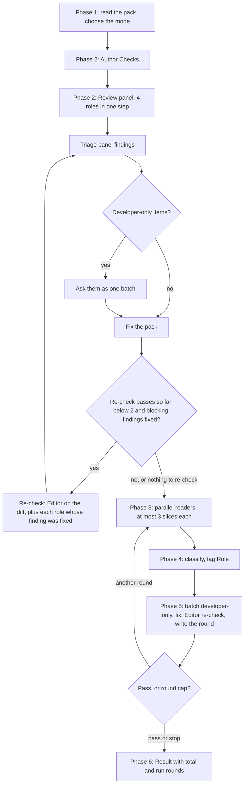
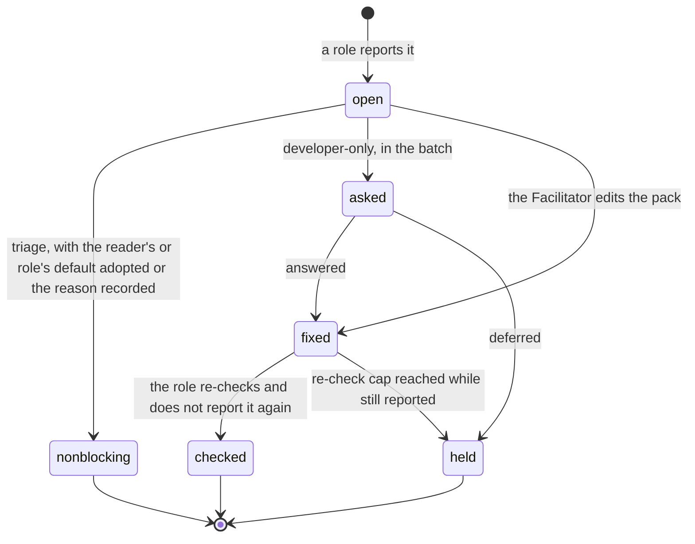
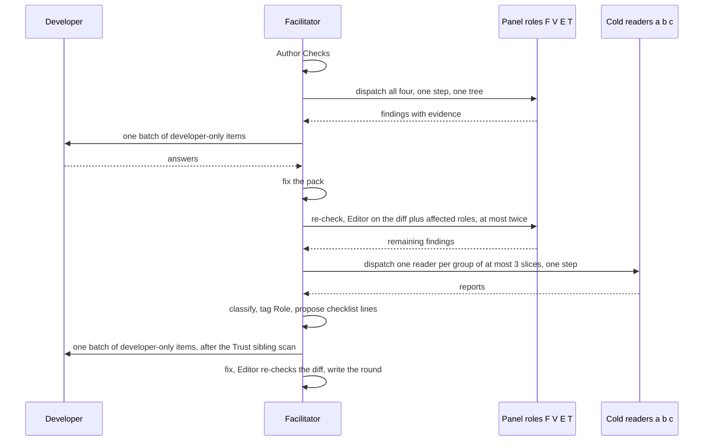

# Design

## 1. Architecture

The main session running `cold-read` is the **Facilitator**. It writes and fixes the pack, and it
dispatches every role and reader; no subagent dispatches another. Five new files hold the roles
and three hold cold-read procedure, so `skills/cold-read/SKILL.md` gains pointers, not procedure
(it is 397 lines today, `context.md` §1). Slice 1 moves the reader-tree procedure out first, to
make room for every later pointer.

| Component | File | Responsibility |
|---|---|---|
| Dispatch contract | `skills/planning/references/roles/dispatch.md` | How any skill dispatches any role: model resolution, the prompt frame, the tree and guard, the output contract, the completeness check, triage, the fallbacks. Shared by every child pack (ADR-001) |
| Fact-checker card | `skills/planning/references/roles/fact-checker.md` | Letter `F`. Proves or disproves claims, citations, counts, fixed-versus-generated values and library behaviour with read-only commands |
| Test engineer card | `skills/planning/references/roles/test-engineer.md` | Letter `V`. Every criterion has a command that would fail if it were false; every Verify command runs now or has a "would fail because…" note (a command needing git-ignored local config such as `.hivrr.json`, absent from the tree, gets that note, not a failure); output is the same on every run; skips cannot pass green |
| Editor card | `skills/planning/references/roles/editor.md` | Letter `E`. Each rule stated once or stated the same; contracts, Files lists and ADRs agree; on a re-check, every restatement a fix diff missed |
| Trust reviewer card | `skills/planning/references/roles/trust-reviewer.md` | Letter `T`. Every outside party and input, its key source, clock, network scope and failure class, gathered into one questionnaire |
| Tree procedure | `skills/cold-read/references/tree.md` | Building a detached tree of `{base}` with the pack copied in, the checksum guard, and removing the tree: moved from `skills/cold-read/SKILL.md:157-200` in Slice 1, used by the panel and every reader |
| Reader procedure | `skills/cold-read/references/readers.md` | Grouping, one reader per group in one step, reader letters, the per-reader completeness check, and the merge (Slice 4) |
| Panel procedure | `skills/cold-read/references/panel.md` | When cold-read runs the panel, the re-check loop (ADR-004), the developer batch, and how panel findings are recorded |
| cold-read | `skills/cold-read/SKILL.md` | Phase 2 gains a **Review panel** subsection pointing to `panel.md`; Phase 3 points to `tree.md` and `readers.md` (ADR-003); Phase 4 adds the Role column; Phase 5 batches developer-only items and calls the re-check; Phase 6 writes the corrected Result |
| Record template | `skills/planning/references/templates/cold-read.md` | The Questions table gains a Role column; the round summary gains the panel line; the Result gains **Checklist proposals** |

No `## Phase` heading is added or renumbered in `cold-read` (`slice` cites its Phase 2 by number,
`skills/slice/SKILL.md:232`, and check 7 holds the sequence). The panel is a subsection of Phase 2
(ADR-002).

## 2. Contracts

### Role card (each file in `roles/` except `dispatch.md`)

Headings, exactly and in this order:

| Heading | Content | Invariants |
|---|---|---|
| `# Role: <Name>` | — | One role per file; the file name is the kebab-case name |
| `## Letter` | One capital letter | Unique across cards: `F`, `V`, `E`, `T` in this pack |
| `## Model` | The model alias: Fact-checker `sonnet`, Test engineer `sonnet`, Editor `sonnet`, Trust reviewer `opus` | The only place a role's model is stated (prd S-01.1) |
| `## Job` | One or two sentences | Names what the role does not do, where it borders another role |
| `## Inputs` | Bullets: always `{tree}` and `{path}`; any extra input with its placeholder. An extra input is the path of a file outside the tree: `{diff}` holds the diff, `{seed}` holds each seed item's Id, file and section, and its text verbatim | The prompt carries these and the card, nothing else (prd S-01.2). Extras in this pack: Editor `{diff}` on a re-check; Trust reviewer `{seed}` on a sibling scan |
| `## Checklist` | Numbered items `{letter}1`, `{letter}2` … each a check the role can run and evidence it must quote | Seeded from the tagged hyalos blockers; a checklist line appears in no other file |
| `## Output` | The output contract below | — |
| Role-specific sections | Trust reviewer only: `## Questionnaire`, a table `Id \| Question \| Options the pack leaves open \| Blocking` | Placed after `## Output` and before `## Blocking test`; no other card has one |
| `## Blocking test` | When a finding is blocking | The same test as the cold read: the executor could not build the slice correctly without it |

### Dispatch (`roles/dispatch.md`)

| Name | Inputs | Outputs | Errors | Invariants |
|---|---|---|---|---|
| Model resolution | the card's `## Model` | `subagent_type: Explore` with that model | no model override: the default model, recorded by name or as `default model` (prd S-01.3) | Cold readers are not roles; they stay as `skills/cold-read/SKILL.md:153` says |
| Prompt frame | card text, `{tree}`, `{path}`, the card's extra inputs | one prompt per role | — | Fixed frame text in a `text` fence, following the reader prompt's structure (`skills/cold-read/SKILL.md:204-240`): the role line, Repository and Pack lines, the read-only line, the card pasted verbatim, then the output sections. No summary, no conversation, no reason for the review |
| Tree and guard | `{base}`, pack path | one detached tree per pass, built by the panel in every mode and removed after its guard, shared by the roles of that pass. A pass is one dispatch step, however many roles it sends | the guard differs outside git-ignored output: the pass is void, the run stops `COLD READ STOPPED` naming the files | The same procedure as a reader, `skills/cold-read/references/tree.md` (today `skills/cold-read/SKILL.md:179`, `:193-194`); `{diff}` and `{seed}` files live outside the tree. `{diff}` is the `diff -ru` of a copy of the pack taken before the fixes against the pack after them, since the pack is untracked |
| Output contract | — | `## Checklist run` (item, result: done, n/a with reason), `## Findings` (Id, blocking, file and section, what is wrong, evidence, checklist item) | — | Ids `P{letter}{n}`; evidence is a command and the output it gave, or quoted lines with `path:line` |
| Completeness check | a role's report | complete or not | missing section, a checklist item absent from Checklist run, or a blocking finding with no evidence: dispatch that role once more; a second failure is recorded `Panel: {role} gave no complete report; not reviewed by {role}.` | Checked per role, never for the panel as a whole |
| Triage | all complete reports of a pass | each finding classed Blocking or Non-blocking, and developer-only where it applies | — | The Facilitator may re-class only with a reason in the Resolution, as cold-read Phase 4 does (`skills/cold-read/SKILL.md:252-269`) |
| No subagent tool | — | the Facilitator works through each card in turn | — | Summary says `Panel run by the Facilitator: not independent.` (prd S-01.4) |

### Panel procedure (`cold-read/references/panel.md`)

| Name | Inputs | Outputs | Errors | Invariants |
|---|---|---|---|---|
| Panel pass | the pack after Author Checks | findings of all four roles, dispatched in one step | as Dispatch | Runs once per run, before the first reader, in every mode. Record only: every panel finding is held and counts as Blocking, its fix written as `Proposed:` in its Resolution, as for author findings. Its findings go in the round that follows; when the run stops before any reader is dispatched, they go in the closing Result under `### Panel without a reader`. In every other mode a fixed finding does not block and a held one does. A deferred item of the pre-reader batch is held, the readers are still dispatched, and the run ends `COLD READ BLOCKED` after that round (prd S-04.3.e1). The item stays blocking as S-04.3 says; only a developer-only item from a reader round stops further rounds, as today |
| Developer batch | every developer-only item of a pass or a round | one message listing each with its options | partial answer: answered items resolve, the rest stay blocking (prd S-04.3) | At most one batch per pass and one per round |
| Re-check | the fix diff and the Ids it answers | Editor on `{diff}`, plus each role whose finding was fixed | — | At most 2 re-check passes before the first reader (ADR-004). After a reader round, one Editor pass checks that round's fix diff before the next reader; it is outside ADR-004's cap and bounded by the 3-round cap |
| Sibling scan | every developer-only question of a reader round | one Trust reviewer dispatch per round, with all of them in `{seed}` | — | Runs before the batch and before any fix; its findings join the same batch (prd S-04.2) |

### Parallel readers (cold-read Phase 3)

| Name | Inputs | Outputs | Errors | Invariants |
|---|---|---|---|---|
| Grouping | slices in plan order; round number; the slices the last fixes touched | groups of at most 3; round 1 covers every slice | — | A slice is touched when a fix edits its section or a file in its Files list. No slices, or no slice touched: one reader on the whole pack (prd S-05.4) |
| Reader dispatch | one group | one new reader per group, all in one step | a short report: that reader alone once more; a second short report stops the run, naming the group, and the round's other reports are discarded unrecorded | Prompt unchanged except `{slices}` (ADR-003); readers lettered `a`, `b`, `c` … per round; one tree per reader, all built in one step before dispatch (Record only: reader `a` uses the Phase 2 tree) |
| Merge | the reports | items with Ids `{reader}Q{n}` and `{reader}C{n}`, for example `aQ1`, `bC2` | — | Each reader's citations count against its own minimum of 8 |

### Record (`templates/cold-read.md`)

| Part | Change | Invariant |
|---|---|---|
| Round summary | adds one line per pass: each role, its model, findings and how many blocking; re-check passes; and each reader's letter and slices | — |
| Questions table | columns `Id \| Blocking \| Role \| File \| Gap \| Resolution` | Role is the checklist the gap belongs to: `fact` (`fact-checker.md`, F), `test` (`test-engineer.md`, V), `editor` (`editor.md`, E), `trust` (`trust-reviewer.md`, T), or `reader` or `author` (prd S-06.1). A `P` item takes its role's value and an `A` item takes `author`; a reader item with any Role but `reader` ends its Resolution with `Checklist line proposed for {role}: …` (prd S-06.2), written as proposed text with the card's next free Id. In the Contradictions table each Item opens with its `{reader}C{n}` Id |
| Closing Result | `Pass after {total} round(s) ({n} in this run).` or `COLD READ BLOCKED: {b} blocking question(s) left after round {N} ({total} rounds, {n} in this run).`, then `### Checklist proposals`, one bullet per proposal, or `None.`; when a run stopped before any reader, `### Panel without a reader` with that pass's findings | `{total}` equals the header Rounds, and `{N}` is the round number, which equals `{total}` (prd S-06.3, S-06.4). The proposals listed are this run's |

## 4. State machines

### Panel finding

Illegal transitions:

- open → checked: a finding is never closed without a fix the role has re-checked.
- held → checked within the same run: held means no re-check is left in this run.
- asked → fixed with no developer answer recorded in the Resolution.

## 5. Flows

## 6. Test strategy

| Level | Proves | How | Fixtures and test data |
|---|---|---|---|
| structural | Files exist with their headings; checklists stated once; `SKILL.md` under 400 lines; pack fences valid | the repo's `verify.test` (`context.md` §4), `wc -l`, `grep` commands in each slice's Verify | the repo itself |
| dry run | A behaviour happens when the edited skill runs | run `cold-read` from this repo's `skills/` on a fixture pack, read the resulting `cold-read.md`, record the evidence against each ID in the progress file | the fixtures below |
| desk check | A failure path the dry run cannot provoke safely | follow the edited skill's text step by step for the stated trigger and quote the lines that decide the outcome | none |

Fixtures, each an untracked copy under `docs/plans/zz-dryrun-<name>/` in this repo, with its README
Status set to `sliced`, deleted before the slice's PR (check 14 reads every folder there):

- **seeded:** a copy of this pack with 10 seeded defects: 3 fact (a wrong `path:line`, a wrong line
  count, a path that does not exist), 3 editor (one rule restated differently in prd, design and a
  slice; a file in a slice's Contracts missing from its Files; an artifact used before the slice
  that creates it), 2 test (a Verify command with no expected output, a command that fails now), 2 trust (an
  upload to an outside service with no key source and no failure class). The progress file lists
  each seeded defect before the run.
- **clean:** the same copy unseeded, for S-02.5.e1.
- **seven:** a copy of `docs/plans/planning-redesign` with `plan.md` cut to Slices 1–7, for
  S-05.1.e1; Slices 2 and 6 touched by hand for S-05.2.e1.
- **small:** a size-S copy (README Slice only), for S-05.1.e2.

| Example rows | Level |
|---|---|
| S-01.2.e1, S-01.2.e2 | dry run (seeded), reading the prompts the Facilitator sent |
| S-01.3.e1, S-01.4.e1, S-01.4.e2 | desk check |
| S-02.4.e1, S-02.4.e2, S-02.2.e1 | dry run (seeded) |
| S-02.2.e2 | desk check |
| S-02.5.e1 | dry run (clean) |
| S-03.1.e1, S-03.2.e1 | dry run (seeded) |
| S-03.3.e1 | desk check |
| S-04.1.e1, S-04.3.e1 | dry run (seeded), the developer deferring one trust item |
| S-04.2.e1 | dry run (seeded) when a reader raises one, otherwise desk check |
| S-05.1.e1, S-05.2.e1 | dry run (seven) |
| S-05.1.e2 | dry run (small) |
| S-05.3.e1 | desk check |
| S-06.1.e1, S-06.1.e2 | dry run (seeded) when readers raise such items, otherwise desk check |
| S-06.3.e1, S-06.3.e2, S-06.4.e1 | desk check against the Result rule, plus the dry-run records |

## 7. Risks

| # | Risk or assumption | Mitigation |
|---|---|---|
| R1 | Strong roles report nits as blocking, and triage becomes the bottleneck | The blocking test is the cold read's; every finding needs evidence; the Facilitator may re-class with a reason |
| R2 | Roles sharing one tree interfere (prd Assumptions row 4) | The seeded dry run compares the guard output; if it fails, one tree per role (stop condition in the panel slice) |
| R3 | `skills/cold-read/SKILL.md` crosses 400 lines | Procedure lives in `panel.md` and `dispatch.md`; every slice's Verify checks `wc -l` |
| R4 | Sonnet roles miss most seeded defects (prd Assumptions row 1) | The seeded dry run counts them; under 7 of 10 found is a stop for the developer |
| R5 | A checklist line is restated in a skill and drifts | A structural grep in Verify shows each checklist line once |
| R6 | Cost grows with four roles and several readers | Dispatches are cheap next to hours of developer wait; the record shows each role's model so cost can be judged |

## 8. Pre-mortem

| # | Failure story | Maps to |
|---|---|---|
| P1 | The panel found everything but nobody trusted it, because its findings had no evidence | Completeness check in the dispatch contract; stop condition in the dispatch slice if the output contract allows a finding without evidence |
| P2 | Readers still took 5 rounds because fixes kept breaking restatements | Editor re-check on every fix diff (S-03.1); R5 |
| P3 | `cold-read` broke `slice`'s Phase 2 reference by renumbering phases | No phase added or renumbered; stop condition in every slice that edits `cold-read` |
| P4 | The developer got four batches a round because each role asked separately | One batch per pass (S-04.1); stop condition in the batching slice if a second message would be sent |
| P5 | A dry-run fixture was left under `docs/plans/` and published as a pack | Fixtures deleted before the PR; Verify lists `docs/plans/` and expects no `zz-dryrun-` folder |
| P6 | Checklist proposals piled up in other repos' records and never came back | Each run's Result lists that run's proposals, and earlier runs' stay in their rounds; the parent pack's retro collects them |
