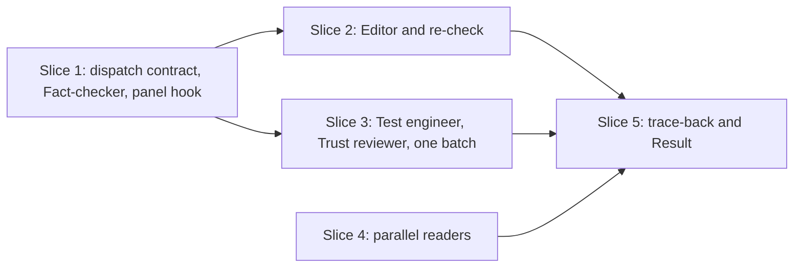

# Plan

## Dependency graph



Slices 1 and 4 both edit `skills/cold-read/SKILL.md` and `templates/cold-read.md`, and Slices 2 and
3 both edit `skills/cold-read/references/panel.md`. Merge in slice order, 1, 2, 3, 4, 5, each
rebased on the one before.

**Line numbers in `skills/cold-read/SKILL.md` shift.** Slice 1 moves lines 157-200 to
`references/tree.md`, and every slice adds pointers. A citation of that file in `context.md` or a
slice names a line range and the section it sits in. At preflight, find the section by its heading.
A section that moved but reads the same is a deviation to record, not a stop. Only a section whose
content changed in a way that touches your Contracts is a stop (README rule 2).

## Traceability

| Criterion | Slices |
|---|---|
| S-01.1, S-01.3, S-01.4 | 1 |
| S-01.2 | 1, 2 |
| S-02.1 | 1, 3 |
| S-02.2, S-02.3 | 1 |
| S-02.4 | 1, 3 |
| S-02.5 | 3 |
| S-03.1, S-03.2, S-03.3 | 2 |
| S-04.1, S-04.2, S-04.3 | 3 |
| S-05.1, S-05.2, S-05.3, S-05.4 | 4 |
| S-06.1, S-06.2, S-06.3, S-06.4 | 5 |

Example rows (S-NN.k.eN) follow their criterion's slices.

## Shared contract

### Checklist seeds

Slices 1 to 3 turn each seed into one checklist item of its role card, keeping its meaning and
adding the evidence the item must quote. The seeds come from the 95 hyalos blockers tagged on
2026-11-24 (`prd.md` Problem); the example after each is the miss it would have caught. The
examples come from Rust packs; each item keeps the seed's meaning in wording that fits any repo,
and may keep its example as a note.

| Role | Seed | Hyalos example |
|---|---|---|
| Fact-checker | For every `path:line`, print the line on `{base}` and quote it; drifted or partly matching fails | `declared_run` cited at `:145`, now `:152` |
| Fact-checker | For every named file, record, flag, env var or feature, show it exists; open each fixture and check its version and counts | `live3.json` is version 1, not 3; no record has five answers |
| Fact-checker | For every "existing code does X", open the function and quote what it does | the existing revert restores only the count, not the ticket |
| Fact-checker | For every library or platform behaviour relied on, read the pinned source or workflow and cite it | the `v*` tag filter also matches `verifier-v*`; whose clock the session time is |
| Fact-checker | For every value treated as fixed (keys, signatures, timestamps, ids), find the code that makes it and say whether it is made per run | `audit_tests.rs` generates its keys per run |
| Fact-checker | Re-count every number the pack states (tests, files, records, answers) | 171 presentations whose agreement was vacuous |
| Test engineer | Run each Verify command on `{base}` that can run now; record its exit status and output; flag any with no stated expected output, and any that cannot run yet without a "would fail because…" note | criterion 3.2 had no Verify command |
| Test engineer | For each test that can skip (no KVM, no network), check that Verify makes a skip fail rather than pass | a network test could skip and still look green |
| Test engineer | Flag any byte-for-byte compare of generated output; require a verdict-level compare, a fixed seed or throwaway keys | byte-comparing ECDSA fixtures cannot match |
| Test engineer | Check every Verify command enables the features its tests need, covers every workspace, and that feature combinations actually build | `test-trust` never enabled; `--all-features` does not compile |
| Test engineer | Check the checker and its oracle are different code | a check that compared against itself |
| Test engineer | For each criterion, name the command that would fail if it were false; flag a step needing a fixture no slice creates | a third-run dry run with no stored reply |
| Editor | List every rule stated in more than one file and compare the wording across prd, design, plan, README and ADRs | which programs lose `--verify`, stated three ways |
| Editor | On a re-check, for every term in `{diff}`, find each restatement the fix did not change | round 7's residual contradicted S-03.3.e2 |
| Editor | For every file, env var, command or reason in a slice's Contracts, check it is in that slice's Files list and the design table | a test env var in no contract or Files list |
| Editor | For each artifact (fuzzer, script, guide, feature flag), name the one slice that creates it and check no earlier slice uses it | no slice creates the frame fuzzer |
| Editor | Compare each accepted ADR with the Contracts and prd; on a conflict say whether the ADR is amended or the contract changes | ADR-003 against the shared-file contract |
| Editor | Check every criterion and limit reads the same in prd, design and plan, and every Brief item has a criterion | the Brief's unchecked-proof requirement had no criterion |
| Trust reviewer | List every outside party or input; for each, state who runs it, who signs, the key source, the clock and the network scope in tests | how the operator side reaches the stand-in provider |
| Trust reviewer | For every key, give its value or path and source, and how a test gets a validly signed bad one; flag a key taken from the chain being checked | the real run's key came from the chain itself |
| Trust reviewer | Build one failure table over every bad, missing or over-limit input: refused, inconclusive or dropped, and the exit code | over-limit reply and missing evidence asked eight rounds apart |
| Trust reviewer | For every dependency, name the test stand-in and the build gate keeping it out of release | stand-in trust variables reaching release builds |
| Trust reviewer | List every operator or developer step; check no done slice depends on it and each has a named owner | an operator-only proof that cannot fit a done slice |
| Trust reviewer | Put every open item in one questionnaire, with the options the pack leaves open | four trust families asked across up to seven rounds |

---

## Slice 1 — Dispatch contract, Fact-checker and the panel hook

Issue: #259 · Depends on: none · Stories: S-01, S-02 · Map: Prepare the review, Panel review

### Outcome

`cold-read` runs a review panel after its Author Checks and before the first reader, dispatching
every role card it finds. In this slice the Fact-checker is the only card, and its fixed findings
are recorded as `PF{n}` items in the round.

### Acceptance

- **S-01.1**
- **S-01.2** (Fact-checker side): the Fact-checker's prompt is built from its card, `{tree}` and
  `{path}` only. Slice 2 proves the Editor examples, S-01.2.e1 and S-01.2.e2.
- **S-01.3**
- **S-01.4**
- **S-02.1** (dispatch side): the panel dispatches every card in `skills/planning/references/roles/`
  other than `dispatch.md`, in one step. Slice 3 proves it with all four cards.
- **S-02.2**
- **S-02.3**
- **S-02.4** (fact side): held and fixed `PF` findings. Slice 3 proves the trust side, S-02.4.e2.
- **1.1** `skills/planning/references/roles/dispatch.md` holds each row of the `design.md` §2
  **Dispatch** table: Model resolution, Prompt frame, Tree and guard, Output contract, Completeness
  check, Triage, No subagent tool.
- **1.2** `skills/planning/references/roles/fact-checker.md` has the role card headings in order,
  letter `F`, and checklist items `**F1**` onward, one per **Fact-checker** seed in the Shared
  contract below, each naming the evidence it must quote.
- **1.3** `skills/cold-read/SKILL.md` Phase 2 ends with a `### Review panel` subsection that points
  to `$CLAUDE_SKILL_DIR/references/panel.md` and adds no procedure of its own. Phase 3's reader-tree
  build and guard (`skills/cold-read/SKILL.md:157-200`) move to
  `$CLAUDE_SKILL_DIR/references/tree.md`, unchanged, behind a pointer. The skill has the same 7
  `## Phase` headings and stays under 400 lines.
- **1.4** Given the seeded fixture with its 3 fact defects, when `cold-read` runs, then the
  Fact-checker reports at least 2 of them, each with evidence.

### Contracts

`design.md` §2: **Role card**, **Dispatch**, and the **Panel pass** row of **Panel procedure**.
Panel findings are recorded in the round's Questions table beside the author findings
(`skills/cold-read/SKILL.md:132-138`), with Ids `PF{n}`.

### Stop conditions

- Stop if a contract this slice depends on has drifted from `context.md` (preflight).
- Stop if the output contract would let a blocking finding through without evidence (pre-mortem P1).
- Stop if fitting the hook in `skills/cold-read/SKILL.md` needs a new or renumbered `## Phase`
  heading (pre-mortem P3).
- Stop if the seeded dry run shows the guard output differs when roles share one tree (design R2);
  record it, and ask whether to give each role its own tree.

### Verify

```bash
eval "$(jq -r .verify.test .hivrr.json)"
# expected: structural checks pass
wc -l < skills/cold-read/SKILL.md
# expected: a number below 400
grep -c '^## Phase' skills/cold-read/SKILL.md
# expected: 7
awk '/^## /{printf "%s|", substr($0, 4)} END {print ""}' skills/planning/references/roles/fact-checker.md
# expected: Letter|Model|Job|Inputs|Checklist|Output|Blocking test|
grep -rhoE '\*\*[FVET][0-9]+\*\*' skills --include=*.md | sort | uniq -d
# expected: no output (each checklist Id appears once, in its card)
ls docs/plans | grep zz-dryrun
# expected: no output
```

Dry runs, each recorded against its IDs in `progress/slice-01.md` (fixtures as `design.md` §6):

- **seeded** fixture: run `cold-read docs/plans/zz-dryrun-seeded` following this repo's
  `skills/cold-read/SKILL.md`. Proves S-02.1 (dispatch side), S-02.3, S-02.4.e1, S-02.2.e1, 1.4, and
  S-01.2 (Fact-checker side) from the prompt sent. Defer one held fact finding to prove S-02.4.e2's
  held path with `PF` in place of `PT`.
- S-02.2.e1 in this repo: there is no Rust, so the role writes a git-ignored file in its tree in
  place of `cargo check`; the guard must still hold.
- Desk checks, quoting the deciding lines: S-01.3.e1, S-01.4.e1, S-01.4.e2, S-02.2.e2.

### Pattern to follow

- Exact prompt with required report sections and a completeness re-dispatch:
  `skills/cold-read/SKILL.md:202-246`.
- A skill pointing to a reference for detail: `skills/spec/SKILL.md:267`.
- Reader tree and guard to move, not rewrite: `skills/cold-read/SKILL.md:157-200`.

### Suggested path

Default route. You may deviate if every mandatory item still holds; record why.

1. Move the tree procedure to `tree.md`, leaving a pointer, and confirm the line count dropped.
2. Write `dispatch.md` from `design.md` §2, putting the prompt frame in a `text` fence.
3. Write `fact-checker.md`, turning the Fact-checker seeds into `**F1**` to `**F6**`.
4. Write `panel.md` with the Panel pass only; Slices 2 and 3 add the re-check and the batch.
5. Add the `### Review panel` pointer to cold-read Phase 2, and point Phase 4's class table at panel
   findings ("Author finding from Phase 2" covers `P` items too).
6. Build the seeded fixture, run the dry run, record the results, delete the fixture.

### Files

- Create: `skills/planning/references/roles/dispatch.md`
- Create: `skills/planning/references/roles/fact-checker.md`
- Create: `skills/cold-read/references/panel.md`
- Create: `skills/cold-read/references/tree.md`
- Modify: `skills/cold-read/SKILL.md`
- Modify: `skills/planning/references/templates/cold-read.md` (the panel line in the round summary)

---

## Slice 2 — Editor and the re-check loop

Issue: #260 · Depends on: Slice 1 · Stories: S-03 · Map: Fix and re-check

### Outcome

The Editor joins the panel, and every fix is checked by someone other than its author: the Editor
reads each fix diff for restatements left unchanged, the roles whose findings were fixed re-check,
and the panel stops after two re-check passes.

### Acceptance

- **S-01.2** (Editor side): S-01.2.e1 and S-01.2.e2, from the Editor's first dispatch and its
  re-check dispatch.
- **S-03.1**
- **S-03.2**
- **S-03.3**
- **2.1** `skills/planning/references/roles/editor.md` has the role card headings in order, letter
  `E`, the extra input `{diff}`, and checklist items `**E1**` onward, one per **Editor** seed in the Shared contract.
- **2.2** cold-read Phase 5's "run the Phase 2 checks again" is rewritten to run the mechanical
  Phase 2 checks and then the re-check in `panel.md`, never the whole panel, so a reader round's
  fixes are re-checked by the Editor before the next reader.
- **2.3** Given the seeded fixture with its 3 editor defects, when `cold-read` runs, then the Editor
  reports at least 2 of them.

### Contracts

`design.md` §2: **Re-check** row of **Panel procedure**; the `{diff}` input of the **Role card**
table. The diff file lives outside the tree, per the **Tree and guard** row. `design.md` §4 **Panel
finding** state machine: `fixed → checked` only after a re-check; `fixed → held` at the cap.

### Stop conditions

- Stop if a contract this slice depends on has drifted from `context.md` (preflight).
- Stop if fitting the change in `skills/cold-read/SKILL.md` needs a new or renumbered `## Phase`
  heading (pre-mortem P3).
- Stop if the re-check would re-dispatch a role whose findings were not fixed; that breaks S-03.2.

### Verify

```bash
eval "$(jq -r .verify.test .hivrr.json)"
# expected: structural checks pass
wc -l < skills/cold-read/SKILL.md
# expected: a number below 400
grep -c '^## Phase' skills/cold-read/SKILL.md
# expected: 7
awk '/^## /{printf "%s|", substr($0, 4)} END {print ""}' skills/planning/references/roles/editor.md
# expected: Letter|Model|Job|Inputs|Checklist|Output|Blocking test|
grep -rhoE '\*\*[FVET][0-9]+\*\*' skills --include=*.md | sort | uniq -d
# expected: no output
ls docs/plans | grep zz-dryrun
# expected: no output
```

Dry runs, recorded in `progress/slice-02.md`:

- **seeded** fixture: fix one fact finding and one editor finding, then read the re-check dispatch.
  Proves S-03.2.e1, S-03.1.e1 (the seeded rule restated in prd, design and a slice), 2.3, and
  S-01.2.e1 and S-01.2.e2 from the Editor prompts sent.
- Desk check: S-03.3.e1, quoting the cap in `panel.md`.

### Pattern to follow

- The restatement rule this generalizes: `skills/cold-read/SKILL.md:293`.
- The card shape from Slice 1: `skills/planning/references/roles/fact-checker.md`.

### Suggested path

Default route. You may deviate if every mandatory item still holds; record why.

1. Write `editor.md`.
2. Add the Re-check section to `panel.md`, with the cap of two passes and the held outcome.
3. Extend cold-read Phase 5's re-run line to point to the re-check.
4. Dry run on the seeded fixture, record, delete the fixture.

### Files

- Create: `skills/planning/references/roles/editor.md`
- Modify: `skills/cold-read/references/panel.md`
- Modify: `skills/cold-read/SKILL.md`

---

## Slice 3 — Test engineer, Trust reviewer and one decision batch

Issue: #261 · Depends on: Slice 1 · Stories: S-02, S-04 · Map: Panel review, Fix and re-check

### Outcome

The panel has all four roles. Every developer-only item from a panel pass, the Trust reviewer's
questionnaire included, reaches the developer in one message before any reader, and a reader's
developer-only question triggers a Trust sibling scan so related questions arrive together.

### Acceptance

- **S-02.1** (all roles): the four cards are dispatched together in one step.
- **S-02.4** (trust side): S-02.4.e2 with a deferred `PT` finding.
- **S-02.5**
- **S-04.1**
- **S-04.2**
- **S-04.3**
- **3.1** `test-engineer.md` (letter `V`) and `trust-reviewer.md` (letter `T`, extra input
  `{seed}`, a `## Questionnaire` output section) have the role card headings in order and
  checklist items, one per **Test engineer** and **Trust reviewer** seed in the Shared contract.
- **3.2** Given the seeded fixture, when the full panel runs, then at least 7 of the 10 seeded
  defects are reported (design R4).

### Contracts

`design.md` §2: **Developer batch** and **Sibling scan** rows of **Panel procedure**; the Trust
reviewer's `{seed}` input. cold-read Phase 5's **Developer-only first**
(`skills/cold-read/SKILL.md`, Phase 5 **Developer-only first**) asks the batch as one message; its "asked at once" becomes
"asked after the sibling scan, before any fix and before any further round".

### Stop conditions

- Stop if a contract this slice depends on has drifted from `context.md` (preflight).
- Stop if fewer than 7 of the 10 seeded defects are found (design R4): record which, and bring it to
  the developer before changing any model or checklist.
- Stop if any path would send the developer a second message in the same pass (pre-mortem P4).
- Stop if fitting the change in `skills/cold-read/SKILL.md` needs a new or renumbered `## Phase`
  heading (pre-mortem P3).

### Verify

```bash
eval "$(jq -r .verify.test .hivrr.json)"
# expected: structural checks pass
wc -l < skills/cold-read/SKILL.md
# expected: a number below 400
grep -c '^## Phase' skills/cold-read/SKILL.md
# expected: 7
for f in test-engineer trust-reviewer; do awk '/^## /{printf "%s|", substr($0, 4)} END {print ""}' skills/planning/references/roles/$f.md; done
# expected:
#   Letter|Model|Job|Inputs|Checklist|Output|Blocking test|
#   Letter|Model|Job|Inputs|Checklist|Output|Questionnaire|Blocking test|
grep -rhoE '\*\*[FVET][0-9]+\*\*' skills --include=*.md | sort | uniq -d
# expected: no output
ls docs/plans | grep zz-dryrun
# expected: no output
```

Dry runs, recorded in `progress/slice-03.md`:

- **seeded** fixture: full panel. Proves S-02.1, 3.2, S-04.1.e1 (one message with every
  developer-only item), S-04.3.e1 (answer all but two items of the batch: the answered ones
  resolve, the two stay blocking and the run ends `COLD READ BLOCKED`), and S-02.4.e2 with `PT`.
- **clean** fixture: S-02.5.e1.
- S-04.2.e1: from the seeded run if a reader raises a developer-only item, otherwise a desk check.

### Pattern to follow

- Asking developer-only questions before any fix: `skills/cold-read/SKILL.md`, Phase 5
  **Developer-only first**.
- The card shape from Slice 1: `skills/planning/references/roles/fact-checker.md`.

### Suggested path

Default route. You may deviate if every mandatory item still holds; record why.

1. Write `test-engineer.md` and `trust-reviewer.md`.
2. Add Developer batch and Sibling scan to `panel.md`.
3. Change cold-read Phase 5's developer-only step to ask one batch, after the sibling scan.
4. Dry run on the seeded and clean fixtures, record, delete them.

### Files

- Create: `skills/planning/references/roles/test-engineer.md`
- Create: `skills/planning/references/roles/trust-reviewer.md`
- Modify: `skills/cold-read/references/panel.md`
- Modify: `skills/cold-read/SKILL.md`

---

## Slice 4 — Parallel cold readers

Issue: #262 · Depends on: none · Stories: S-05 · Map: Cold read

### Outcome

Round 1 reads every slice: cold-read splits the slices into groups of at most 3 and dispatches one
new reader per group in one step. Later rounds read only the slices the fixes touched.

### Acceptance

- **S-05.1**
- **S-05.2**
- **S-05.3**
- **S-05.4**
- **4.1** The reader prompt in `skills/cold-read/SKILL.md` is unchanged apart from `{slices}`.

### Contracts

`design.md` §2 **Parallel readers**: Grouping, Reader dispatch, Merge. Ids `{reader}Q{n}` and
`{reader}C{n}`; one tree per reader; each report checked for completeness on its own (ADR-003).

### Stop conditions

- Stop if a contract this slice depends on has drifted from `context.md` (preflight).
- Stop if the change needs any edit to the reader prompt beyond `{slices}`; the read stays cold.
- Stop if fitting the change in `skills/cold-read/SKILL.md` needs a new or renumbered `## Phase`
  heading (pre-mortem P3).

### Verify

```bash
eval "$(jq -r .verify.test .hivrr.json)"
# expected: structural checks pass
wc -l < skills/cold-read/SKILL.md
# expected: a number below 400
grep -c '^## Phase' skills/cold-read/SKILL.md
# expected: 7
diff <(git show origin/main:skills/cold-read/SKILL.md | awk '/^You are about to implement/,/^A table: citation/') <(awk '/^You are about to implement/,/^A table: citation/' skills/cold-read/SKILL.md)
# expected: no output (the reader prompt is unchanged, its {slices} line included)
ls docs/plans | grep zz-dryrun
# expected: no output
```

Dry runs, recorded in `progress/slice-04.md`:

- **seven** fixture: S-05.1.e1 (three readers, Slices 1–3, 4–6, 7, in one step); after touching
  Slices 2 and 6 by hand, S-05.2.e1 (one reader on Slices 2 and 6).
- **small** fixture: S-05.1.e2 and S-05.4.
- Desk check: S-05.3.e1.

### Pattern to follow

- Slice assignment today: `skills/cold-read/SKILL.md:145-147`.
- Incomplete-report handling to apply per reader: `skills/cold-read/SKILL.md:244-246`.

### Suggested path

Default route. You may deviate if every mandatory item still holds; record why.

1. Write `readers.md`: grouping ("only" the touched slices, replacing today's "prefer" at
   `skills/cold-read/SKILL.md:145-147`), one reader per group in one step, letters, the per-reader
   report check and the merge. Leave pointers in **Assign slices** and Phase 3.
2. Make the Display line per reader.
3. Update the template's round summary to list each reader's letter and slices.
4. Dry run on the seven and small fixtures, record, delete them.

### Files

- Create: `skills/cold-read/references/readers.md`
- Modify: `skills/cold-read/SKILL.md`
- Modify: `skills/planning/references/templates/cold-read.md`

---

## Slice 5 — Trace-back and an honest Result

Issue: #263 · Depends on: Slice 2, Slice 3, Slice 4 · Stories: S-06 · Map: Record and learn

### Outcome

Every item in `cold-read.md` has a Role: the checklist it belongs to, or `author` or `reader`. Each reader blocker that a role
should have caught proposes a checklist line for that role, the Result lists every proposal, and
the Result line states the total rounds and this run's rounds so it agrees with the header.

### Acceptance

- **S-06.1**
- **S-06.2**
- **S-06.3**
- **S-06.4**
- **5.1** The cold-read template's Questions table has the columns
  `Id | Blocking | Role | File | Gap | Resolution`, and its Result has a `### Checklist proposals`
  subsection.

- **5.2** The template's closing Result shows the `### Panel without a reader` subsection
  (`design.md` §2 Record), and Phase 6 writes it when a run stopped before any reader.

### Contracts

`design.md` §2 **Record**: Questions table, Round summary, Closing Result.

### Stop conditions

- Stop if a contract this slice depends on has drifted from `context.md` (preflight).
- Stop if the Result change would alter the `rounds` or `blocking` fields of the result JSON; the
  `planning` wrapper reads them (`skills/planning/SKILL.md:64`).
- Stop if fitting the change in `skills/cold-read/SKILL.md` needs a new or renumbered `## Phase`
  heading (pre-mortem P3).

### Verify

```bash
eval "$(jq -r .verify.test .hivrr.json)"
# expected: structural checks pass
wc -l < skills/cold-read/SKILL.md
# expected: a number below 400
grep -c '^## Phase' skills/cold-read/SKILL.md
# expected: 7
grep -c '| Id | Blocking | Role | File | Gap | Resolution |' skills/planning/references/templates/cold-read.md
# expected: 1
grep -rF 'Pass after {total} round(s) ({n} in this run)' skills/cold-read | wc -l
# expected: 1
grep -rF '({total} rounds, {n} in this run)' skills/cold-read | wc -l
# expected: 1
ls docs/plans | grep zz-dryrun
# expected: no output
```

Dry runs, recorded in `progress/slice-05.md`:

- **seeded** fixture: the record's Role column and Checklist proposals. Proves S-06.1.e1 and
  S-06.1.e2 when readers raise such items, otherwise desk checks.
- Desk checks against the Result rule: S-06.3.e1, S-06.3.e2, S-06.4.e1.

### Pattern to follow

- The Result rewrite today: `skills/cold-read/SKILL.md:343-356`.
- The template's Questions table: `skills/planning/references/templates/cold-read.md`.

### Suggested path

Default route. You may deviate if every mandatory item still holds; record why.

1. Add the Role column to the template and the trace-back rule to cold-read Phase 4.
2. Add the checklist-line Resolution and the Checklist proposals list to Phase 5 and Phase 6.
3. Rewrite both Result lines in Phase 6. If the skill nears 400 lines, move the Result text to
   `skills/cold-read/references/result.md` behind a pointer, as Slice 1 does for `tree.md`.
4. Dry run, record, delete the fixture.

### Files

- Modify: `skills/cold-read/SKILL.md`
- Modify: `skills/planning/references/templates/cold-read.md`
- Create, only if the Result text moves: `skills/cold-read/references/result.md`
