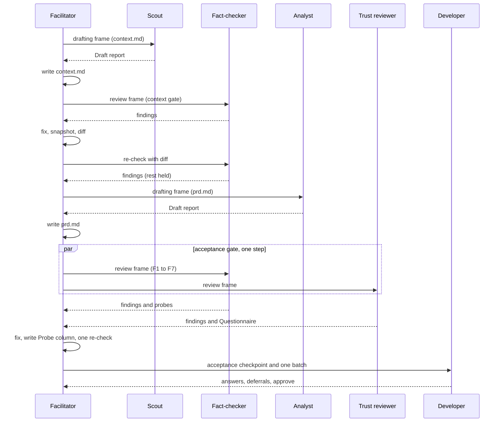

# Design

## 1. Architecture

The Facilitator (the main session running `spec` or `slice`) stays the only dispatcher and the
only writer. Each stage gets a **drafting role** that writes the stage's file as its report, and a
**gate** of reviewing roles that checks it before the stage's checkpoint. Every role runs
read-only, as `subagent_type: Explore`, in a detached tree under the checksum guard (ADR-001).

| Component | File | Responsibility |
|---|---|---|
| Dispatch contract | `skills/planning/references/roles/dispatch.md` | Model resolution, the `{base}` step, both prompt frames, tree and guard, both completeness checks, the drafting display and drafting lines, triage, the no-subagent fallback |
| Gate procedure | `skills/planning/references/gates.md` (new) | The gate pass, its one re-check, held findings, the checkpoint batch and the handoff entries; shared by `spec` and `slice` |
| Handoff note | `docs/plans/<slug>/handoff.md` (pack file, transient; template `skills/planning/references/templates/handoff.md`, new) | Work in flight between runs: Gate pending and Spec pending entries (ADR-008) |
| `planning` | `skills/planning/SKILL.md` | Resume reads `handoff.md` first; the gate before Approve and Publish refuses while it exists (ADR-008) |
| Reviewing cards | `fact-checker.md`, `editor.md`, `test-engineer.md`, `trust-reviewer.md` in `roles/` | Unchanged jobs; each gains `## Kind` `review`; the Fact-checker gains **F7** (ADR-005) |
| Drafting cards | `scout.md`, `analyst.md`, `architect.md`, `planner.md` in `roles/` (new) | One file each; `## Kind` `draft` |
| Panel | `skills/cold-read/references/panel.md` | Step 1 dispatches `review` cards only (ADR-004) |
| `spec` | `skills/spec/SKILL.md` | Phase 1 reads `handoff.md`; Phase 2 resolves `{base}`, dispatches the Scout and runs the context gate; Phase 3 the Analyst and the acceptance gate; Phase 4 shows the batch; Phase 7 the Architect; Phase 8 asks the Architect's held open points |
| `slice` | `skills/slice/SKILL.md` | Phase 1 resolves `{base}` and reads `handoff.md`, and **Re-slice** may move to `skills/slice/references/reslice.md` (R2); Phase 2 dispatches the Planner; Phase 4 runs the slice gate after the Self-check; Phase 5 shows the batch |
| prd template | `skills/planning/references/templates/prd.md` | The Assumptions table gains a `Probe` column |
| Pack format | `skills/planning/references/pack-format.md` | Its Assumptions content-section row names the probe result; §1 Layout lists `handoff.md` |

`gates.md` sits in `skills/planning/references/`, not in `roles/`, because every file in `roles/`
except `dispatch.md` is a card (`dispatch.md:3-4`), and a non-card there would be reported as a
card with no kind. It is a skill reference, not a pack file, so ADR-007's rejected pack file of the
same name does not apply to it. The one new pack file is `handoff.md` (ADR-008).

### Stages

ADR-003: each row runs whenever its stage writes its file; a stage the route skips dispatches
nothing.

| Stage | Skill phase | Drafting role | Gate after it | Batch at |
|---|---|---|---|---|
| Context | `spec` Phase 2 | Scout, `context.md` | **Context gate**: Fact-checker | the acceptance checkpoint (held) |
| Acceptance | `spec` Phase 3 | Analyst, `prd.md`, or the README Slice's Outcome and Acceptance at size S | **Acceptance gate**: Fact-checker (with F7) and Trust reviewer, one step | the acceptance checkpoint, `spec` Phase 4 |
| Design | `spec` Phase 7 | Architect, `design.md` | none (non-goal) | the design checkpoint, `spec` Phase 8: the Architect's held open points only |
| Slice | `slice` Phases 2 and 4 | Planner, `plan.md` | **Slice gate**: Test engineer and Editor, one step | the slice checkpoint, `slice` Phase 5 |

Nothing else in either skill moves: ADRs, `inventory.md`, `ux.md`, modifier sections and the size S
README Slice's later headings stay with the Facilitator, who adds them after writing the draft, and
every checkpoint keeps its options.

## 2. Contracts

### Cards

| Name | Inputs | Outputs | Errors | Invariants |
|---|---|---|---|---|
| `## Kind` section | none | `review` or `draft`, alone on the line after the heading; placed after `## Model` | A card with no `## Kind`, or with any value but `review` or `draft`, is dispatched by no one; the panel says `Card {file} states no kind; not dispatched.` for either | Every card in `roles/` has one (ADR-004) |
| Reviewing card shape | none | `# Role:`, `## Letter`, `## Model`, `## Kind`, `## Job`, `## Inputs`, `## Checklist`, `## Output`, `## Blocking test`, plus any section the card adds (the Trust reviewer's `## Questionnaire`) | none | Child 1's shape with `## Kind` inserted |
| Drafting card shape | none | `# Role:`, `## Letter`, `## Model`, `## Kind`, `## Job`, `## Inputs`, `## Checklist`, `## Output` | none | No `## Blocking test`: a drafter reports open points, not findings. Its Checklist holds only what its file needs beyond the phase skill's own rules, which it reads, never a copy of them |
| Drafting roles | none | Scout: letter `S`, model `sonnet`, writes `context.md`. Analyst: `N`, `opus`, `prd.md` (README Slice Outcome and Acceptance at size S). Architect: `R`, `opus`, `design.md`. Planner: `L`, `opus`, the whole `plan.md`, its Dependency graph and Traceability included; `slice` Phase 2 **Count** counts the draft's `## Slice N` headings before anything is written. In a Re-slice (`skills/slice/SKILL.md:77-92`) the Planner's card lists one extra input, `{current}`: a file outside the tree, in a temporary directory of its own, holding the current `plan.md` and the reason `slice` Phase 1 **Re-slice** records (the developer's request), added to the prompt as the Drafting frame allows; the Planner returns the whole file with only the slices the reason needs revised; a draft that changes any other slice's text is an incomplete draft | none | Letters differ from `F`, `E`, `V`, `T`, and from `A`, which `cold-read` gives author items. Models: ADR-002 |
| Fact-checker **F7** | the prd's Assumptions table | One row per assumption: `held`, `false` or `not run: {reason}`, with evidence: the command and its output, or the quoted lines with `path:line` | A check that writes, installs or uses the network is not run: `not run: changes state` | Runs whenever the card runs, in a gate or in the panel; with no Assumptions table it is n/a (ADR-005) |

### Dispatch

| Name | Inputs | Outputs | Errors | Invariants |
|---|---|---|---|---|
| `{base}` step | `branches.integration` from `.hivrr.json`, then the repository default branch, then `origin/HEAD`, then `main` | `{base}`: `origin/{integration}` after `git fetch origin {integration}`; the stale ref with `Tree from origin/{integration}, not refreshed: fetch failed, may be stale.`; or `HEAD` with `Tree from HEAD: origin/{integration} unavailable.` | none: a fallback, never a stop | Resolved once per skill run, before its first dispatch, as `cold-read` Phase 1 does (`skills/cold-read/SKILL.md:54-60`); the fallback line is shown at the next checkpoint |
| Drafting frame | `{tree}`, `{path}`, `{name}`, `{card}`, `{file}` (the file to draft), `{template}`, `{skill}` (the phase skill's `SKILL.md`, the phase to follow, and each reference file that phase points to) and `{format}` (`pack-format.md`), each an absolute path; `{date}` (`date +%F`) and `{sha}` (`git rev-parse --short {base}`), both taken once per skill run, with `{base}` | The prompt text, held once in `dispatch.md` | none | Like the review frame: only the card and the listed inputs, nothing else; a card's **Inputs** may list an extra input, added as one line after the Pack line, as the review frame allows for `{diff}` and `{seed}` (`dispatch.md:25-26`); the Facilitator learned this session. `{template}`, `{skill}` and `{format}` resolve through `$CLAUDE_SKILL_DIR` of the skill being run, the same copy that skill reads its own references from; they are read-only inputs outside the tree and the guard. The pack already holds every approved earlier file |
| Draft report | the drafting frame | `## Draft`: the file verbatim between a line `=== BEGIN {file} ===` and a line `=== END {file} ===`; then `## Open points`: a table `Id \| Question \| Options \| Blocking (yes/no)`, Ids `D{letter}1`, `D{letter}2` …, or "None." | see the next row | The marker lines are not fences, so the file's own `bash` and `mermaid` fences pass through intact. At size S the Analyst's markers name `README.md` and the draft holds only the Slice's `### Outcome` and `### Acceptance`, which the Facilitator puts in place of those two headings. `context.md`'s opening line names `{sha}`, the commit its citations are checked at. On a Greenfield route, whose `context.md` cites each stack choice to the ADR that chose it (`skills/spec/SKILL.md:136-138`), the Scout cites the Brief or the **Ruled out** option instead, the context gate checks that, and the Facilitator adds each ADR citation in Phase 5 when the ADR is written |
| Draft completeness check | the draft report, the route | Accepted: the Facilitator writes the text between the markers to `{path}/{file}` | Missing a marker, a marker naming another file, a second pair of markers, `## Open points`, or a section the route's triggers require (other than those §1 keeps with the Facilitator), in a Re-slice a change to a slice the reason does not name, or no report at all: dispatched once more in a new tree; a second short draft and the Facilitator drafts the file itself, saying `Drafted by the Facilitator: {role} gave no complete draft.` | Each draft is checked on its own. Every open point is triaged like a finding (`dispatch.md` **Triage**); a non-blocking one is settled by the Facilitator in the file and listed at the checkpoint; a blocking or developer-only one is held for its stage's checkpoint (§1 **Stages**), which lists it with the checkpoint's content until Slice 2's batch exists |
| Drafting line | the dispatch | `Drafted by the {role}, {Model} (Agent tool, model: {alias}, Explore).`, shown at the checkpoint that shows the file | A card model the tool rejects: dispatched on the default model, as `dispatch.md` **Model resolution** says, and the line reads `Drafted by the {role}, default model (Agent tool, Explore).` | One per drafted file |
| Draft display | each drafting dispatch | `Draft: {role} {model} — {file}, {o} open points`, printed when the report is accepted | none | Held in `dispatch.md`, so every drafting stage has it before `gates.md` exists |
| No subagent tool | none | The Facilitator drafts by the card and says `Drafted by the Facilitator: not independent.`; it works through each gate card and says `Gate run by the Facilitator: not independent.` | none | A missing capability changes where a role runs, never whether it runs (`dispatch.md:20`) |

### Gates (`gates.md`)

| Name | Inputs | Outputs | Errors | Invariants |
|---|---|---|---|---|
| Gate pass | the stage's roles (Stages table), `{base}`, the pack | One tree as `dispatch.md` **Tree and guard** says; one review-frame prompt per role, all in one message; each report checked by `dispatch.md` **Completeness check**; findings triaged | A guard difference voids the gate: say which files changed, remove the tree, and the skill stops `{SKILL} STOPPED` with Status unchanged and the files on disk. A report incomplete twice: `Gate: {role} gave no complete report; not reviewed by {role}.` and the gate goes on | One dispatch step per pass |
| Ids | role reports | Gate findings renumbered `G{letter}{n}` (`GF1`, `GT1`, `GV1`, `GE1`), continuing from the highest `G{letter}` Id in the README **Open questions** `Deferred at …` lines and in `handoff.md` (ADR-008); a Trust reviewer's Questionnaire row takes its finding's `G` Id | none | Never `P…`, which `cold-read` uses for the panel; a re-check finding that matches an earlier one keeps its Id; a finding that matches a deferred item names that item's Id and is not raised again |
| Fix | blocking findings | The Facilitator fixes each one it can, in a file its skill may edit: `spec` any spec file; `slice` only `plan.md` (`skills/slice/SKILL.md:33-35`). Snapshot first, as `panel.md` **Snapshot** says. In `slice`, the Phase 4 Self-check runs again on the fixed `plan.md` before the re-check; a failure is fixed once, then held | A fix that needs a file the skill may not edit is **held** | Non-blocking findings of the gate pass are fixed when cheap, else counted in the gate's Display line and listed under it at the checkpoint, never asked; nothing the re-check reports is fixed (ADR-006) |
| One re-check | `{diff}` of the gate's fixes | Each role with a fixed finding, dispatched once more with `{diff}`, in one step, in a new tree | A fixed finding reported again, or a new blocking finding, is **held**, never fixed again in this gate; a new non-blocking finding is listed at the checkpoint under the gate's Display line, not fixed (ADR-006) | With no fixes, no re-check |
| Held | developer-only findings, blocking Questionnaire rows, findings held by Fix or the re-check, `false` probes, and each drafter's blocking or developer-only open points | Queued for the next checkpoint's batch | none | The Scout's and the Analyst's open points and the context gate's held items wait for the acceptance checkpoint; the Architect's for the design checkpoint; the Planner's for the slice checkpoint; nothing is asked between stages. A dispatch the tool ends with an error or no report, or one the developer interrupts, counts as an incomplete report; there is no time limit |
| Probe results | the acceptance gate's F7 rows | Written by the Facilitator into the prd's Assumptions `Probe` column: `held: {evidence}`, `false: {evidence}` or `not run: {reason}` | none | A `false` row is held, its "If false" text the batch item (prd S-04.3) |
| Checkpoint batch | every held item for this checkpoint | One message: the checkpoint's own content, then each item with its Id, the role's wording, file and section, and the options the pack leaves open, then the checkpoint's question | none | One message per checkpoint; duplicates from two roles are one item listing both Ids; a deferred item is never asked again |
| Answer | the developer's reply | Each answer written into the file it concerns with the date; an answer choosing between options is a developer-stated choice, so `spec` Phase 5 records it as an `accepted` ADR (`skills/spec/SKILL.md:226-229`) | At the slice checkpoint, an answer that needs the prd, design or an ADR changed: `slice` writes a **Spec pending: {Id}** entry to `handoff.md` and stops with `Stopped: {Id} needs a spec change — next: planning {path} revise spec.` | `slice` never edits a spec file |
| Deferral | a deferred item | A README **Open questions** line `Deferred at the {acceptance \| design \| slice} checkpoint on {date}: {Id} — {question}.` | At the slice checkpoint, a deferred **blocking** item withholds Approve: change or stop, and a stop says `Stopped: {Id} unanswered — next: planning {path} revise spec.` | At the acceptance and design checkpoints a deferral does not withhold Approve, since the panel and the cold read meet it again; a blocking item neither answered nor deferred does |
| Display | each gate dispatch | `Gate {stage}: {role} {model} — {f} findings ({b} blocking){, …} \| fixed {x}, held {h}`; `Gate {stage} re-check: {roles} — {f} findings \| checked {c}, held {h}` | none | The checkpoint repeats each gate's line as its summary (ADR-007) |
| Handoff | the stage's file written; the gate's notices and held items | For `context.md`, `prd.md`, `design.md` and `plan.md` alike, a `## Gate pending: {file}` section in `handoff.md`, from `templates/handoff.md`: the drafting line, every trust and fallback line, each held item as `Id \| Question \| Options \| Blocking`, and `Fix not re-checked` while a fix waits for its re-check; updated as the gate runs | none | The checkpoint that shows the file removes the entry, after answers are written and deferrals are Open questions lines; the file is deleted when its last entry goes. A run that finds a Gate pending entry dispatches no drafter for that file and re-runs only its gate on the file as it stands, keeping the entry's Ids; for `design.md`, which has no gate, it goes straight to the design checkpoint with the entry's lines and open points. `spec` revise removes a **Spec pending** entry when its checkpoint approves (ADR-008). `planning` Resume reads `handoff.md` before the README pending lines (`skills/planning/SKILL.md:114-116`): a **Spec pending: {Id}** entry resumes at Phase 4, Specify, passing its answer as `spec`'s request, as a README `Spec pending after …` line does; the two are told apart by where they live, and each keeps its own removal rule |

### Template

| Name | Inputs | Outputs | Errors | Invariants |
|---|---|---|---|---|
| Assumptions `Probe` column | none | `\| Assumption \| How to validate \| If false \| Probe \|`; the Analyst writes `not probed yet`, the Facilitator writes the F7 result | none | Every row has a Probe cell once the acceptance gate has run |

## 5. Flows

The acceptance stage, the one with the most parts:

The slice stage is the same shape with one drafter (the Planner) and one gate (the Test engineer and
the Editor), with the Phase 4 Self-check between the written draft and the gate.

## 6. Test strategy

There is no test runner (`context.md` §4). Two levels:

| Level | Proves | How | Fixtures and test data |
|---|---|---|---|
| structural | Cards have their sections and kinds; the skills keep their phase numbering and stay under 400 lines; the pack fences hold | `eval "$(jq -r .verify.test .hivrr.json)"`, `wc -l`, `awk` over card headings, `grep` | the repo itself |
| dry run | Each role is dispatched as specified, and the files and checkpoint messages come out as the criteria say | Run the changed phase on a fixture pack and read what it writes and shows; record against the IDs in the slice's progress file | `docs/plans/zz-dryrun-*` packs, built in the slice and removed before commit (`context.md` §4) |

Fixtures:

- **fresh:** a Feature pack at `routed`, README only, whose Brief names a small real change to this
  repo (for example, one more line in `init` Phase 4's output). Proves the Scout, the Analyst and
  the Architect on real material.
- **seeded-context:** fresh, plus a `context.md` with five seeded defects: a drifted `path:line`,
  a named file that does not exist, a wrong line count, a claim resting on a value only the
  developer can choose (developer-only), and a second drifted citation the executor fixes wrongly on
  purpose, so the re-check reports it again. The context gate must report the first four.
- **clean-context:** a three-line `context.md` whose every citation the executor checked before the
  run. The context gate must report no blocking finding.
- **seeded-prd:** seeded-context fixed except its developer-only seed, which stays held, plus a prd
  with five assumptions: one whose probe is a file read that shows it true, one whose file read
  shows it false, one that needs a write to check, one that needs a dry run of a slice not yet built,
  and one about a key with no source; and a clock the prd relies on with no stated source. The
  Trust reviewer must ask two questions: the key and the clock.
- **held-prd:** seeded-prd with only its true assumption, and no outside party or input.
- **seeded-plan:** a specified copy with a `plan.md` holding a Verify command with no expected
  output, which the executor fixes wrongly on purpose, so the re-check reports it again and it is
  held blocking (the S-06.3.e2 item, deferred); a rule stated two ways in `prd.md` and `plan.md`
  whose wrong side is the prd (the S-06.3.e3 item, answered); and a slice that leaves a product
  choice open (the S-06.3.e1 item).

**Seeding.** The Facilitator writes each accepted draft over whatever file is there, so a seeded run lets the drafter run and
write its draft, then the executor replaces that file with the seeded one before the gate, and
records that it did. A seeded open point is a row the executor adds to the report's `## Open
points` before the completeness check. The executor writes each seed's text against real lines of
this repository and records it. A forced short draft changes only the prompt in the session, never
a card or `dispatch.md`. The executor plays the developer at every fixture checkpoint and records
each answer and that it played the developer in the progress file.

Every fixture lives under `docs/plans/zz-dryrun-*`, including a copy of `roles/` for the panel
step, and is removed before commit. The panel step runs `panel.md` step 1 with its `roles/` path
replaced by the copy's in the session only, never in `panel.md`. Dry runs may fetch `origin`; a
failed fetch takes the `{base}` fallback line.

**Live runs.** The executor runs the session with the planner plugin loaded from this checkout, and
the progress file records `Skill dir: {resolved $CLAUDE_SKILL_DIR}` once per dry run. A dry run
whose `Skill dir` is outside this checkout, or whose dispatches fell back to the Facilitator when
the slice needs a live one, is a stop: the progress file says `blocked` and names the run, and the
developer re-runs it in a session that has the tool. The one exception is a forced fallback a row
asks for (S-01.4.e1, S-01.4.e2), recorded as such. A row proven by a live dispatch quotes its
dispatch line, `(Agent tool, model: …)`, in its progress row.

**Pass rule.** A seeded dry run passes when the gate reports every seed its row names; a run that
misses one may be run once more, and a second miss is a fail, recorded under Deviations. Each
proven Id is a progress Acceptance row `| {id} | pass — {how it was shown} |`.

The level of each example row:

| Rows | Level | Slice |
|---|---|---|
| S-01.1.e1, S-01.4.e1, S-02.1.e1, S-02.1.e2 | dry run on **fresh** (S-01.4.e1 by a forced fallback, recorded as such); the S-01.2 contract by a forced short Scout draft | Slice 1 |
| S-01.1.e2 | dry run: a drafter prompt in a tree where a file is changed before the second guard run | Slice 1 |
| S-01.3.e1, S-01.3.e2 | structural (`grep` of `## Kind` in every card) and a dry run of `panel.md` step 1 on a copy of `roles/` with one card's kind removed | Slice 1 |
| S-01.4.e2, S-02.2.e1, S-02.2.e2, S-02.3.e1, S-02.3.e2 | dry run on **seeded-context**, and on **clean-context** for S-02.2.e2 | Slice 2 |
| S-03.4.e1, S-03.4.e2 | dry run: the batch answered in part on **seeded-context** | Slice 2 |
| S-03.5.e1, S-03.5.e2, S-03.5.e3, S-03.6.e1 | dry run on **seeded-context**: the session ended by the executor after the context gate, then `spec` run again; `planning` Phase 7 on a copy with an entry left | Slice 2 |
| S-01.2.e1, S-01.2.e2 | dry run on **seeded-prd**: one Analyst draft as dispatched, one forced short twice | Slice 3 |
| S-03.1.e1, S-03.1.e2, S-03.2.e1, S-03.2.e2, S-03.3.e1, S-03.3.e2 | dry run on **seeded-prd**; on **held-prd** for S-03.2.e2; on a size S Change copy for S-03.1.e2 | Slice 3 |
| S-04.1.e1, S-04.1.e2, S-04.2.e1, S-04.2.e2, S-04.3.e1, S-04.3.e2 | dry run on **seeded-prd**, and on **held-prd** for S-04.3.e2 | Slice 3 |
| S-05.1.e1, S-05.1.e2, S-05.2.e1, S-05.2.e2, S-05.2.e3 | dry run on fresh at `routed` through Phase 8; S-05.2.e1 by `design.md` replaced with an untagged-fence copy after it is written, before the Self-check | Slice 4 |
| S-06.4.e1 | dry run: the `planning` and `spec` side on a copy with a Spec pending entry, and the `slice` side on **seeded-plan** | Slices 2 and 5 |
| S-06.1.e1, S-06.1.e2, S-06.2.e1, S-06.2.e2, S-06.3.e1, S-06.3.e2, S-06.3.e3 | dry run on **seeded-plan**; S-06.1.e2 by a desk check of a 13-slice report against Phase 2 **Count** | Slice 5 |

## 7. Risks

| # | Risk or assumption | Mitigation |
|---|---|---|
| R1 | An `Explore` report cuts a long draft short | The completeness check catches a missing end marker; Slice 1's dry run measures it on a real `context.md`; if it fails, the drafter returns one section per dispatch (ADR-001) |
| R2 | `slice/SKILL.md` crosses 400 lines (385 today) | Procedure lives in `gates.md` and `dispatch.md`; every slice's Verify checks `wc -l`; Slice 5 may move `slice` Phase 1 **Re-slice** to `skills/slice/references/reslice.md` |
| R3 | Drafter cards restate the phase skill's rules and drift from them | The drafting frame passes `{skill}`; a drafting card's Checklist holds only what the skill does not say (Contracts, Drafting card shape) |
| R4 | Gates make each stage slow | One step per gate, roles in parallel, one re-check (ADR-006); the design stage has no gate |
| R5 | A Fact-checker F7 probe runs something that changes state | F7 forbids writes, installs and network use. The guard catches a write only in the pack or the tree; elsewhere the read-only `Explore` tool set and the harness permissions are what hold, as child 1 found (`../planning-team-review/progress/slice-05.md:86-88`) |
| R6 | The panel's Fact-checker repeats the gates' work | Accepted: it re-checks the gates' fixes, and F1 on an unchanged citation is cheap |

## 8. Pre-mortem

| # | Failure story | Maps to |
|---|---|---|
| P1 | The panel sent the Scout to review a finished pack, because a card lost its kind | Stop condition in the slice that adds `## Kind`: every card has one before the panel change merges; R3 |
| P2 | A drafted prd lost its `mermaid` fence because the report wrapped the file in a fence | Draft report contract: marker lines, not a fence; stop condition in the slice that writes the drafting frame |
| P3 | The developer was asked twice at the acceptance checkpoint, once for the context gate and once for the acceptance gate | Checkpoint batch invariant; stop condition in the slice that adds the context gate: nothing is asked before Phase 4 |
| P4 | `slice` edited `prd.md` to fix an Editor finding | Fix contract (`slice` edits only `plan.md`); stop condition in the slice that adds the slice gate |
| P5 | A gate built its tree from a stale `{base}` and checked the wrong copy of the pack | `{base}` step with its recorded fallback line, in the slice that adds the first dispatch |
| P6 | `slice` passed 400 lines and the next edit had nowhere to go | R2 |
| P7 | A slice used `gates.md` before the slice that creates it merged | Each slice's Depends on is checked against every file it uses (child 1 Retro); stop condition in every slice |
