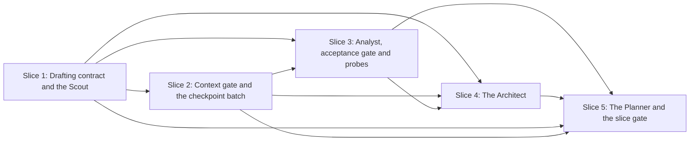

# Plan

## Dependency graph



Slices 1 to 4 all edit `skills/spec/SKILL.md`, and Slices 1, 3, 4 and 5 each add a card to
`skills/planning/references/roles/`. Merge in slice order, 1 to 5, each rebased on the one before.

## Traceability

| Criterion | Slices |
|---|---|
| S-01.1, S-01.3, S-02.1 | 1 |
| S-01.2 | 1, 3 |
| S-01.4 | 1, 2 |
| S-02.2, S-02.3, S-03.4, S-03.6 | 2 |
| S-03.5 | 2, 3, 4, 5 |
| S-03.1, S-03.2, S-03.3, S-04.1, S-04.2, S-04.3 | 3 |
| S-05.1, S-05.2 | 4 |
| S-06.1, S-06.2, S-06.3 | 5 |
| S-06.4 | 2, 5 |

Example rows (S-NN.k.eN) follow their criterion's slices.

---

## Slice 1 — Drafting contract and the Scout

Issue: #270 · Depends on: none · Stories: S-01, S-02 · Map: Map the code

### Outcome

`spec` Phase 2 dispatches a Scout that returns `context.md` as its report, and the Facilitator
writes it. Every role card states its kind, and `cold-read`'s panel dispatches reviewing cards only.

### Acceptance

- **S-01.1**
- **S-01.2** (contract side): the draft completeness check and its retry, proven with the Scout;
  the rows, which name the Analyst, are proven in Slice 3.
- **S-01.3**
- **S-01.4** (drafting side): S-01.4.e1.
- **S-02.1**
- **1.1** `skills/planning/references/roles/scout.md` has the drafting card headings in order,
  letter `S`, model `sonnet`, kind `draft`.
- **1.2** Every card in `roles/` has `## Kind`, holding `review` or `draft`.
- **1.3** The drafting frame and the draft report's marker lines are stated once, in
  `dispatch.md`.
- **1.4** `dispatch.md` states the `{base}` step, and `spec` Phase 2 runs it before its first
  dispatch.
- **1.5** On a Greenfield route `spec` Phase 2 has the Scout cite each stack choice to the Brief or
  the **Ruled out** option, and Phase 5 adds the ADR citation when it writes the ADR (`design.md`
  §2 Draft report).

### Contracts

`design.md` §2 **Cards**: `## Kind` section, Reviewing card shape, Drafting card shape, and the
Scout's entry in Drafting roles. `design.md` §2 **Dispatch**: every row, except the gate side of **No subagent tool**, which is
Slice 2's. `cold-read`'s panel pass
step 1 dispatches `review` cards only (ADR-004). Until Slice 2, `spec` Phase 4 lists the Scout's
held open points with the checkpoint's content.

### Stop conditions

- Stop if a contract this slice depends on has drifted from `context.md` (preflight).
- Stop if a dry run this slice needs live fell back to the Facilitator: set the progress file to
  `blocked` and name the run (`design.md` §6 **Seeding**).
- Stop if any card is left without `## Kind` when the panel change is made: the panel would then
  silently drop a reviewer (pre-mortem P1).
- Stop if the drafting frame would wrap the drafted file in a fence, rather than marker lines
  (pre-mortem P2).
- Stop if forcing a short draft would need a card or `dispatch.md` edited: change only the prompt
  in the session (`design.md` §6 **Seeding**).
- Stop if the Scout's card needs to restate a rule `spec` Phase 2 already states: point to it
  through `{skill}` instead (R3).
- Stop if fitting the change in `skills/spec/SKILL.md` needs a new or renumbered `## Phase`.
- Stop if this slice needs a file no slice before it creates (pre-mortem P7).

### Verify

```bash
eval "$(jq -r .verify.test .hivrr.json)"
# expected: structural checks pass (no output at all is a failure: scaffold .hivrr.json as docs/verification.md says)
r=skills/planning/references/roles
for f in $r/*.md; do [ "$f" = "$r/dispatch.md" ] || awk '/^## /{printf "%s|", substr($0, 4)} END {print " " FILENAME}' "$f"; done
# expected, five lines:
# Letter|Model|Kind|Job|Inputs|Checklist|Output|Blocking test| skills/planning/references/roles/editor.md
# Letter|Model|Kind|Job|Inputs|Checklist|Output|Blocking test| skills/planning/references/roles/fact-checker.md
# Letter|Model|Kind|Job|Inputs|Checklist|Output| skills/planning/references/roles/scout.md
# Letter|Model|Kind|Job|Inputs|Checklist|Output|Blocking test| skills/planning/references/roles/test-engineer.md
# Letter|Model|Kind|Job|Inputs|Checklist|Output|Questionnaire|Blocking test| skills/planning/references/roles/trust-reviewer.md
for f in $r/*.md; do [ "$f" = "$r/dispatch.md" ] || awk '/^## Kind$/ {k = 1; next} k && NF {print FILENAME ": " $0; exit} END {if (!k) print FILENAME ": no kind"}' "$f"; done
# expected: editor, fact-checker, test-engineer and trust-reviewer ": review"; scout ": draft"; five lines, none "no kind"
grep -h -A2 '^## Letter$' $r/*.md | grep -xE '[A-Z]' | sort | tr '\n' ' '; echo
# expected: E F S T V
awk '/^## (Letter|Model|Kind)$/ {h = $2; next} h && NF {printf "%s=%s ", h, $0; h = ""} END {print ""}' $r/scout.md
# expected: Letter=S Model=sonnet Kind=draft
grep -c 'Tree from HEAD: origin/{integration} unavailable.' $r/dispatch.md
# expected: 1
grep -cF 'Drafted by the Facilitator: not independent.' $r/dispatch.md; grep -cF 'gave no complete draft.' $r/dispatch.md
# expected: 1, then 1
awk '/^## Phase/ {p = $3} /\{base\}/ {print p}' skills/spec/SKILL.md | sort -u | grep -x 2
# expected: 2
awk '/^## Phase/ {p = $3} /Scout/ {print p}' skills/spec/SKILL.md | sort -u | grep -x 2
# expected: 2
awk '/^## Phase/ {p = $3} /dispatch\.md/ {print p}' skills/spec/SKILL.md | sort -u | tr '\n' ' '; echo
# expected: 2
grep -rcF '=== BEGIN {file} ===' skills | grep -v ':0$'
# expected: skills/planning/references/roles/dispatch.md:1
grep -c 'states no kind; not dispatched' skills/cold-read/references/panel.md
# expected: 1
wc -l < skills/spec/SKILL.md
# expected: a number below 400
grep -c '^## Phase' skills/spec/SKILL.md
# expected: 10
g=docs/plans/planning-team-spec/progress/slice-01.md
for id in S-01.1.e1 S-01.1.e2 S-01.2 S-01.3.e1 S-01.3.e2 S-01.4.e1 S-02.1.e1 S-02.1.e2 1.5; do grep -qF "| $id | pass" $g || echo "missing $id"; done
# expected: no output (run after the dry runs are recorded)
for id in S-01.1.e1 S-01.2 S-02.1.e1; do grep -F "| $id | pass" $g | grep -qF '(Agent tool, model:' || echo "not live $id"; done
# expected: no output
grep -cw blocked $g; grep 'Skill dir:' $g | grep -vF "Skill dir: $(pwd)/skills/"
# expected: 0, then no output
ls docs/plans | grep -c zz-dryrun
# expected: 0 (grep exits 1 on a zero count; read the output, not the status)
```

Dry runs, recorded in `progress/slice-01.md`:

- **fresh** fixture (`design.md` §6): run `spec` Phase 2. Proves S-01.1.e1 and S-02.1.e1 (the
  Scout's dispatch line, its model, the written `context.md` and its Read order entry), and prd
  Assumptions row 1, on whole-file reports: record the draft's length and whether the end marker came
  back.
- The same fixture with the Scout prompt changed, in the session only, to drop one section
  (`design.md` §6 **Seeding**): proves the S-01.2 retry and the Facilitator's drafting line.
- A Scout dispatch after which the executor edits one file in that tree from the main session,
  before the second guard run: proves S-01.1.e2.
- A size S Change copy of fresh: proves S-02.1.e2 (no Scout, no gate).
- A Greenfield copy of fresh run through `spec` Phase 5: the drafted `context.md` cites the Brief,
  and the ADR citation is added in Phase 5: proves 1.5.
- No subagent tool, simulated by drafting from the card in the main session: proves S-01.4.e1.
- `panel.md` step 1, its `roles/` path replaced in the session only (`design.md` §6 **Seeding**),
  on a copy of `roles/` under `docs/plans/zz-dryrun-roles/` holding the four reviewing cards, the
  Scout and three stand-in drafting cards (copies of `scout.md` renamed): four dispatches, proving
  S-01.3.e1; then the same copy with one reviewing card's kind removed: S-01.3.e2.

### Pattern to follow

- The review frame this mirrors: `skills/planning/references/roles/dispatch.md:22-54`.
- The card shape: `skills/planning/references/roles/fact-checker.md:1-53`.
- The `{base}` step to restate: `skills/cold-read/SKILL.md:54-60`.

### Suggested path

Default route. You may deviate if every mandatory item still holds; record why.

1. Add `## Kind` with `review` to the four reviewing cards, after `## Model`.
2. In `dispatch.md`, add the `{base}` step, the drafting frame, the draft report and its
   completeness check, the drafting line, the draft display, and the drafting side of **No subagent tool**.
3. Write `scout.md`.
4. Change `panel.md` step 1 to dispatch `review` cards only, with the no-kind line.
5. In `spec` Phase 2, replace "read the code … write `context.md`" with: resolve `{base}`, dispatch
   the Scout as `dispatch.md` says, write its draft. Keep Phase 2's citation rules: the Scout reads
   them through `{skill}`. The opening line's commit becomes `{sha}`, the short `{base}`
   (`skills/spec/SKILL.md:128` names `HEAD` today), and the Greenfield bullet
   (`skills/spec/SKILL.md:136-138`) cites the Brief or the Ruled out option, with Phase 5 adding
   the ADR citation.
6. Dry run, record, delete the fixtures.

### Files

- Create: `skills/planning/references/roles/scout.md`
- Modify: `skills/planning/references/roles/dispatch.md`
- Modify: `skills/planning/references/roles/fact-checker.md`, `editor.md`, `test-engineer.md`,
  `trust-reviewer.md`
- Modify: `skills/cold-read/references/panel.md`
- Modify: `skills/spec/SKILL.md`

---

## Slice 2 — Context gate and the checkpoint batch

Issue: #271 · Depends on: Slice 1 · Stories: S-01, S-02, S-03, S-06 · Map: Map the code, Agree acceptance

### Outcome

The Fact-checker checks `context.md` before the prd is written, the Facilitator fixes what it can,
and the Fact-checker re-checks once. Whatever is left reaches the developer in the acceptance
checkpoint's one message, and each deferral becomes an Open questions line.

### Acceptance

- **S-01.4** (gate side): S-01.4.e2.
- **S-02.2**
- **S-02.3**
- **S-03.4**
- **S-03.5** (`context.md`, and the handoff note itself)
- **S-03.6**
- **S-06.4** (`planning` and `spec` side): resuming a Spec pending entry, and removing it
- **2.1** `skills/planning/references/gates.md` exists with the headings `## Gate pass`,
  `## Re-check`, `## Held`, `## Checkpoint batch`, `## Display` and `## Handoff`, in that order:
  **Ids** and **Fix** under `## Gate pass`, **Answer** and **Deferral** under `## Checkpoint batch`.
- **2.2** The deferral line `Deferred at the {acceptance | design | slice} checkpoint on {date}: …` is
  stated once, in `gates.md`.
- **2.3** Given a gate run before the acceptance checkpoint, when it ends, then no message has gone
  to the developer: its held items wait for Phase 4.
- **2.4** `skills/planning/references/templates/handoff.md` exists; `pack-format.md` §1 lists
  `handoff.md`; `planning` Resume reads it first and resumes a Spec pending entry at Specify;
  `spec` removes that entry when its checkpoint approves; and the `planning` gate before Approve and Publish refuses
  while it exists.

### Contracts

`design.md` §2 **Gates**: every row except **Probe results**, which is Slice 3's, including the
slice-checkpoint errors of **Answer** and **Deferral** that Slice 5 then uses. `design.md` §2
**Dispatch**: the gate side of **No subagent tool**. ADR-008, the handoff note. The context gate's roles are those in
`design.md` §1 **Stages**.

### Stop conditions

- Stop if a contract this slice depends on has drifted from `context.md` (preflight).
- Stop if a dry run this slice needs live fell back to the Facilitator: set the progress file to
  `blocked` and name the run (`design.md` §6 **Seeding**).
- Stop if any gate step would send the developer a message before the acceptance checkpoint
  (pre-mortem P3).
- Stop if a gate would use `P…` Ids, which `cold-read` gives the panel.
- Stop if fitting the change in `skills/spec/SKILL.md` needs a new or renumbered `## Phase`.
- Stop if this slice needs a file Slice 1 does not create (pre-mortem P7).

### Verify

```bash
eval "$(jq -r .verify.test .hivrr.json)"
# expected: structural checks pass (no output at all is a failure: .hivrr.json is git-ignored, so scaffold it as docs/verification.md says; jq then errors and eval still exits 0)
grep '^## ' skills/planning/references/gates.md
# expected, six lines: ## Gate pass, ## Re-check, ## Held, ## Checkpoint batch, ## Display, ## Handoff
grep -cF 'Gate run by the Facilitator: not independent.' skills/planning/references/roles/dispatch.md
# expected: 1
ls skills/planning/references/templates/handoff.md; grep -c 'handoff\.md' skills/planning/SKILL.md skills/planning/references/pack-format.md | grep -c ':0$'
# expected: the path, then 0
awk '/^## Phase/ {p = $3} /handoff\.md/ {print p}' skills/spec/SKILL.md | sort -u | grep -x 1
# expected: 1
wc -l < skills/planning/SKILL.md
# expected: a number below 400
grep -rlF 'Deferred at the {' skills
# expected: skills/planning/references/gates.md
awk '/^## Phase/ {p = $3} /gates\.md/ {print p}' skills/spec/SKILL.md | sort -u | grep -xE '2|4' | tr '\n' ' '; echo
# expected: 2 4
wc -l < skills/spec/SKILL.md
# expected: a number below 400
grep -c '^## Phase' skills/spec/SKILL.md
# expected: 10
g=docs/plans/planning-team-spec/progress/slice-02.md
for id in S-01.4.e2 S-02.2.e1 S-02.2.e2 S-02.3.e1 S-02.3.e2 2.3 S-03.4.e1 S-03.4.e2 S-03.5.e1 S-03.5.e2 S-03.5.e3 S-03.6.e1 S-06.4.e1; do grep -qF "| $id | pass" $g || echo "missing $id"; done
# expected: no output (run after the dry runs are recorded)
for id in S-02.2.e1 S-02.3.e1 S-03.5.e1; do grep -F "| $id | pass" $g | grep -qF '(Agent tool, model:' || echo "not live $id"; done
# expected: no output
grep -cw blocked $g; grep 'Skill dir:' $g | grep -vF "Skill dir: $(pwd)/skills/"
# expected: 0, then no output
ls docs/plans | grep -c zz-dryrun
# expected: 0 (grep exits 1 on a zero count; read the output, not the status)
```

Dry runs, recorded in `progress/slice-02.md`:

- **seeded-context** fixture, seeded after the Scout's draft (`design.md` §6 **Seeding**): run
  `spec` Phases 2 to 4. Proves S-02.2.e1 (each reported seed fixed and re-checked), S-02.3.e1 and S-02.3.e2 (held items reach the acceptance
  checkpoint in one message), 2.3, and S-03.4.e1 and S-03.4.e2 (one item answered, one deferred,
  the Open questions line written).
- **clean-context**: proves S-02.2.e2 (no fix, no re-check).
- **seeded-context** again, the session ended by the executor after the context gate and `spec`
  run again: proves S-03.5.e1; carried on to an approved acceptance checkpoint, S-03.5.e2. A copy
  with a README Open questions `Deferred at … GF3 …` line: S-03.6.e1. `planning` Phase 7 on a copy holding an entry:
  S-03.5.e3.
- A copy with a `## Spec pending: GV1` entry in `handoff.md`: `planning` resumes at Specify with its
  answer, and `spec`'s checkpoint, approved, removes the entry and the file: proves S-06.4.e1 (`planning` and `spec` side).
- No subagent tool, simulated: proves S-01.4.e2.

### Pattern to follow

- The panel's pass, re-check and batch this narrows: `skills/cold-read/references/panel.md:9-34`,
  `:36-57`, `:69-84`.
- The re-check Ids rule: `skills/cold-read/references/panel.md`, **Ids**.

### Suggested path

Default route. You may deviate if every mandatory item still holds; record why.

1. Write `gates.md`: gate pass, one re-check, held, checkpoint batch (collect, send with the
   checkpoint, answers, deferrals), display, handoff; and `templates/handoff.md`.
2. Add `handoff.md` to `pack-format.md` §1, and to `planning` Resume and its gate before Approve
   and Publish. In `spec` Phase 1, read `handoff.md`.
3. In `spec` Phase 2, after the Scout's draft is written, run the context gate as `gates.md` says.
4. In `spec` Phase 4, show each gate's summary line and send the batch with the checkpoint.
5. Dry run, record, delete the fixtures.

### Files

- Create: `skills/planning/references/gates.md`
- Create: `skills/planning/references/templates/handoff.md`
- Modify: `skills/planning/references/roles/dispatch.md`
- Modify: `skills/planning/references/pack-format.md`
- Modify: `skills/planning/SKILL.md`
- Modify: `skills/spec/SKILL.md`

---

## Slice 3 — Analyst, acceptance gate and probes

Issue: #272 · Depends on: Slice 1, Slice 2 · Stories: S-01, S-03, S-04 · Map: Agree acceptance

### Outcome

`spec` Phase 3 dispatches an Analyst that drafts the prd. The Fact-checker, with its new probe
item, and the Trust reviewer review it in one step before the acceptance checkpoint, and each
assumption records its probe result.

### Acceptance

- **S-01.2** (Analyst rows): S-01.2.e1 and S-01.2.e2.
- **S-03.1**
- **S-03.2**
- **S-03.3**
- **S-04.1**
- **S-04.2**
- **S-04.3**
- **S-03.5** (`prd.md` stage): the acceptance gate's Gate pending entry.
- **3.1** `skills/planning/references/roles/analyst.md` has the drafting card headings in order,
  letter `N`, model `opus`, kind `draft`.
- **3.2** `fact-checker.md` has checklist item `**F7**`, and its Output reads "one row per item F1 to F7".
- **3.3** `templates/prd.md`'s Assumptions header is `| Assumption | How to validate | If false | Probe |`,
  and `pack-format.md`'s Assumptions row reads `Assumption, how to validate, what changes if false,
  and its probe result`.

### Contracts

`design.md` §2 **Cards**: Fact-checker **F7** and the Analyst's entry in Drafting roles. `design.md`
§2 **Gates**: **Probe results**, and **Handoff** for `prd.md`, from Slice 2. `design.md` §2 **Template**: Assumptions `Probe` column. The
acceptance gate's roles are those in `design.md` §1 **Stages**.

### Stop conditions

- Stop if a contract this slice depends on has drifted from `context.md` (preflight).
- Stop if a dry run this slice needs live fell back to the Facilitator: set the progress file to
  `blocked` and name the run (`design.md` §6 **Seeding**).
- Stop if F7 would allow any check that writes, installs or uses the network (R5).
- Stop if forcing a short draft would need a card or `dispatch.md` edited (`design.md` §6
  **Seeding**).
- Stop if the acceptance checkpoint would need a second message for the acceptance gate's items
  after the context gate's (pre-mortem P3).
- Stop if fitting the change in `skills/spec/SKILL.md` needs a new or renumbered `## Phase`.
- Stop if this slice needs a file Slices 1 and 2 do not create (pre-mortem P7).

### Verify

```bash
eval "$(jq -r .verify.test .hivrr.json)"
# expected: structural checks pass (no output at all is a failure: .hivrr.json is git-ignored, so scaffold it as docs/verification.md says; jq then errors and eval still exits 0)
r=skills/planning/references/roles
awk '/^## /{printf "%s|", substr($0, 4)} END {print ""}' $r/analyst.md
# expected: Letter|Model|Kind|Job|Inputs|Checklist|Output|
awk '/^## (Letter|Model|Kind)$/ {h = $2; next} h && NF {printf "%s=%s ", h, $0; h = ""} END {print ""}' $r/analyst.md
# expected: Letter=N Model=opus Kind=draft
grep -h -A2 '^## Letter$' $r/*.md | grep -xE '[A-Z]' | sort | uniq -d
# expected: no output
grep -c '^- \*\*F7\*\*' $r/fact-checker.md
# expected: 1
grep -c 'one row per item F1 to F7' $r/fact-checker.md
# expected: 1
grep -c '| Assumption | How to validate | If false | Probe |' skills/planning/references/templates/prd.md
# expected: 1
grep -c 'Assumption, how to validate, what changes if false, and its probe result' skills/planning/references/pack-format.md
# expected: 1
awk '/^## Phase/ {p = $3} /gates\.md/ {print p}' skills/spec/SKILL.md | sort -u | grep -xE '2|3|4' | tr '\n' ' '; echo
# expected: 2 3 4
awk '/^## Phase/ {p = $3} /Analyst/ {print p}' skills/spec/SKILL.md | sort -u | grep -x 3
# expected: 3
wc -l < skills/spec/SKILL.md
# expected: a number below 400
grep -c '^## Phase' skills/spec/SKILL.md
# expected: 10
g=docs/plans/planning-team-spec/progress/slice-03.md
for id in S-01.2.e1 S-01.2.e2 S-03.1.e1 S-03.1.e2 S-03.2.e1 S-03.2.e2 S-03.3.e1 S-03.3.e2 S-04.1.e1 S-04.1.e2 S-04.2.e1 S-04.2.e2 S-04.3.e1 S-04.3.e2 S-03.5; do grep -qF "| $id | pass" $g || echo "missing $id"; done
# expected: no output (run after the dry runs are recorded)
for id in S-01.2.e1 S-03.1.e1 S-03.2.e1 S-04.1.e1; do grep -F "| $id | pass" $g | grep -qF '(Agent tool, model:' || echo "not live $id"; done
# expected: no output
grep -cw blocked $g; grep 'Skill dir:' $g | grep -vF "Skill dir: $(pwd)/skills/"
# expected: 0, then no output
ls docs/plans | grep -c zz-dryrun
# expected: 0 (grep exits 1 on a zero count; read the output, not the status)
```

Dry runs, recorded in `progress/slice-03.md`:

- **seeded-prd** fixture, seeded after the Analyst's draft (`design.md` §6 **Seeding**): run `spec`
  Phases 3 and 4. Proves S-03.1.e1, S-03.2.e1, S-03.3.e1 and
  S-03.3.e2 (the Trust question and the Fact-checker finding on the unsourced key merged into one
  item), S-04.1.e1, S-04.1.e2, S-04.2.e1, S-04.2.e2 and S-04.3.e1, and S-01.2.e1.
- The same fixture with the Analyst prompt changed, in the session only, to drop Rules and
  examples, twice: proves S-01.2.e2.
- **held-prd**: proves S-04.3.e2 and S-03.2.e2.
- **seeded-prd** with the session ended by the executor after the acceptance gate, then `spec` run
  again: no Analyst dispatch, the gate re-run from the `Gate pending: prd.md` entry; proves S-03.5.
- A size S Change copy: proves S-03.1.e2.

### Pattern to follow

- The Scout card from Slice 1: `skills/planning/references/roles/scout.md`.
- A checklist item with evidence and example: `skills/planning/references/roles/fact-checker.md:24-45`.

### Suggested path

Default route. You may deviate if every mandatory item still holds; record why.

1. Write `analyst.md`.
2. Add F7 to `fact-checker.md`.
3. Add the `Probe` column to `templates/prd.md`, and extend `pack-format.md`'s Assumptions row.
4. In `gates.md`, add **Probe results** under **Held**, and the acceptance gate's batch items.
5. In `spec` Phase 3, dispatch the Analyst and write its draft; then run the acceptance gate as
   `gates.md` says, before Phase 4.
6. Dry run, record, delete the fixtures.

### Files

- Create: `skills/planning/references/roles/analyst.md`
- Modify: `skills/planning/references/roles/fact-checker.md`
- Modify: `skills/planning/references/templates/prd.md`
- Modify: `skills/planning/references/pack-format.md`
- Modify: `skills/planning/references/gates.md`
- Modify: `skills/spec/SKILL.md`

---

## Slice 4 — The Architect

Issue: #273 · Depends on: Slice 1, Slice 2, Slice 3 · Stories: S-03, S-05 · Map: Design

### Outcome

`spec` Phase 7 dispatches an Architect that drafts `design.md` from the approved files, and the
design checkpoint shows it with its drafting line and asks the Architect's held open points as one
batch.

### Acceptance

- **S-05.1**
- **S-05.2**
- **S-03.5** (`design.md` stage): its Gate pending entry, with no gate to re-run.
- **4.1** `skills/planning/references/roles/architect.md` has the drafting card headings in order,
  letter `R`, model `opus`, kind `draft`.
- **4.2** Given the Architect's held open points, when the design checkpoint is shown, then they are
  asked with it in one message (S-05.2.e3).

### Contracts

`design.md` §2 **Cards**: the Architect's entry in Drafting roles. `design.md` §2 **Dispatch**:
Drafting frame, Draft report, Draft completeness check, Drafting line and Draft display, from
Slice 1. `design.md` §2 **Gates**: **Held**, **Checkpoint batch** and **Handoff**, from Slice 2, at the design
checkpoint (`design.md` §1 **Stages**).

### Stop conditions

- Stop if a contract this slice depends on has drifted from `context.md` (preflight).
- Stop if a dry run this slice needs live fell back to the Facilitator: set the progress file to
  `blocked` and name the run (`design.md` §6 **Seeding**).
- Stop if the Architect would draft ADRs, `inventory.md`, `ux.md` or modifier sections: those stay
  with the Facilitator, who adds modifier sections after writing the draft (`design.md` §1; prd
  **Non-goals** for ADRs, `inventory.md` and `ux.md`).
- Stop if the Phase 7 self-check would be skipped or weakened for a drafted file.
- Stop if fitting the change in `skills/spec/SKILL.md` needs a new or renumbered `## Phase`.
- Stop if this slice needs a file Slices 1 to 3 do not create (pre-mortem P7).

### Verify

```bash
eval "$(jq -r .verify.test .hivrr.json)"
# expected: structural checks pass (no output at all is a failure: .hivrr.json is git-ignored, so scaffold it as docs/verification.md says; jq then errors and eval still exits 0)
r=skills/planning/references/roles
awk '/^## /{printf "%s|", substr($0, 4)} END {print ""}' $r/architect.md
# expected: Letter|Model|Kind|Job|Inputs|Checklist|Output|
awk '/^## (Letter|Model|Kind)$/ {h = $2; next} h && NF {printf "%s=%s ", h, $0; h = ""} END {print ""}' $r/architect.md
# expected: Letter=R Model=opus Kind=draft
awk '/^## Phase/ {p = $3} /Architect/ {print p}' skills/spec/SKILL.md | sort -u | grep -xE '7|8' | tr '\n' ' '; echo
# expected: 7 8
grep -h -A2 '^## Letter$' $r/*.md | grep -xE '[A-Z]' | sort | uniq -d
# expected: no output
wc -l < skills/spec/SKILL.md
# expected: a number below 400
grep -c '^## Phase' skills/spec/SKILL.md
# expected: 10
g=docs/plans/planning-team-spec/progress/slice-04.md
for id in S-05.1.e1 S-05.1.e2 S-05.2.e1 S-05.2.e2 S-05.2.e3 4.2 S-03.5; do grep -qF "| $id | pass" $g || echo "missing $id"; done
# expected: no output (run after the dry runs are recorded)
for id in S-05.1.e1 S-05.2.e2 S-05.2.e3; do grep -F "| $id | pass" $g | grep -qF '(Agent tool, model:' || echo "not live $id"; done
# expected: no output
grep -cw blocked $g; grep 'Skill dir:' $g | grep -vF "Skill dir: $(pwd)/skills/"
# expected: 0, then no output
ls docs/plans | grep -c zz-dryrun
# expected: 0 (grep exits 1 on a zero count; read the output, not the status)
```

Dry runs, recorded in `progress/slice-04.md`:

- **fresh** fixture at `routed`, run through `spec` Phase 8. Proves S-05.1.e1 and S-05.2.e2.
- **fresh** again, `design.md` replaced after the Architect's draft is written with a copy holding
  one untagged fence, before the Phase 7 Self-check (`design.md` §6 **Seeding**): proves S-05.2.e1.
- A Bug copy at size S with `design.md` declined: proves S-05.1.e2.
- **fresh** with the session ended after the Architect's draft is written, then `spec` run again:
  no Architect dispatch, the design checkpoint shown from the `Gate pending: design.md` entry;
  proves S-03.5.
- **fresh** with one developer-only open point added to the Architect's report before it is
  accepted (`design.md` §6 **Seeding**): proves S-05.2.e3 and 4.2.

### Pattern to follow

- The Scout card from Slice 1: `skills/planning/references/roles/scout.md`.
- The design guidance the Architect reads through `{skill}`: `skills/spec/references/design.md`.

### Suggested path

Default route. You may deviate if every mandatory item still holds; record why.

1. Write `architect.md`, its Inputs naming `skills/spec/references/design.md` as part of `{skill}`,
   and its Checklist only the design checks that neither Phase 7 nor that reference states.
2. In `spec` Phase 7, dispatch the Architect for `design.md` and write its draft; keep the
   self-check, and add the drafting line and the batch of its held open points to Phase 8.
3. Dry run, record, delete the fixtures.

### Files

- Create: `skills/planning/references/roles/architect.md`
- Modify: `skills/spec/SKILL.md`

---

## Slice 5 — The Planner and the slice gate

Issue: #274 · Depends on: Slice 1, Slice 2, Slice 3, Slice 4 · Stories: S-03, S-06 · Map: Slice

### Outcome

`slice` resolves `{base}` before its first dispatch, and Phase 2 dispatches a Planner that drafts
`plan.md`. After the Self-check, the Test engineer
and the Editor check it in one step, and the slice checkpoint sends what is left as one batch,
withholding Approve while a blocking item is unanswered.

### Acceptance

- **S-06.1**
- **S-06.2**
- **S-06.3**
- **S-03.5** (`plan.md` stage): the slice gate's Gate pending entry.
- **S-06.4** (`slice` side): the Spec pending entry it writes.
- **5.1** `skills/planning/references/roles/planner.md` has the drafting card headings in order,
  letter `L`, model `opus`, kind `draft`.
- **5.2** `skills/slice/SKILL.md` keeps its Self-check section, and its **Headings** and **Trace**
  commands, under their names, so `cold-read` Phase 2 still finds them.
- **5.3** `slice` Phase 1 resolves `{base}` as `dispatch.md` says, before its first dispatch, and
  reads `handoff.md`.
- **5.4** In a Re-slice, `planner.md` lists `{current}` in its Inputs and the Planner's draft
  revises only the slices the reason names (`design.md` §2 Drafting roles).

### Contracts

`design.md` §2 **Cards**: the Planner's entry in Drafting roles. `design.md` §2 **Dispatch**: the
`{base}` step and the drafting rows, from Slice 1. `design.md` §2 **Gates**: every row except
**Probe results**, from Slice 2, including the slice-checkpoint errors of **Answer** and
**Deferral**, and **Handoff** (ADR-008). The slice gate's roles are those in `design.md` §1 **Stages**.

### Stop conditions

- Stop if a contract this slice depends on has drifted from `context.md` (preflight).
- Stop if a dry run this slice needs live fell back to the Facilitator: set the progress file to
  `blocked` and name the run (`design.md` §6 **Seeding**).
- Stop if any gate fix would edit `prd.md`, `design.md` or an ADR: `slice` holds it instead
  (pre-mortem P4).
- Stop if the Self-check, or its **Headings** or **Trace** command, would be renamed or moved
  (`skills/slice/SKILL.md:232-234`).
- Stop if `skills/slice/SKILL.md` would reach 400 lines without moving Phase 1 **Re-slice** to
  `skills/slice/references/reslice.md` (R2, pre-mortem P6).
- Stop if fitting the change needs a new or renumbered `## Phase` in `skills/slice/SKILL.md`.
- Stop if this slice needs a file Slices 1 to 4 do not create (pre-mortem P7).

### Verify

```bash
eval "$(jq -r .verify.test .hivrr.json)"
# expected: structural checks pass (no output at all is a failure: .hivrr.json is git-ignored, so scaffold it as docs/verification.md says; jq then errors and eval still exits 0)
r=skills/planning/references/roles
awk '/^## /{printf "%s|", substr($0, 4)} END {print ""}' $r/planner.md
# expected: Letter|Model|Kind|Job|Inputs|Checklist|Output|
awk '/^## (Letter|Model|Kind)$/ {h = $2; next} h && NF {printf "%s=%s ", h, $0; h = ""} END {print ""}' $r/planner.md
# expected: Letter=L Model=opus Kind=draft
grep -h -A2 '^## Letter$' $r/*.md | grep -xE '[A-Z]' | sort | uniq -d
# expected: no output
grep -cE '^\*\*(Headings \(S-04\.2\)|Trace \(S-04\.4\))\.\*\*' skills/slice/SKILL.md
# expected: 2
awk '/^## Phase/ {p = $3} /gates\.md/ {print p}' skills/slice/SKILL.md | sort -u | grep -xE '4|5' | tr '\n' ' '; echo
# expected: 4 5
awk '/^## Phase/ {p = $3} /Planner/ {print p}' skills/slice/SKILL.md | sort -u | grep -x 2
# expected: 2
awk '/^## Phase/ {p = $3} /\{base\}|handoff\.md/ {print p}' skills/slice/SKILL.md | sort -u | grep -x 1
# expected: 1
wc -l < skills/slice/SKILL.md
# expected: a number below 400
grep -c '^## Phase' skills/slice/SKILL.md
# expected: 7
g=docs/plans/planning-team-spec/progress/slice-05.md
for id in S-06.1.e1 S-06.1.e2 S-06.2.e1 S-06.2.e2 S-06.3.e1 S-06.3.e2 S-06.3.e3 S-06.4.e1 S-03.5 5.4; do grep -qF "| $id | pass" $g || echo "missing $id"; done
# expected: no output (run after the dry runs are recorded)
for id in S-06.1.e1 S-06.2.e1 S-06.3.e1; do grep -F "| $id | pass" $g | grep -qF '(Agent tool, model:' || echo "not live $id"; done
# expected: no output
grep -cw blocked $g; grep 'Skill dir:' $g | grep -vF "Skill dir: $(pwd)/skills/"
# expected: 0, then no output
ls docs/plans | grep -c zz-dryrun
# expected: 0 (grep exits 1 on a zero count; read the output, not the status)
```

Dry runs, recorded in `progress/slice-05.md`:

- **seeded-plan** fixture, seeded after the Planner's draft (`design.md` §6 **Seeding**): run
  `slice` Phases 2 to 5. Proves S-06.1.e1, S-06.2.e1, S-06.2.e2 (the
  prd side held, since `slice` never edits the prd), S-06.3.e1, and S-06.3.e2 (the held item
  deferred, Approve not offered, the stop message), and S-06.3.e3 (an answer that needs the prd
  changed, and the spec-change stop), and S-06.4.e1 (`planning` run next on it, through `spec`'s
  checkpoint).
- **seeded-plan** with the session ended after the slice gate, then `slice` run again: no Planner
  dispatch, the gate re-run from the `Gate pending: plan.md` entry; proves S-03.5.
- A Re-slice copy of **seeded-plan** at `sliced`, with a reason touching one slice: the Planner's
  draft revises only that slice, and a draft forced, in the session only, to change another slice is
  retried as incomplete (`design.md` §2 Drafting roles): proves 5.4.
- Desk check: a 13-slice Planner report against Phase 2 **Count**, quoting the stop line Phase 2
  prints: proves S-06.1.e2.

### Pattern to follow

- The Scout card from Slice 1: `skills/planning/references/roles/scout.md`.
- The context gate from Slice 2: `skills/spec/SKILL.md` Phase 2 and `skills/planning/references/gates.md`.

### Suggested path

Default route. You may deviate if every mandatory item still holds; record why.

1. Write `planner.md`, its Inputs naming `slice` Phases 2 to 4 as `{skill}`.
2. In `slice` Phase 1, resolve `{base}` as `dispatch.md` says and read `handoff.md`. In Phase 2,
   dispatch the Planner for the whole `plan.md`; count its `## Slice N` headings before writing (the
   stop at more than 12). In a Re-slice, pass the current `plan.md` and keep unrevised slices as they are.
3. In Phase 4, after the Self-check passes, run the slice gate as `gates.md` says, and run the
   Self-check again on the fixed file before the gate's re-check.
4. In Phase 5, show the gate's summary and send the batch with the checkpoint; withhold Approve
   while a blocking item is unanswered or deferred.
5. Before the edits would bring `slice` to 400 lines, move Phase 1 **Re-slice** to
   `skills/slice/references/reslice.md` with a pointer.
6. Dry run, record, delete the fixtures.

### Files

- Create: `skills/planning/references/roles/planner.md`
- Create (if needed): `skills/slice/references/reslice.md`
- Modify: `skills/slice/SKILL.md`
