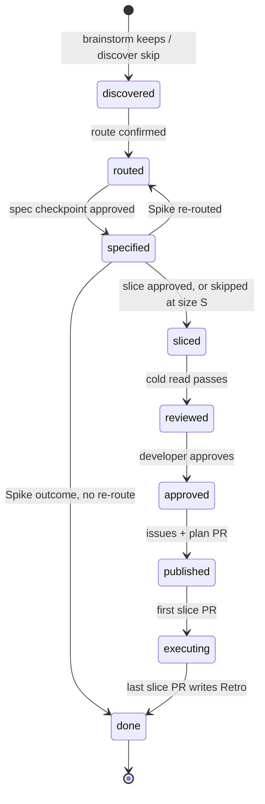
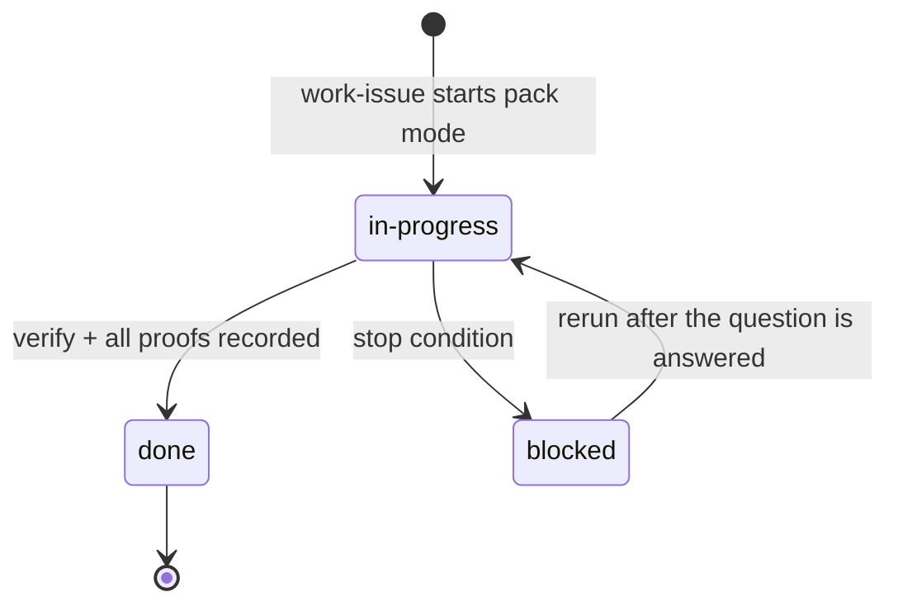

# Plan Pack Format

The normative reference for every `planner` skill that writes a plan pack. A **plan pack** is a
committed folder, `docs/plans/<slug>/`, whose `README.md` is its entry point. It gains files as the
work grows more complex, and any model, strong or weak, can execute it cold in a new session from
the pack and the repository alone.

When a skill and this file disagree, this file is right and the skill is a bug. Templates for every
pack file are in [`templates/`](templates/); each one follows the shapes below.

Executors (`work-issue`, `ship-issue`) never read this file. Everything an executor needs travels
inside the pack, in the README's **How to execute this pack** section, so a `dev`-only install works.

---

## 1. Layout

```text
docs/plans/<slug>/
  README.md        always
  prd.md           what and why: problem, users, goals, non-goals, measures, stories
  context.md       current-state map with citations, conventions, glossary
  design.md        architecture, contracts, invariants, one section per modifier
  decisions/ADR-NNN-<kebab>.md
  inventory.md     Migration: usages and breaking changes; Rewrite: behaviour inventory and parity
  ux.md            ui modifier at size M+: screens, flow, wireframes, states
  plan.md          slices
  progress/slice-NN.md   written by executors
  cold-read.md     written by cold-read
```

- **Slug.** Kebab-case, derived from the topic, confirmed at Route. If it collides with an existing
  folder under `docs/plans/`, append `-2`. After Publish the slug is fixed.
- **ADR numbers** are per pack, start at 001, and are never reused.
- **No code.** No file in a pack contains implementation code. See §6, Fences.

### Inventory sections

- **Migration:** a **Usage sites** table with the columns path:line, usage, breaking change, slice.
- **Rewrite:** a **Behaviour inventory** table with the columns behaviour, evidence (path:line in
  the old system), criterion ID. Then a **Parity matrix**, one row per behaviour, with the columns
  old, new and status. Status is `kept`, `changed` or `dropped`, each with a reason.

### ADRs

Every decision with at least one rejected option gets an ADR, with a **Status** line, a
**Proposed by** line, and the sections Context, Options (each rejected one with its reason),
Decision and Consequences.

| Who made the decision | Status | Proposed by |
|---|---|---|
| The developer stated it outright | `accepted` | `developer` |
| The author made it; shown at the `spec` checkpoint (a "contested" ADR) | `proposed` | `author (<skill>)`, the skill that wrote it |
| The developer approved a proposed ADR | `accepted (developer, <date>)` | unchanged, plus `; accepted by the developer at <checkpoint>` |

**Lifecycle.** A `proposed` ADR may be revised in place until the developer approves it. An
accepted ADR (`accepted` or `accepted (developer, <date>)`) is **never edited**. To change or
reverse it, write a new ADR whose Context names the one it changes, and append one clause to the
old ADR's Status line, the only edit an accepted ADR ever takes:

- `; amended by ADR-NNN, <what it changes>` when the new ADR changes part of it;
- `; superseded by ADR-NNN` when the new ADR replaces it outright.

A superseded ADR stays in `decisions/`, and its number is never reused. This holds for every
skill that writes a pack, at every Status, and in a re-route (§2).

---

## 2. Routing

A route is a **type**, a **size** and zero or more **modifiers**, each with a one-line reason. The
developer confirms it at the Route checkpoint.

### Routing matrix

R = required, O = optional (write it only when it has real content), blank = absent.

| Type | README | prd | context | design | decisions | inventory | plan | Notes |
|---|---|---|---|---|---|---|---|---|
| Change | R | | | | O | | | README carries acceptance criteria and Verify; always size S |
| Bug | R | R at M+ | R | O | O | | O | README carries repro and root cause (from `debug` if run). Regression rules and examples live in the README at S, in the prd at M+ |
| Spike | R | | O | | R | | | README carries the question and a timebox; the outcome is an ADR, then re-route; has no size and no rules or examples |
| Feature | R | R | R | R at M+ | O | | R at M+ | Stories with Given/When/Then |
| Refactor | R | R | R | R | O | | R | prd replaces stories with a **behaviour-preservation contract**; Slice 1 adds characterization tests |
| Migration | R | R | R | R | R | R | R | inventory: every usage site and each breaking change mapped to a slice; rollback per slice |
| Greenfield | R | R | R | R | R | | R | context = chosen stack and conventions (seed for the new `CLAUDE.md`); Slice 1 = walking skeleton |
| Rewrite | R | R | R | R | R | R | R | inventory = behaviour inventory and parity matrix; cutover plan in design |

**Optional (O) files.** The skill that owns the file proposes it at its checkpoint, saying what it
would hold. The developer decides whether it is written.

### Size

| Size | Slices | What it changes |
|---|---|---|
| S | 1 | plan.md absent; the README's **Slice** section is the pack's single slice |
| M | 2–6 | Full set per type |
| L | 7–12 | Adds a dependency graph in plan.md |
| XL | over 12 | Split into child packs `docs/plans/<slug>-<part>/`. The parent pack is a README only, with a **Child packs** section listing each child and its order. The wrapper writes the parent README, then plans each child as its own `planning` run whose Brief links the parent |

### Modifiers

Each modifier adds one `## Modifier: <name>` section to `design.md`. At size S, where there is no
design.md, the section goes in the README instead. The `ui` modifier at size M+ gets its own
`ux.md`, linked from that section, because wireframes are long.

| Modifier | The section must state |
|---|---|
| data | Schema change as expand/contract steps, backfill, deploy order, rollback |
| integration | The external contract, failure modes, timeouts and retries, how tests fake it |
| performance | Baseline with measurement command, numeric target, benchmark command |
| security | Threat model: assets, entry points, mitigations; links to `auditor` findings if any |
| ui | Screen inventory; navigation flow (Mermaid); one text wireframe per screen (`text` fence: regions, hierarchy, primary action); state table per screen (loading, empty, error, success, partial); responsive behaviour; accessibility. High-fidelity mockups are linked, never embedded. Guidance: [`ux-checklist.md`](ux-checklist.md) |
| observability | Events logged, with levels and what must never be logged; metrics; alerts, each with a numeric threshold; how to tell in production that it works, tied to the PRD's success measures |
| public-api | Consumers, versioning, deprecation policy, compatibility tests |
| infra | Environments, flags, rollout order, rollback |

### Content sections

Sections inside files, switched on by the route. "Stories" means the PRD has a **Stories** section,
which is true for every type with a prd except Refactor. A Refactor's preservation contract uses
the same rules-and-examples form.

| Section | File | Included when | What it holds |
|---|---|---|---|
| Users and jobs | prd | always with a prd | Who, plus "When …, I want …, so I can …" per user |
| Story map | prd | Feature, Greenfield, Rewrite at M+ | Journey steps left to right, stories under each step |
| Stories | prd | Feature, Greenfield, Rewrite, Migration | "As a …, I want …, so that …" plus criteria `S-NN.k` |
| Rules and examples | prd (README at size S) | whenever there are stories, a preservation contract, or Bug regression criteria | Per story: rules, each with an examples table whose columns make given, when and then explicit (a When shared by every row may sit in the column header). IDs `S-NN.k.eN`; at least 2 rows per rule, at least 1 edge or failure |
| Failure modes | prd | whenever there are stories; Bug | Failure, trigger, expected behaviour, what the user sees, criterion |
| Non-functional requirements | prd | always with a prd | One row per quality: performance, reliability, security, privacy, accessibility, observability, compatibility/portability, maintainability. Each is a measurable target or `none` |
| Assumptions | prd | always with a prd | Assumption, how to validate, what changes if false |
| Domain model | design | the work adds or changes persisted entities or core types | Mermaid `erDiagram`, with names matching the glossary |
| State machines | design | any entity with a lifecycle is touched | Mermaid `stateDiagram-v2` per entity, plus a list of illegal transitions |
| Flows | design | two or more components interact | Mermaid `sequenceDiagram` of each main flow |
| Test strategy | design | always with a design | Levels used, what each proves, fixtures and test data, the level each example is proven at |
| Pre-mortem | design | size M+ | "It failed; why?" items, each mapped to a mitigation, stop condition or risk row |

At size S, the README's Acceptance uses the same rules-and-examples form, and a one-line failure
note replaces the Failure modes table.

**Not routed.** For a batch of independent small items, recommend `ship-issue` and write nothing.

### Re-routing

A route can grow at any checkpoint.

- No file is ever deleted or rewritten wholesale.
- New files are added.
- Inside an existing file, a section may be added or revised. Record each revision in the README
  **Open questions** until the developer approves it at the next checkpoint. For example, a Feature
  re-routed to a Refactor revises the prd's Stories into a behaviour-preservation contract.
- An accepted ADR is the exception: it is never revised. A changed decision is a new ADR that
  amends or supersedes it (§1, Lifecycle).
- Status stays where it was. It advances only through the next approved checkpoint.
- A Spike always ends by offering a re-route.

---

## 3. README contract

Sections, in order:

1. A title line.
2. A **header table** with Status, Type, Size, Modifiers, Issues, Owner and Opened.
3. **Brief.**
4. **Slice**, at size S only: Outcome, Acceptance (as rules and examples), Contracts, Stop
   conditions and Verify, with the same meaning as in §4. `spec` writes it, for every type at size
   S, Change included.
5. **Route**: type, size and modifiers, each with its one-line reason. `brainstorm` writes a
   proposed Route; the wrapper rewrites it as confirmed at the Route checkpoint.
6. **Read order.** Whichever skill adds a file to the pack also adds it here.
7. **How to execute this pack**, copied verbatim from the template, with `<slug>` filled in. It
   includes the progress-file format, so a `dev`-only install needs nothing from `planner`.
8. **Open questions.**
9. **Retro.**

`brainstorm` adds **Ruled out** and **Key insights** after Brief. An XL parent adds **Child packs**
after Brief and has no Slice section.

| README part | Written by |
|---|---|
| Owner (`git config user.name`), Opened (today) | Whichever writes the README first: `brainstorm` or the wrapper's Discover skip |
| Type, Size and Modifiers rows, and the **Route** section | Proposed by `brainstorm`; confirmed and rewritten by the wrapper at Route |
| **Slice** (size S) | `spec` |
| Issues row | The wrapper, at Publish |
| Status `executing`, Retro, Status `done` | `work-issue`, per rules 7 and 8 |

### Status

Status always names the **last finished phase**. Values, in order:

| Status | Meaning | Next |
|---|---|---|
| `discovered` | Brainstorm finished and its brief kept | route |
| `routed` | Route confirmed | specify |
| `specified` | Spec files approved | slice; for a Spike, the outcome ADR |
| `sliced` | plan.md approved; at size S, passed through when `slice` is skipped | cold read |
| `reviewed` | Cold read ended with zero blocking questions | approve |
| `approved` | Developer approved for publish | publish |
| `published` | Issues exist and the pack PR is open or merged | execute |
| `executing` | At least one progress file exists | — |
| `done` | Retro written; for a Spike, the outcome ADR written with no re-route | — |



**Resume.** The wrapper resumes at the phase after the current Status.

Illegal transitions:

- **No skill lowers Status.** A skill writes its Status only when the current Status is the one
  immediately before it; otherwise it leaves Status alone and says so. The one exception is the
  Spike re-route, `specified → routed`.
- Skipping a state, except the skips by route. A skip still passes through each skipped value at
  the moment of the skip.
- `sliced → approved` without `reviewed`. Publish needs a passed cold read.

A Spike's Status goes `routed` → `specified` (question written) → `done` (outcome ADR, no
re-route), or back to `routed` under its new type.

---

## 4. Slice contract (`plan.md`)

`plan.md` opens with:

- a dependency graph in Mermaid, required at size L;
- a **traceability table** mapping PRD criterion IDs to the slices that cover them. A row may group
  several IDs that share the same slices. Every PRD criterion ID appears at least once.

Optionally, a **Shared contract** section for interfaces several slices use. Then one section per
slice:

| Heading | Kind | Content |
|---|---|---|
| `## Slice N — <name>` | — | Then one line: `Issue: #… · Depends on: Slice … · Stories: S-… · Map: <story-map steps>`. Map applies only when the PRD has a Story map |
| `### Outcome` | mandatory | One or two sentences describing the observable result |
| `### Acceptance` | mandatory | PRD criterion IDs this slice satisfies, plus local criteria (IDs `N.k`). A behavioural local criterion uses Given/When/Then; a structural one (a file exists, a grep is empty) may be a plain statement whose proof is a Verify command |
| `### Contracts` | mandatory | Interfaces this slice creates or changes, as tables (name, inputs, outputs, errors, invariants), or a reference to a design.md table. Migration and Rewrite slices end it with a **Rollback:** line |
| `### Stop conditions` | mandatory | "Stop if …" bullets. Must include any preflight drift in a contract this slice depends on |
| `### Verify` | mandatory | Exact commands with expected output, plus the dry-run scenarios for behavioural criteria |
| `### Pattern to follow` | guide | `path:line` of existing work to imitate |
| `### Suggested path` | guide | Opens with: "Default route. You may deviate if every mandatory item still holds; record why." |
| `### Files` | guide | Expected create, modify and delete list |

Mandatory items must hold. Guide items are a default route the executor may leave, recording why.

---

## 5. Progress file (`progress/slice-NN.md`)

`NN` is the slice number, zero-padded to two digits. Each slice has its own file, so parallel
branches never conflict. This table and README rule 7 must say the same thing; the README copy is
the one executors read.

| Section | Content |
|---|---|
| Header | Status (`in-progress`, `blocked`, `done`), Issue, PR, Executor model if known, Date |
| Preflight | Citations checked and their result, one line each |
| Acceptance | Each criterion ID and example ID → how it was shown (test name, or dry-run scenario with line reference) |
| Deviations | Table: plan said / reality / why / contract affected (y/n) |
| Decisions | Choices the plan left open, and what was chosen |
| Discoveries | Things the next slice or the retro should know |
| Blocked on | Only when Status is `blocked`: the question, and which stop condition triggered |



Illegal: `blocked → done` without passing through `in-progress`, and `done` with any acceptance ID
or example row lacking a proof.

---

## 6. Fences

No fenced block in a pack may hold code in a programming language. A fence's info string must be
exactly one of:

- `bash` or `sh`: shell commands, meant for Verify sections;
- `mermaid`: diagrams;
- `text`: trees, layouts and wireframes.

An untagged fence is rejected, because it could hide code. So are `json`, `yaml` and every other
tag. The structural check in `docs/verification.md` enforces the info string (`PACK CODE FENCE`)
and that every folder directly under `docs/plans/` has a README (`PACK NO README`). `slice` and
`cold-read` enforce what is inside each fence.

---

## 7. Marker

A slice's issue body carries one line that ties it to its pack:

```text
Plan: docs/plans/<slug> · Slice: <N>
```

- The executor matches the **first** line of the issue body that starts with `Plan: docs/plans/`.
- Matching is case-sensitive. The separator may be `·` or `|`.
- For a pack without plan.md (size S), `Slice: 1` refers to the README's **Slice** section.
- A line that starts with `Plan: ` but is not a `docs/plans/` path is not a marker. The executor
  warns `unrecognised Plan: line — legacy mode` and continues in legacy mode.

The issue body is a summary. When it and the pack disagree, the pack wins; issue comments still
override scope.
