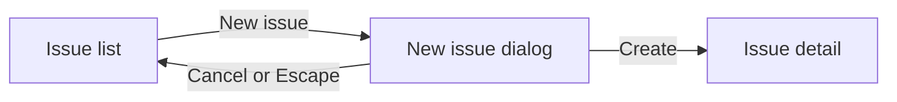

# UX Checklist Reference

Guidance for the `ui` modifier of a plan pack. The modifier has six parts, and this file says what
a good version of each looks like. At size M and larger the parts live in the pack's `ux.md`
([template](templates/ux.md)), linked from `design.md` **Modifier: ui**. At size S they go in that
modifier section of the README.

Every example below sits in a `text` fence or a table, because a pack may hold no other kind of
fence (see [`pack-format.md`](pack-format.md) §6). Wireframes are layout, not markup.

---

## When to Apply

Propose the `ui` modifier at Route when the work changes what a user sees or touches. Signals in
the input include:

`UI`, `UX`, `frontend`, `page`, `screen`, `component`, `dashboard`, `form`, `modal`, `button`, `design`, `layout`, `responsive`, `user interface`, `view`, `widget`, `panel`, `sidebar`, `navigation`, `nav`, `menu`, `dialog`, `tooltip`, `animation`, `style`, `theme`, `color`, `icon`

The developer confirms the modifier; a keyword alone never adds it.

---

## Part 1 — Screen Inventory

List every screen or standalone component the work adds or changes, before drawing any of them. A
screen missing from the inventory is a screen an executor invents.

| Screen | Purpose | Entry points | New or changed |
|---|---|---|---|
| Issue list | Find and open an issue | Sidebar "Issues", deep link | changed |
| New issue dialog | Create an issue | "New issue" button on the list | new |

One row per screen. A dialog, drawer or full-page empty state with its own layout counts as a
screen.

---

## Part 2 — Navigation Flow

A Mermaid `flowchart` with one node per inventory row and one edge per transition. Label each edge
with the action that causes it, so the flow doubles as the list of interactions to build.



Every screen in the inventory appears in the flow, and every node in the flow is in the inventory.

---

## Part 3 — Wireframes

One `text` fence per screen. Show regions in order of visual priority and mark the primary action.
Ask: if the user has 3 seconds, what must they see? If they have 30 seconds?

```text
Issue list
+----------------------------------------------+
| [1] Title "Issues"            [New issue] (P) |
| [2] Filter bar: status, label, search         |
| [3] Rows: title | status | assignee | age     |
| [4] Pagination                                |
+----------------------------------------------+
(P) primary action. Numbers are visual priority.
```

Bad: "Display the user's profile information." Good: the regions above, in order, with the one
action most users take next.

**Patterns to flag in a wireframe.** These make a UI feel generic. Name the replacement in the plan.

| Pattern | Problem | Fix |
|---|---|---|
| Generic 3-column feature grid (icon, bold title, 2-line description, repeated) | Reads as a template | A layout that reflects the content's real relationships |
| "Clean, modern UI" | Not a design decision | Name the font, spacing, colour and interaction pattern |
| Centered everything | No visual hierarchy | Deliberate alignment |
| Cards for everything | Cards stop meaning "interactive" | Use a card only where the whole block is an action |
| Uniform border-radius everywhere | Nothing has visual weight | Differentiate buttons, inputs and containers |
| Hero copy such as "Unlock the power of…" | Not this product | Copy that says what it does |
| Spinner with no skeleton | Layout shift when content arrives | A skeleton that matches the final layout |

---

## Part 4 — States

One table per screen with all five states. Leaving a state unspecified means the executor ships
whatever comes to mind, usually "No items found." in plain text.

| State | What the user sees | Action offered |
|---|---|---|
| Loading | Three skeleton rows matching the row layout | none |
| Empty | "No issues yet. Describe what you want to build to get started." | "Create first issue" |
| Error | "Couldn't load issues." | "Retry" |
| Success | Rows render | open a row |
| Partial | Loaded rows, plus a spinner for the next page | "Load more" |

- **Empty:** a warm message, the reason it is empty, and a primary action. "No items found." alone
  is never acceptable.
- **Error:** always a recovery action (retry, go back, contact support). Never show a raw error; log
  the technical detail and show a human summary.

---

## Part 5 — Responsive Behaviour

"Stacks on mobile" is not responsive design. For each screen, say what is hidden, collapsed or
reorganised at each breakpoint.

| Screen | Desktop (≥1024px) | Tablet (768–1023px) | Mobile (<768px) |
|---|---|---|---|
| Issue list | List 70%, filter sidebar 30% | Sidebar becomes a filter button and drawer | Full-screen filter drawer; rows show title and status only |

Also state touch targets (44×44px minimum) and any interaction that differs on touch (hover becomes
tap, drag becomes swipe).

---

## Part 6 — Accessibility

Specify per component, not as a general goal.

| Component | Keyboard | Screen reader | Contrast | Touch |
|---|---|---|---|---|
| New issue dialog | Tab order Title → Description → Labels → Create; Escape closes; focus is trapped | Dialog role, modal, labelled by its title; errors described by their field | Body text ≥4.5:1, large text ≥3:1 | 44×44px targets |

Minimum bar (WCAG 2.1 AA):

- Text contrast at least 4.5:1, or 3:1 for large text.
- All functionality reachable by keyboard.
- Focus visible on every interactive element.
- Meaningful alt text on images.
- Every form input has an associated label.

---

## Mockups

A high-fidelity mockup is linked from `ux.md`, never embedded: no images, exports or markup in the
pack. The wireframe and state tables stay the contract; the mockup is reference.
